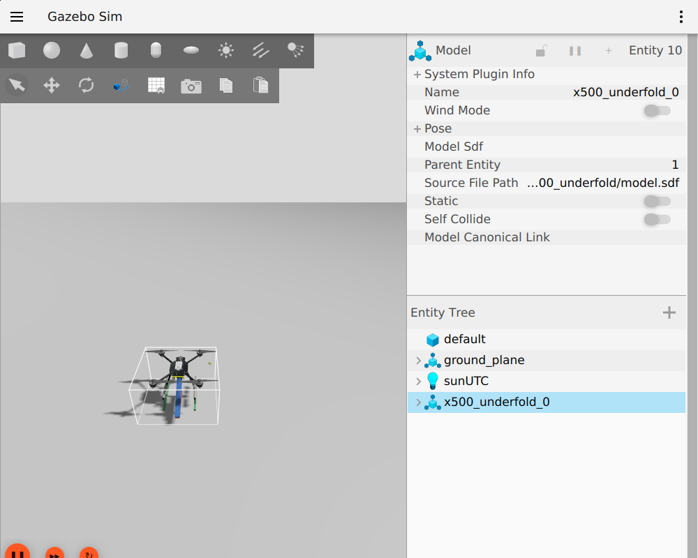

# 安全空中机械臂测试平台

一个可复用的 **PX4 SITL + Gazebo Harmonic + ROS 2** 空中机械臂仿真、可视化、控制与数据记录平台。

> **当前仿真开发分支：** `simulation`
>
> 仿真平台有意独立于 `main` 分支维护。

<p align="center">
  
  
</p>

当前版本已在一台全新的 Ubuntu 22.04 服务器上完成 clean-room 验证。验证内容包括 PX4 SITL、Gazebo Sim 8.15、ROS 2 Humble、基于 VirtualGL 的 NVIDIA GPU 渲染、已验证机械臂模型、可配置 N 连杆机械臂、公共 Vehicle/Arm API、rosbag 记录以及 PX4 ULog 归档。

## 项目提供的能力

- 固定 PX4 commit 的 PX4 SITL + Gazebo Harmonic 仿真运行环境。
- 已验证的两连杆空中机械臂模型。
- 可配置串联 N 连杆机械臂生成器。
- 稳定的公共实验 API：`ScenarioContext`、`VehicleAPI`、`ArmAPI` 和观测接口。
- 明确区分 PX4 估计状态与可选的 Gazebo ground truth。
- 场景自动发现和用户自定义场景模板。
- 平台统一管理 rosbag + PX4 ULog 记录。
- 面向远程 Linux 服务器的 GPU Gazebo GUI。
- Ubuntu 22.04 clean-host 安装脚本。
- 为未来 PX4 HIL 预留的后端接口边界。

## 快速开始

### 1. 克隆 `simulation` 分支

```bash
git clone -b simulation https://github.com/lilinanan/safe-aerial-manipulator-testbed.git
cd safe-aerial-manipulator-testbed
```

如果仓库仍为 private，需要先完成 GitHub 认证。例如可以使用：

```bash
gh auth login
gh auth setup-git
```

也可以继续使用你已经配置好的 Git HTTPS 或 SSH 凭据。

### 2. 安装主机级依赖

当前验证目标系统为 **Ubuntu 22.04**。

```bash
sudo ./deploy/host/install_ubuntu22.sh
```

该脚本会安装：

- ROS 2 Humble
- Gazebo Harmonic / Gazebo Sim 8
- ros_gz
- rosbag2
- 编译工具链
- Micro-XRCE-DDS Agent 2.4.2
- 远程可视化所需工具

该脚本**不会修改**：

- NVIDIA 驱动
- 防火墙规则
- SSH 配置
- 云平台自身的系统服务

如需 GPU 渲染，请先确保服务器已有可用 NVIDIA 驱动：

```bash
nvidia-smi
```

### 3. 准备项目工作区

```bash
./scripts/amsim setup --check-only
./scripts/amsim setup
./scripts/amsim doctor
```

安装正常时，`doctor` 最后会输出：

```text
READY
```

第一次完整执行 `setup` 可能需要几分钟，因为需要编译 PX4 SITL 和 ROS 消息包。

### 4. 在远程服务器上启动可视化

如果运行在没有物理显示器的远程服务器上：

```bash
./scripts/amsim desktop-start
./scripts/amsim desktop-status
./scripts/amsim render-status
```

在验证通过的 NVIDIA 路径下，`render-status` 应显示类似：

```text
selected_backend: virtualgl
ready: true
gpu: NVIDIA ...
```

VNC/noVNC 默认只监听 localhost。建议通过 SSH 隧道或云平台的端口转发访问，**不要直接把这些端口暴露到公网**。

如果本机已经有可用 X display，则不需要执行 `desktop-start`。

### 5. 运行已验证示例

悬停基线：

```bash
./scripts/amsim run hover
```

机械臂运动实验：

```bash
./scripts/amsim run arm_motion
```

面向用户的正式运行默认开启可视化。如需显式无界面批处理：

```bash
./scripts/amsim run hover --headless
```

每次完成的实验都会在 `runs/` 下生成独立结果目录，通常包含：

- 场景配置快照
- 模型快照
- 运行 manifest
- rosbag2 数据
- PX4 ULog
- recorder 日志
- 场景专属结果文件

## 常用运行命令

启动已验证的两连杆模型：

```bash
./scripts/amsim start
./scripts/amsim check
./scripts/amsim gui-start
```

查看状态：

```bash
./scripts/amsim status
./scripts/amsim gui-status
```

正常停止：

```bash
./scripts/amsim gui-stop
./scripts/amsim stop
./scripts/amsim desktop-stop
```

## 可配置机械臂

查看当前可用模型：

```bash
./scripts/amsim model-list
```

构建仓库中提供的三连杆示例：

```bash
./scripts/amsim model-build x500_serial_3link_example
```

启动三连杆模型：

```bash
./scripts/amsim start --model x500_serial_3link_example
./scripts/amsim gui-start
```

运行时会根据配置动态暴露全部机械臂关节，例如：

```text
/arm/arm_joint_1/cmd_vel
/arm/arm_joint_2/cmd_vel
/arm/arm_joint_3/cmd_vel
/arm/joint_states
```

详细说明见 `docs/CONFIGURABLE_MODELS.md`。

## 公共实验 API

实验代码不需要直接操作底层 PX4/Gazebo topic。

```python
from amsim import ScenarioContext

with ScenarioContext() as ctx:
    ctx.vehicle.takeoff(2.0)

    ctx.arm.move_position(
        "arm_joint_1",
        -5.0,
        unit="deg",
        max_speed=1.0,
        speed_unit="deg/s",
    )

    obs = ctx.observe()
    print(obs.vehicle.z)
    print(obs.arm)

    ctx.vehicle.land()
```

默认情况下，飞行器状态来自 **PX4 估计值**。

只有显式请求时才会返回 Gazebo ground truth：

```python
obs = ctx.observe(ground_truth=True)
```

详细 API 见 `docs/PUBLIC_API.md`。

## 创建自定义场景

查看已有场景：

```bash
./scripts/amsim scenarios
```

创建新的用户场景模板：

```bash
./scripts/amsim new-scenario my_experiment
```

系统会在 `scenarios/` 下生成 Python 实验文件和 YAML 配置文件。

运行：

```bash
./scripts/amsim run my_experiment
```

更多说明见：

- `docs/CUSTOM_SCENARIOS.md`
- `docs/RECORDING.md`

## 当前已验证的软件基线

| 组件 | 已验证版本 |
|---|---|
| 操作系统 | Ubuntu 22.04.3 LTS |
| Python | 3.10.x |
| ROS | ROS 2 Humble |
| Gazebo | Gazebo Sim 8.15.0 |
| ros_gz | 0.244.12-3jammy |
| rosbag2 | 0.15.17 |
| PX4 | `d6f12ad1c4f70ad3230afd7d86e971421e02fef4` |
| Micro-XRCE-DDS Agent | 2.4.2 |
| clean-room GPU | NVIDIA RTX 3080 Ti |
| clean-room NVIDIA 驱动 | 580.142 |

经过验证的 `px4_msgs` 接口快照已经固定保存在：

```text
vendor/px4_msgs
```

该快照**不会**直接根据当前 PX4 的 `msg/` 目录重新生成，因为平台运行所需的 ROS 消息接口与固定 PX4 source tree 中现有消息目录并不完全一致。

## 故障排查

优先执行：

```bash
./scripts/amsim setup --check-only
./scripts/amsim doctor
./scripts/amsim desktop-status
./scripts/amsim render-status
```

### `doctor` 提示缺少 ROS / Gazebo / MicroXRCEAgent

重新执行：

```bash
sudo ./deploy/host/install_ubuntu22.sh
```

### 服务器有 GPU，但 `render-status` 没有 ready

先检查：

```bash
nvidia-smi
./scripts/amsim desktop-start
./scripts/amsim render-status
```

### `direct_renderer` 显示 `llvmpipe`

这表示 direct X/OpenGL 当前使用的是 Mesa CPU 软件渲染。

如果远程服务器有 NVIDIA GPU，并且：

```text
virtualgl_ready: true
```

则应优先使用自动选择的 VirtualGL GPU 路径。

### 上一次运行被异常中断

清理本平台拥有的进程：

```bash
./scripts/amsim gui-stop
./scripts/amsim stop
./scripts/amsim desktop-stop
```

## 文档

- [详细安装指南](docs/INSTALLATION.md)
- [可移植性设计](docs/PORTABILITY.md)
- [Clean-room 验证报告](docs/CLEAN_ROOM_VALIDATION_2026-10-02.md)
- [公共 API](docs/PUBLIC_API.md)
- [自定义场景](docs/CUSTOM_SCENARIOS.md)
- [数据记录](docs/RECORDING.md)
- [可配置机械臂模型](docs/CONFIGURABLE_MODELS.md)

## 当前范围

### 已验证

- PX4 SITL
- Gazebo Harmonic
- ROS 2 Humble
- 远程 NVIDIA GPU 可视化
- 已验证两连杆机械臂
- 可配置 N 连杆机械臂
- 公共控制/观测 API
- 场景运行器
- rosbag2 + PX4 ULog 数据记录
- clean shutdown

### 尚未宣称已验证

- 第三台全新服务器上的“一键 host installer”从零完整复测
- Docker 打包
- PX4 HIL
- 实体无人机硬件

`legacy/v3_reference` 是冻结的历史参考工作流，产品化过程中不要修改。
