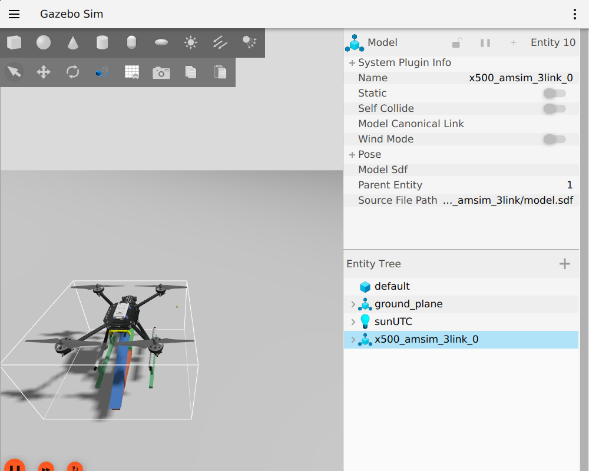

# 安全空中机械臂测试平台

一个可复用的 **PX4 SITL + Gazebo Harmonic + ROS 2** 空中机械臂仿真、可视化、控制与数据记录平台。

> **当前仿真开发分支：** `simulation`
>
> 仿真平台有意独立于 `main` 分支维护。

<p align="center">
  
  
</p>

当前版本已在一台全新的 Ubuntu 22.04 服务器上完成 clean-room 验证。验证内容包括 PX4 SITL、Gazebo Sim 8.15、ROS 2 Humble、基于 VirtualGL 的 NVIDIA GPU 渲染、已验证机械臂模型、可配置 N 连杆机械臂、公共 Vehicle/Arm API、rosbag 记录以及 PX4 ULog 归档。

这份源码包含平台、控制算法、数值配置、模型准备工具与测试。**用户自有 X650 的 CAD、URDF、网格及其压缩包不随源码提供**；生成模型、准备报告、飞行数据、视频、ULog、rosbag 和预编译插件也由实验者另行保存。下文中的模型输入与结果路径是本地运行约定，不是克隆后自动存在的附件。合成单元测试可以脱离私有模型运行；精确复现某次 X650 飞行则必须取得该次模型及哈希绑定的证据。

## PID + 前馈 + 末端协同闭环

**`flyarm-pid-ff 1.0.0` 已接入本分支。** 它将当前已验证的控制器封装为独立 Python 包，并提供悬停、普通八字和快速八字场景。底层 PID 在 PX4 内执行；包根据实际机体与关节状态计算末端位置误差，联合输出飞机参考和两关节速度，同时计算机械臂运动引起的飞机侧惯性补偿。

| 入口 | 用途 |
|---|---|
| [控制包 README](control_packages/pid_ff_wholebody_v1/README.md) | 安装、Python API、坐标系、控制参数与日志说明 |
| [仿真启动器](simulations/pid_ff_wholebody_v1/launch.py) | 选择轨迹和 ON/OFF 模式，管理飞行锁及运行结果 |
| [接入与验证说明](docs/PID_FF_WHOLEBODY_V1.md) | 算法范围、历史指令重放和真实服务器悬停证据 |

仅调用控制 API 时，需要 **Python ≥3.10、NumPy ≥1.23**。在已激活的 Python 环境中，从仓库根目录安装并运行示例：

```bash
python -m pip install ./control_packages/pid_ff_wholebody_v1
python control_packages/pid_ff_wholebody_v1/examples/one_step.py
```

实际飞行需要先完成下方的平台安装与 `doctor` 检查。已有仿真环境可直接使用，无需重新安装；将 `AMSIM_VENV` 设为该环境的实际路径。以下使用已验证服务器的路径，从仓库根目录执行：

```bash
export AMSIM_VENV=/root/autodl-tmp/amsim-venv

# 检查任务配置，不启动仿真
python3 simulations/pid_ff_wholebody_v1/launch.py --dry-run

# 悬停；普通八字 12 秒/圈；快速八字 8 秒/圈
python3 simulations/pid_ff_wholebody_v1/launch.py --trajectory hover --mode ON
python3 simulations/pid_ff_wholebody_v1/launch.py --trajectory normal --mode ON
python3 simulations/pid_ff_wholebody_v1/launch.py --trajectory fast --mode ON

# 同一普通八字的对照：保留相同 PID 和前馈，关闭末端协同反馈
python3 simulations/pid_ff_wholebody_v1/launch.py --trajectory normal --mode OFF
```

这些命令逐次运行，启动器采用 headless 模式，每次结果写入独立的 `runs/pid_ff_wholebody_v1_*` 目录。`ON` 和 `OFF` 都保留底层飞行闭环。名义轨迹分配为飞机 80%、机械臂 20%；ON 模式的纠偏量根据实际误差和约束计算。

本控制版本固定用于 `x500_underfold` 两自由度机械臂，使用 Gazebo 真值辅助反馈，控制末端位置并输出关节速度。原算法已完成四类实验 ON/OFF 的历史指令重放核对；新封装入口已完成一次真实 PX4/Gazebo 悬停接入验证。普通与快速八字入口已配置，本次封装没有重飞整套八字对比。详细范围和证据见上面的验证说明。

## 导入自有 URDF 模型

平台新增 `.urdf` / `.zip` 导入入口，保存原始模型及资源哈希，使用服务器已有的 `gz sdf` 转换为 Gazebo SDF。支持显式根坐标转换、`package://` 资源映射，以及无机械臂模型。URDF 的质量、惯量和关节限位按原文件保留。

```bash
# 先检查；可在不安装 Gazebo 的电脑上运行
python -m amsim.cli model-inspect /path/to/robot.zip

# 以下在已有 Gazebo 环境的服务器执行
./scripts/amsim model-import /path/to/robot.zip --name my_robot
./scripts/amsim model-preview amsim_urdf_my_robot --check --iterations 100
./scripts/amsim model-preview amsim_urdf_my_robot --static
```

最后一条生成静态查看场景并返回 `open_command`；执行返回的完整命令即可打开 Gazebo，命令中的独立 `GZ_PARTITION` 必须保留。动态检查会在重力下加载原模型，无动力的机体会下落。

导入完成后可检查模型外观和物理加载。进入 PX4 飞行前，需要额外提供明确的电机映射、转向、动力系数和已构建的 PX4 airframe；`model-bind-flight` 负责绑定并检查这些参数。未绑定的模型不能直接 `start` 或 `run`。现有 PID＋前馈包仍固定于原来的 `x500_underfold` 两关节模型。

完整命令、支持范围、飞行配置模板和 X650 的坐标转换见 [URDF 导入说明](docs/URDF_IMPORT.md)。导入与物理加载检查、动力配置绑定、悬停闭环验收各自生成独立证据，前一项不会自动证明后一项已经通过。历史验证记录及原始日志单独归档，不作为本源码发布的附件。

X650 数值动力配置采用 **T-MOTOR MN4014 KV330＋15×5CF、6S 30000 mAh、无臂整机 3.02 kg**，包括仿真电机编号、五点推力拟合、质量／惯量守恒检查和 PX4 4999 airframe。反扭矩与响应时间仍有显式估计项。源码说明见 [X650 动力配置](configs/vehicles/x650_no_arm/README.md)、[无臂悬停协议](simulations/x650_hover_v1/README.md)和[实测状态回放方法](docs/X650_HOVER_REPLAY.md)。

## X650 + 二连杆与精密定位接入

2026-10-26 [节点间硬约束恢复](docs/X650_MPC_INTERVAL_HARD_CONSTRAINTS.md)：不加松弛变量，保持 ±0.42／±0.32 rad/s 内界。在原积分网格上补入区间极值／风险点，并将已知 MIT 指令编码余项计入硬约束后重线性化。原失败第 429 次固定输入以 39 条附加约束、2 次 QP 通过完整模型检查，dq1 最低 −0.418767 rad/s；429 条各自恢复原 Memory 的独立调用全部通过，7 条正常对照逐元素一致，4 项 native、6 项 ROS 2、14 项审计测试通过。[软件验证和原件](docs/validation/cpp_interval_hard_20261026/README.md)已归档。随后通过独立 ABI 3 准入和实际 ROS worker 429 条连续 Memory 回放，完成了[新后端的实际受扰重跑](docs/validation/cpp_interval_flight_20261026/README.md)：455 次 Core 均接受，两次节点间修复生效；但 9.16 s 附近下发器因旧候选年龄超过 50 ms 退出，末端前缀峰值 197.6 mm，**原定三段外扰／完整 24 s 仍未通过**。实际消费、PX4 编码与安全退出分别检查，失败原件保留；没有用软件回放替代物理验收。

2026-10-26 [关节规划与候选安全余量一致性检查](docs/X650_MPC_JOINT_SAFETY_MARGIN.md)：已在 C++ 和 Python 的 QP 预测状态约束中加入最终检查原有的 0.0003 rad／0.03 rad/s 余量，44 项回归通过。第 429 次原输入与完整 Memory 重放显示，最低预测速度由 −0.427988 改善为 −0.420047 rad/s，但仍因节点之间的极值未满足原余量而拒绝；离散节点均通过，最终检查和内部状态回滚保留。该更新仅经独立离线验证，尚未取得新的完整受扰飞行结果。

2026-10-26 新增 [C++ MPC 可信中心恢复](docs/X650_MPC_TRUSTED_CENTRE_RECOVERY.md)：保留关节局部半径 0.02，在已识别的 QP 不可行后重建通过原约束和非线性检查的中心，再重新线性化求解。原 7.544 s 失败快照已恢复，前 378 次正常输出与内部状态完全一致，实际 ROS 2 C++ 工作进程的 379 条原输入回放通过。随后以相同 Core ABI 2、原 QP／TS20 库、参数与原三段外扰做了[真实受扰重跑](docs/validation/cpp_recovery_flight_20261026/README.md)：修复施扰启动文件可见性竞态后，实际闭环两次 QP 恢复成功，但 8.604 s 因候选关节速度预留余量不足拒绝，末端前缀峰值 127.9 mm，**完整 24 s 仍未通过**。失败前的连续下发、两关节实际采用、PX4 指令编码与安全退出分别经原始证据检查。没有放宽限制或更改控制后端，原件、图和失败诊断均保留；方法见[整段验证说明](docs/X650_MPC_RECOVERY_DISTURBANCE_FLIGHT.md)。

执行隔离将状态接收、算法、20 ms 输出和大诊断记录放入独立进程。2026-10-23 的 shadow 软件测试没有执行器输出；此后新增的 `x650_isolated_live_v1` 已接入实际 Gazebo 关节消费反馈和 PX4 仿真执行端，并逐次记录源码、命令、消费及退出证据。revision17 的 packed 预测准备、发布后完整诊断与失败恢复交接已通过 **379 项回归、30 个固定工况、388 条历史调用**及 **86 项架构测试**。当前源码的 20 秒悬停、30 秒关节检查已取得新证书；随后 hold24 的 247 次求解全部成功，但状态源更新中断，原 source 年龄达到 30.796 ms，超过 25 ms 门槛，完整保持仍未通过。实际归零消费、AUTO_LOITER 接管、降落及 56 项参数恢复均经独立记录核验，未进入普通八字。revision18 增加固定容量的 source 分段 wall/线程 CPU 和自然 GC 观察，含异常入口与恢复前冻结，相关 **39 项测试**通过；这项观测补全尚不代表停顿已修复。历史八字结果不替代新架构验收。最新修复与原始记录见 [当前实际接入验证](docs/validation/isolated_live_20261024/README.md)，逐级测试和 Orin／动捕／TS20 迁移参考见 [执行隔离与测试方法](docs/X650_EXECUTION_ISOLATION_AND_TEST_METHOD.md)。

最终软件测试覆盖 30 s、1405 次新的逐条复算（指令差为 0）及四项暂停注入；正常输出间隔最大 20.077 ms，诊断无丢失，覆盖一次自然第 2 代 GC。25 ms 算法暂停仍可能导致候选过期，按原规则拒绝；不能把故障检测通过称为连续控制或飞行通过。全部结果与开发失败记录见 [服务器执行隔离结果](docs/validation/isolated_runtime_20261023/README.md)。

真机前开发路线已整理为 [执行器、动捕、Orin 与 NMPC 验证框架](docs/X650_REAL_FLIGHT_READINESS_AND_NMPC.md)。用户确认采用 TS20-50／24 V；新增 [TS20 条件模型及 MIT 接入](docs/X650_TS20_INTEGRATION.md)、纯离线调用模块与旧 MPC 命令敏感性重放。该模型来自约 20 V 台架，未标定的力矩尺度不写入 URDF；24 V 带载整机闭环仍需新证据。历史八字继续按原协议解释。

2026-10-27 完成[服务器／实体 Orin NX 同输入配对基准](docs/validation/orin_paired_20261027/README.md)：重建全部 1,598 条普通及 1,198 条快速八字历史输入，每端 27,960 次正式调用。NX 中位数为 2.148／2.184 ms，P99 为 4.154／4.971 ms，两端均无超过 20 ms 的正式调用。仅测原 **Core ABI 1** 本体，不代表当前 ABI 4 或整条控制链验收。原指令容差通过；额外统一加速度容差的 136 条失败与按差分公式传播误差的显式检查均保留。输入、结果只留工作站，NX 保留运行代码；复现入口见 [NX 基准方法](docs/ORIN_NX_MPC_BENCHMARK.md)。

随后完成[当前 ABI 4 及双 QP 重工况配对](docs/validation/orin_abi4_20261027/README.md)：全量 2,420 个实际记录输入，每端 26,200 次正式调用。NX 保持／受扰／双 QP 中位数为 1.978／3.880／14.485 ms，双 QP P99 16.686 ms、最大 16.939 ms；两端均无超过当前 40 ms MPC 周期的调用。**时间预算通过，数值一致性未全部通过**：9 个不同输入超过原 1e-7 命令或速度容差，最大关节速度差 4.76e-7 rad/s，全部失败保留。源码、参数与约束未调整；每端 8 项原生检查及 41 项本地工具回归通过。此次没有 CUDA 或新飞行验收结论。

新增[实体 NX 同步仿真在环](docs/validation/orin_pil_20261027/README.md)：通过 2,420 次连续记录输入、25 项故障检查后，让 NX 实际驱动服务器 PX4/Gazebo，完成新的 30 秒末端保持和普通八字。末端 RMSE 分别为 2.69 mm、3.72 mm（八字运动段），NX Core 最大耗时 10.88／13.76 ms；关节消费、PX4 指令与降落恢复均核验。修复跨架构参考重算比较，显式 `-ffp-contract=off` 构建使连续流满足原数值容差，历史失败仍保留。公网等待时仿真暂停，因此**不等价于墙钟实时或真机飞行验收**。NX 仅留代码；接口、时钟和后续迁移流程见[处理器在环方法](docs/ORIN_NX_PROCESSOR_IN_LOOP.md)。

2026-10-28 完成[真实 NX / Pixhawk ROS 2 只读状态通道](docs/NX_PX4_ROS2_STATE.md)：新增依赖统一位于 NX 的 `~/flyarm/ros2_hw_runtime/v1/`，构建临时文件在内存，实验日志仅保留电脑。飞控重启后 DDS 建立成功，随后 Agent 重连的完整 60 秒窗口收到姿态、里程计各 6,000 条和位置 3,000 条，无源时间戳倒退。首次同步初始化失败仍保留；水平位置与航向未就绪，未执行 Offboard 或解锁，详情见[状态接收记录](docs/validation/nx_ros2_state_20261028/README.md)。

2026-10-28 随后完成[真实 NX C++ 状态处理与 PX4 诊断请求闭环](docs/validation/nx_hardware_link_20261028/README.md)：一次预飞检查请求得到飞控 ACCEPTED 确认，NX 本机测得往返 10.88 ms；完整观察窗口 3,001 次处理均阻止使用无效位置，未发布轨迹、Offboard 或解锁请求。轨迹字段接收仍待内部回读；真实位置闭环另需有效定位、关节反馈及后续执行链验收。代码对应与复现见[台架指令链指南](docs/NX_PX4_HARDWARE_LINK.md)。

同日补齐[完整 C++ 接口离线回放](docs/NX_CPP_INTERFACE_REPLAY.md)：实体 NX 上 1,281 个历史快照经重建 PX4/JointState 消息、内存 CDR、共用状态适配、原 ABI 4 MPC、PVA 编码和模拟提交全部通过。修复新适配器的浮点同刻误报未来，并绑定实际库对应的历史 C++ 头文件；原求解参数未改，float32 量化差异单独报告。结果见[验证记录](docs/validation/nx_full_interface_20261028/README.md)。另已准备 [Pixhawk FMU Debug 独立回读接法](docs/NX_PX4_SETPOINT_READBACK.md)，本轮未发送实机轨迹设定值。

随后完成[真实 NX→PX4 限时设定值发送与独立回读](docs/validation/nx_setpoint_readback_20261028/README.md)：10 秒内发送 184 条 A/B/C 编码测试值，COM13 读取飞控内部 uORB，35 个新时间戳样本覆盖三种模式并逐字段匹配。其余 115 个采样符合预先捕获的内部基线，无异常字段组合。全程未解锁、非 Offboard；本次不执行实机 MPC 或验证电机响应。临时程序仅在 NX RAM 运行，结果存电脑；USB 未连接故障在未解锁飞控重启后恢复，根因未定。代码与复现见[限时发送及回读指南](docs/NX_PX4_SETPOINT_READBACK.md)。

2026-10-30 新阶段采用 [TELEM1 MAVLink UART 控制链](docs/NX_MAVLINK_CONTROL_CHAIN.md)，旧 USB 协议切换因随后发生 Hard Fault 继续隔离。已在真实 NX 完成原 MPC 1,281 个快照的新 MAVLink 输出编码验证，并用 C++ 在原 UART 配置下完成 20 秒零发送接收（330 帧、无 CRC 错误）。消息频率与上下行带宽已明确；用户批准的五项通信参数已应用，飞控重启后确认 921600 baud / 30000 B/s / Custom 生效。新刷新率、PX4 内部目标回读、人工接管与断流退出仍待 NX 网络恢复后验收；不能用软件测试代替。结果与代码身份见[本轮验证记录](docs/validation/nx_uart_contract_20261030/README.md)。

2026-10-29 完成 [Pixhawk 四旋翼电调／电机拆桨台架检查](docs/PX4_ROTOR_COMMISSIONING.md)：COM13核验DShot600、AUX1–4分配及限值，现场逐台确认M1右前CCW、M2左后CCW、M3左前CW、M4右后CW和停止；M1、M2修正方向后均通过保存、断电重启复测。14次最低输出、1秒限时记录保留了未看清、未起转及遥测故障。原20 V／0.5 A限流改为20 V／2 A并断电重启后，遥测恢复；最终M2复测和M3／M4记录窗口无新增CRC错误或超时，但故障根因尚未完全隔离。电脑端新增指定电调转向、遥测新鲜度和计数检查，61项无硬件测试通过，见[真实台架记录](docs/validation/px4_rotor_commissioning_20261029/README.md)。动力已关闭；原始日志存电脑，不改NX配置或PX4参数，不把空载点动视为飞行验收。

新的 [TS20 Gazebo 条件执行器准备与接口验证](docs/X650_TS20_PLANT_README.md)支持完整 URDF flight 模型派生、独立 airframe 4997、固定 5 ms MIT 总线和实际关节状态记录。两关节低幅正反向原生物理位移检查已通过；新工况的悬停、摆臂与完整末端保持仍须分别验收，快速八字尚未开放。该插件保留原刚体惯性，通过条件自由运动响应施加速度约束，不是已标定的轴端力矩模型。

[X650 控制包](control_packages/x650_wholebody_v1/README.md)提供新的 PID＋前馈协同基线与上层运动学 MPC；[分阶段仿真入口](simulations/x650_wholebody_mpc_v1/README.md)管理地面、悬停、关节、响应辨识与末端定点验收。当前精密上层协议 **`precision_ev_upper_v2` 只接受 `pid_ff` 的 `response_probe` 和 `tip_hold`**。MPC、普通/快速八字及全身动力学 NMPC 尚未在该协议下放行；有源码、预检通过或地面话题正常，不等于 MPC 飞行性能已验证。

新的 **`precision_ev_mixed_mpc_v3`** 已接入经全新训练与独立验证通过的 X/Y 二阶、Z 一阶基体速度响应模型，并固定同条件、零加速度前馈的 PID／MPC 对照流程。新版 `mixed_response_prediction_chain_v2` 补入关节源时间传播、已发送命令历史及水平加速度对预测姿态和末端几何的影响，已通过全新完整末端保持、小幅和普通 PID／MPC 八字验收；后续快速阶段仍需完整验收。正式响应参数、证据绑定、运行命令及顺序见 [混合阶 MPC 分阶段验证说明](docs/X650_MIXED_MPC_COMMISSIONING.md)。

2026-10-22 最新服务器仿真结果：**小幅和普通八字的 PID／MPC 共四组完整实验均已通过。** 小幅约 40 秒整窗末端三维 RMS 为 **1.920／1.571 mm**，峰值为 **4.984／3.984 mm**；该单次 PID／MPC 对照 RMS 降低 **18.208%**。普通约 32 秒整窗 RMS 为 **15.965／4.087 mm**、峰值 **51.437／8.595 mm**，分别降低 **74.402%／83.291%**；普通 PID 的 J1 约 2.1% 的窗口处于近限速状态。普通 MPC 新实验最大实际控制间隔 **40 ms**，完整审计、着陆及参数恢复通过；首次在任务约 21.472 秒后因 **52 ms＞50 ms** 中断的原失败记录仍保留，不拼接计分。

已完成最小 CPU 优化：以专用 N×3 叉乘替换通用 `np.cross`，未修改公式、epsilon、模型或控制门槛。原版／优化版各两轮完整 789 步离线重放，指令、完整预测计划与参考轨迹逐值误差均为 0；离线 adapter 中位耗时 **13.464→11.888 ms**、P95 **16.650→14.461 ms**、本轮最大值 **21.017→18.348 ms**。15 项测试通过，提交 **`92ef899`** 已推送；后续普通 MPC 全新运行通过，但不表示所有工况下的时序超限已根治。小幅与普通对照图已生成并通过配对校验，四组记录已按参考样式重制为两个左右同步视频（左 PID、右 MPC，完整目标八字、实际轨迹和共用误差曲线），均通过完整解码验证，结果包含离线播放页面。任务、独立参考中心／航向、原始证据、性能复核及失败记录见 [八字实验阶段结果](docs/X650_FIGURE8_RESULTS_20261022.md)。

此前 PID／MPC 约 30 秒末端保持均通过，RMS 为 **3.849／3.205 mm**，详见 [预测链与完整保持结果](docs/X650_PREDICTION_CHAIN_RESULTS_20261022.md)；早期响应验证和首次 MPC 失败见 [此前实验结果](docs/X650_FORMAL_RESPONSE_AND_MPC_RESULTS_20261022.md)。各次失败均保留，改善比例只描述对应单次完整对照，不表示统计显著性或全面优越。

独立物理记录器的 [源码构建入口](benchmark/whole_body_closed_loop_v1/README.md)随仓库提供；在目标 Gazebo 环境构建并把实际库路径写入任务。构建成功、插件可加载和完整飞行验收是不同步骤。

本轮八字实验的 [MPC 公式与闭环架构](docs/X650_MPC_FORMULAS_AND_ARCHITECTURE.md)说明 12 维预测状态、5 维速度输入、两条预测链、15 节点 QP、实际权重与约束，以及 PX4 位置／速度接口换算，并附架构图。该文档记录实验前冻结的实现定义；最新实验进度以 [八字阶段结果](docs/X650_FIGURE8_RESULTS_20261022.md)为准。

通用 `model-import` 接受用户提供的 URDF/ZIP 与完整 mesh 资源；X650 预设则绑定特定源 URDF 哈希、二连杆构型、物理准备报告、airframe、世界文件和实际 PID 参数。`prepare_x650_flight.py` 会拒绝不匹配的源模型。换一台同名 X650 或改动几何，必须建立新的模型准备与证据版本，不能只改路径或移除哈希检查。

精密模式使用理想 Gazebo EV 测量辅助 PX4 EKF，因此标记 `ground_truth_aided=true`；v2 上层控制的直接反馈来自 PX4 估计状态和实测关节，独立物理真值用于验收。它验证当前仿真测量条件下的闭环，不提供 GPS 或实机定位性能结论。原始结果按独立运行保存，源码不附带可直接充当 stage gate 的成功证书。

## 项目提供的能力

- 固定 PX4 commit 的 PX4 SITL + Gazebo Harmonic 仿真运行环境。
- 已验证的两连杆空中机械臂模型。
- 可配置串联 N 连杆机械臂生成器。
- 自有 URDF/ZIP 模型导入、资源归档、独立 Gazebo 预览与显式 PX4 动力配置绑定。
- 稳定的公共实验 API：`ScenarioContext`、`VehicleAPI`、`ArmAPI` 和观测接口。
- 明确区分 PX4 估计状态与可选的 Gazebo ground truth。
- 场景自动发现和用户自定义场景模板。
- 平台统一管理 rosbag + PX4 ULog 记录。
- 面向远程 Linux 服务器的 GPU Gazebo GUI。
- Ubuntu 22.04 clean-host 安装脚本。
- 已实现 Gazebo ↔ MAVLink PX4 HIL 软件后端，并保留可选 Micro-XRCE-DDS ROS 2 链路。
- 可独立调用的 PID + 前馈 + 末端协同闭环控制包，以及悬停和八字仿真入口。

## 快速开始

### 1. 克隆 `simulation` 分支

```bash
git clone -b simulation https://github.com/lilinanan/safe-aerial-manipulator-testbed.git
cd safe-aerial-manipulator-testbed
```

如果仓库仍为 private，需要先完成 GitHub 认证。例如可以使用：

```bash
gh auth login
gh auth setup-git
```

也可以继续使用你已经配置好的 Git HTTPS 或 SSH 凭据。

### 2. 安装主机级依赖

当前验证目标系统为 **Ubuntu 22.04**。

```bash
sudo ./deploy/host/install_ubuntu22.sh
```

该脚本会安装：

- ROS 2 Humble
- Gazebo Harmonic / Gazebo Sim 8
- ros_gz
- rosbag2
- 编译工具链
- Micro-XRCE-DDS Agent 2.4.2
- 远程可视化所需工具

该脚本**不会修改**：

- NVIDIA 驱动
- 防火墙规则
- SSH 配置
- 云平台自身的系统服务

如需 GPU 渲染，请先确保服务器已有可用 NVIDIA 驱动：

```bash
nvidia-smi
```

### 3. 准备项目工作区

```bash
./scripts/amsim setup --check-only
./scripts/amsim setup
./scripts/amsim doctor
```

安装正常时，`doctor` 最后会输出：

```text
READY
```

第一次完整执行 `setup` 可能需要几分钟，因为需要编译 PX4 SITL 和 ROS 消息包。

### 4. 在远程服务器上启动可视化

如果运行在没有物理显示器的远程服务器上：

```bash
./scripts/amsim desktop-start
./scripts/amsim desktop-status
./scripts/amsim render-status
```

在验证通过的 NVIDIA 路径下，`render-status` 应显示类似：

```text
selected_backend: virtualgl
ready: true
gpu: NVIDIA ...
```

VNC/noVNC 默认只监听 localhost。建议通过 SSH 隧道或云平台的端口转发访问，**不要直接把这些端口暴露到公网**。

如果本机已经有可用 X display，则不需要执行 `desktop-start`。

### 5. 运行已验证示例

悬停基线：

```bash
./scripts/amsim run hover
```

机械臂运动实验：

```bash
./scripts/amsim run arm_motion
```

面向用户的正式运行默认开启可视化。如需显式无界面批处理：

```bash
./scripts/amsim run hover --headless
```

每次完成的实验都会在 `runs/` 下生成独立结果目录，通常包含：

- 场景配置快照
- 模型快照
- 运行 manifest
- rosbag2 数据
- PX4 ULog
- recorder 日志
- 场景专属结果文件

## 常用运行命令

启动已验证的两连杆模型：

```bash
./scripts/amsim start
./scripts/amsim check
./scripts/amsim gui-start
```

查看状态：

```bash
./scripts/amsim status
./scripts/amsim gui-status
```

正常停止：

```bash
./scripts/amsim gui-stop
./scripts/amsim stop
./scripts/amsim desktop-stop
```

## 可配置机械臂

查看当前可用模型：

```bash
./scripts/amsim model-list
```

构建仓库中提供的三连杆示例：

```bash
./scripts/amsim model-build x500_serial_3link_example
```

启动三连杆模型：

```bash
./scripts/amsim start --model x500_serial_3link_example
./scripts/amsim gui-start
```

运行时会根据配置动态暴露全部机械臂关节，例如：

```text
/arm/arm_joint_1/cmd_vel
/arm/arm_joint_2/cmd_vel
/arm/arm_joint_3/cmd_vel
/arm/joint_states
```

详细说明见 `docs/CONFIGURABLE_MODELS.md`。

## 公共实验 API

实验代码不需要直接操作底层 PX4/Gazebo topic。

```python
from amsim import ScenarioContext

with ScenarioContext() as ctx:
    ctx.vehicle.takeoff(2.0)

    ctx.arm.move_position(
        "arm_joint_1",
        -5.0,
        unit="deg",
        max_speed=1.0,
        speed_unit="deg/s",
    )

    obs = ctx.observe()
    print(obs.vehicle.z)
    print(obs.arm)

    ctx.vehicle.land()
```

默认情况下，飞行器状态来自 **PX4 估计值**。

只有显式请求时才会返回 Gazebo ground truth：

```python
obs = ctx.observe(ground_truth=True)
```

详细 API 见 `docs/PUBLIC_API.md`。

## 创建自定义场景

查看已有场景：

```bash
./scripts/amsim scenarios
```

创建新的用户场景模板：

```bash
./scripts/amsim new-scenario my_experiment
```

系统会在 `scenarios/` 下生成 Python 实验文件和 YAML 配置文件。

运行：

```bash
./scripts/amsim run my_experiment
```

更多说明见：

- `docs/CUSTOM_SCENARIOS.md`
- `docs/RECORDING.md`

## 当前已验证的软件基线

| 组件 | 已验证版本 |
|---|---|
| 操作系统 | Ubuntu 22.04.3 LTS |
| Python | 3.10.x |
| ROS | ROS 2 Humble |
| Gazebo | Gazebo Sim 8.15.0 |
| ros_gz | 0.244.12-3jammy |
| rosbag2 | 0.15.17 |
| PX4 | `d6f12ad1c4f70ad3230afd7d86e971421e02fef4` |
| Micro-XRCE-DDS Agent | 2.4.2 |
| clean-room GPU | NVIDIA RTX 3080 Ti |
| clean-room NVIDIA 驱动 | 580.142 |

经过验证的 `px4_msgs` 接口快照已经固定保存在：

```text
vendor/px4_msgs
```

该快照**不会**直接根据当前 PX4 的 `msg/` 目录重新生成，因为平台运行所需的 ROS 消息接口与固定 PX4 source tree 中现有消息目录并不完全一致。

## 故障排查

优先执行：

```bash
./scripts/amsim setup --check-only
./scripts/amsim doctor
./scripts/amsim desktop-status
./scripts/amsim render-status
```

### `doctor` 提示缺少 ROS / Gazebo / MicroXRCEAgent

重新执行：

```bash
sudo ./deploy/host/install_ubuntu22.sh
```

### 服务器有 GPU，但 `render-status` 没有 ready

先检查：

```bash
nvidia-smi
./scripts/amsim desktop-start
./scripts/amsim render-status
```

### `direct_renderer` 显示 `llvmpipe`

这表示 direct X/OpenGL 当前使用的是 Mesa CPU 软件渲染。

如果远程服务器有 NVIDIA GPU，并且：

```text
virtualgl_ready: true
```

则应优先使用自动选择的 VirtualGL GPU 路径。

### 上一次运行被异常中断

清理本平台拥有的进程：

```bash
./scripts/amsim gui-stop
./scripts/amsim stop
./scripts/amsim desktop-stop
```

## 文档

- [PID + 前馈控制包与调用接口](control_packages/pid_ff_wholebody_v1/README.md)
- [当前 ABI 4 MPC 的可调用 C++ 接口](control_packages/x650_mpc_controller_v1/README.md)：原后端与参数保持不变，prepare／发布后提交／丢弃分离；1,281 个完整任务输入快照的封装数值一致性通过。
- [同速度执行接口的上层 NMPC 离线原型](control_packages/x650_nmpc_controller_v1/README.md)：以完整非线性目标决定重线性化候选是否接受；[本轮验证](docs/validation/nmpc_interface_20261027/README.md)保留受扰段 31 个候选拒绝，不宣称新 NMPC 飞行或真机准入通过。
- [上层 MPC／NMPC 同条件仿真入口](docs/UPPER_CONTROLLER_SIMULATION.md)：共用实际反馈、25 Hz 求解准入与 50 Hz 下发；[六组新的完整验收与比较](docs/validation/nmpc_live_20261027/README.md)均通过，保留原始误差、时效、实际消费及退出证据；当前 NMPC 未显示一致的精度优势。
- [末端协同闭环接入与验证](docs/PID_FF_WHOLEBODY_V1.md)
- [X650 PID/前馈与上层 MPC 控制包](control_packages/x650_wholebody_v1/README.md)
- [X650 精密定位与分阶段实验协议](simulations/x650_wholebody_mpc_v1/README.md)
- [X650 上层响应辨识结果重放与绘图](docs/X650_UPPER_RESPONSE_ANALYSIS.md)
- [X650 水平响应链与二阶模型开发诊断](docs/X650_RESPONSE_DYNAMICS_DIAGNOSTICS.md)
- [X650 新训练与独立验证的冻结响应协议](docs/X650_FORMAL_RESPONSE_PROTOCOL.md)
- [X650 正式响应结果与连续预测对比图](docs/X650_FORMAL_RESPONSE_PLOTTING.md)
- [X650 混合阶 MPC 分阶段验证](docs/X650_MIXED_MPC_COMMISSIONING.md)
- [X650 PID／MPC 已验收结果对比图](docs/X650_MIXED_STAGE_COMPARISON.md)
- [详细安装指南](docs/INSTALLATION.md)
- [可移植性设计](docs/PORTABILITY.md)
- [Clean-room 验证报告](docs/CLEAN_ROOM_VALIDATION_2026-10-02.md)
- [公共 API](docs/PUBLIC_API.md)
- [X650 / TS20 上层 MPC 的 C++ 数值后端与验证方法](control_packages/x650_wholebody_v1/NATIVE_NUMERICS.md)
- [X650 完整 C++ 在线 MPC 链与分层验证](docs/X650_CPP_PIPELINE.md)
- [自定义场景](docs/CUSTOM_SCENARIOS.md)
- [数据记录](docs/RECORDING.md)
- [可配置机械臂模型](docs/CONFIGURABLE_MODELS.md)
- [PX4 HIL 使用与验证](docs/HIL.md)
- [Docker 使用说明](deploy/docker/README.md)
- [Docker CI 验证报告](docs/DOCKER_VALIDATION_2026-10-02.md)

## 当前范围

### 已验证

- PX4 SITL
- Gazebo Harmonic
- ROS 2 Humble
- 远程 NVIDIA GPU 可视化
- 已验证两连杆机械臂
- 可配置 N 连杆机械臂
- 公共控制/观测 API
- 场景运行器
- rosbag2 + PX4 ULog 数据记录
- clean shutdown
- Docker headless 镜像构建与完整 hover 运行（GitHub Actions）
- HIL 软件数据链路回环：Gazebo sensors → MAVLink HIL → actuator → Gazebo

### 尚未宣称已验证

- Docker 内 NVIDIA GPU / VirtualGL GUI（Docker headless 已验证）
- 实体 PX4 HIL（软件 HIL bridge 已实现并通过回环测试，真实飞控仍需接入验证）
- 实体无人机硬件

`legacy/v3_reference` 是冻结的历史参考工作流，产品化过程中不要修改。
