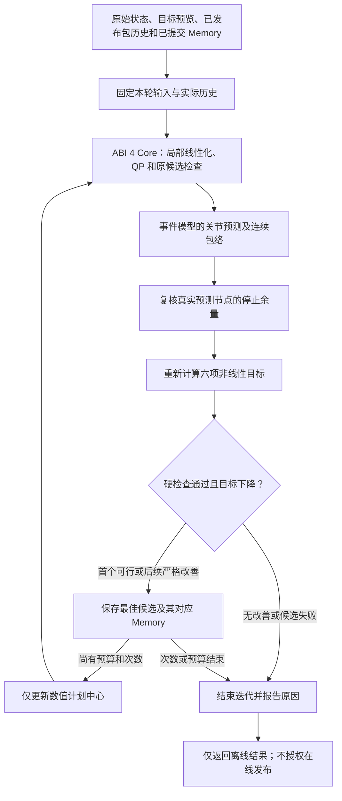

# X650 上层协同 NMPC：离线有界重线性化原型 v1

本包建立与现有 MPC **相同五维执行接口**的 NMPC 研究入口：沿用 X650＋二连杆＋TS20-50/24 V 的模型、参数、PX4 内环和硬约束，增加固定当前状态下的多次重线性化，以及完整非线性目标的独立接受判据。它可直接由 C++ 调用，当前只进行固定记录上的离线计算，不拥有执行器连接，不下发指令。

当前实现是**使用既有 QP 后端产生局部候选、按非线性目标接受候选的有界迭代原型**。它已经具有区别于原 MPC 恢复分支的非线性目标改进逻辑，但不保证求得一般 NLP 的驻点或最优解；也不是直接输出四旋翼推力和关节力矩的全动力学 NMPC。阶段划分与论文依据见 [实现设计说明](../../docs/NMPC_IMPLEMENTATION_NOTES_20261027.md)，本轮数据、成功与拒绝记录见 [独立验证报告](../../docs/validation/nmpc_interface_20261027/README.md)。

## 控制边界与架构

优化变量为每个预测节点的五维命令：

\[
u_i=\begin{bmatrix}v_{B,x}^{cmd}&v_{B,y}^{cmd}&v_{B,z}^{cmd}&\dot q_1^{cmd}&\dot q_2^{cmd}\end{bmatrix}^{\!\top}.
\]

飞机三维速度命令、飞机位置/速度/加速度参考和两关节命令，继续采用已有执行适配器的含义。飞机旋翼和姿态内环由 PX4 执行，关节包编码与内部闭环由 TS20 接口执行；本包不会将这五个量重新解释为力或力矩。世界位置/速度使用 ENU，机体角速度使用 FLU，旋转矩阵为 FLU→ENU。完整输入时钟和实际包历史约定与 [MPC 调用接口](../x650_mpc_controller_v1/README.md) 相同。

预测状态包含机体位置、速度、水平加速度、实际关节角和角速度，共 12 个数；机体旋转由原等效闭环姿态模型预测。末端评价保留旋转和机械臂正运动学的非线性：

\[
p_E=p_B+Rr(q),\qquad
v_E=v_B+RJ(q)\dot q+\dot Rr(q).
\]

关节使用原 TS20 事件预测器，包含已配置的包时序、量化、延迟和摩擦分支。这里“实际预测状态”指该候选经原事件模型传播所得的状态，不是下一时刻已发生的物理测量。它与 QP 中的局部仿射状态分开保存。



每次外层尝试都从同一个原始 `Memory` 恢复，只把最佳候选的 `plan / plan_h / plan_t` 用作新的数值中心。上一条已采用命令、任务起点、计步器、实际状态时间戳和实际关节包历史始终不变。内部优化尝试不能增加已执行步数，也不能当成机械臂已经收到的命令。

## 完整非线性目标与候选接受

设节点步长为 \(h_i\)，\(D_v=\operatorname{diag}(v_{lim})\)，\(D_{a,i}=\operatorname{diag}(a_{lim}h_i)\)。沿用原六项权重：

\[
\begin{aligned}
J(U)=\sum_{i=0}^{N-1}h_i\big[&
w_0\|p_{E,i}-p_{E,i}^{ref}\|^2
+w_1\|v_{E,i}-v_{E,i}^{ref}\|^2\\
&+w_2\|p_{B,i}-p_{B,i}^{nom}\|^2
+w_3\|q_i-q_i^{nom}\|^2\\
&+w_4\|D_v^{-1}(u_i-u_i^{nom})\|^2
+w_5\|D_{a,i}^{-1}(u_i-u_{i-1})\|^2\big].
\end{aligned}
\]

`nom` 量由原任务锚点、原分配比例和同一目标预览生成；本包没有修改权重、名义分配或增加终端项。首节点的 \(u_{-1}\) 固定为原 `Memory.previous_command`，后续节点使用本候选自己的上一节点命令。首步采用输入的真实 `dt`，其余采用原 `node_dt`。

前两项使用完整的非线性末端位置和速度，其中速度包含 \(\dot Rr\)。关节位置项使用事件模型传播后的 \(q\)，不使用 QP 的仿射代理。`evaluate_objective()` 还核验节点时间、关节传播结果、末端位置和旋转与原生完整诊断一致。原 `Diagnostics.objective` 是局部 QP 目标，不能替代这里跨线性化中心比较的 \(J\)。

首个通过全部检查的候选建立 \(J_0\)。之后只有满足

\[
J_{new}<J_{best}-\left(\epsilon_{abs}+\epsilon_{rel}|J_{best}|\right)
\]

才更新最佳候选。默认 \(\epsilon_{abs}=10^{-10}\)、\(\epsilon_{rel}=10^{-7}\)，最多 **4 次外层候选尝试**。一次 Core 调用仍可能执行其已有的内部 QP 恢复，因此“4 次候选”不等于“最多 4 个 QP”。旧恢复用于建立可行局部问题；新外层用于在同一真实目标下接受改善，两者不能混为同一算法步骤。

没有下降、原生候选失败或预算耗尽时停止；若已有有效候选，保留与它严格匹配的输出和候选 Memory。若第一个候选就未通过真实停止余量等检查，当前实现直接报告没有可行候选，**尚未实现外层的可行性恢复或一般线搜索**。完整外扰记录中已经触发这一限制，不能将其写成所有工况均已通过。目标或证据不一致属于完整性错误，即使之前找到过候选也会抛出异常。

原事件模型含量化与静摩擦切换，局部候选沿用代理灵敏度；它不是该非光滑映射的完整精确导数。严格下降只说明选中计划在当前固定模型和目标下的代价值降低，不证明 KKT 收敛、全局最优或真实闭环误差必然下降。

## 保留的硬约束及额外复核

不加入松弛变量，不放宽两关节实际角速度预测内界 **0.42 / 0.32 rad/s**。继续使用原输入及增量约束、关节位置和参考积分约束、节点间连续包络检查、局部起始半径和条件式首条命令保持检查。当前匹配配置的首条命令保持窗口为 **160 ms**；它以已知历史和当前模型为条件，不是未知未来发送相位下的物理保证。

新外层还对**每个**候选的真实传播节点复核原停止余量表达式：

\[
q_{min,j}\le q_{i,j}+T_{res,j}\dot q_{i,j}\le q_{max,j},
\qquad
T_{res,j}=\frac{v_{lim,j}}{2a_{lim,j}}+dt_{max}+T_{hold}+T_{age}.
\]

其中 \(T_{age}\) 为控制时刻与关节源测量时刻之差；数值违规量按原 `feasibility_tolerance` 判定。这项检查避免仅在线性化停止行通过时就假设真实传播节点也通过。它是预测模型内的保守停止要求，不是经实际制动试验验证的刹停距离公式，也没有把这项节点检查扩写成所有机体状态的连续安全证明。

离线对照使用相同底层 MPC 库和参数。新增的全候选真实停止复核可能拒绝原普通路径接纳的样本，报告必须保留这一差异，不能通过修改基线消除它。

## C++ API 与使用范围

入口为 [`include/x650_nmpc/offline_solver.hpp`](include/x650_nmpc/offline_solver.hpp)：

```cpp
x650_nmpc::Options options;
options.max_proposals = 4;
options.evaluation_budget_ms = 200.0;  // 仅离线研究预算，显式覆盖默认值

try {
    const auto result = x650_nmpc::solve_offline(
        config, predictor, original_committed_memory, input, options);
    // 查看 result.output、selected_objective、iterations 和 stop_reason。
    // result.proposed_memory 只对应选中的单步候选；本调用未提交或发送它。
    // approved_for_online_publication 始终为 false。
} catch (const x650_nmpc::OfflineError& error) {
    // 保留 error.diagnostics；输入和 original_committed_memory 未被更改。
}
```

| 接口/结果 | 含义 |
|---|---|
| `solve_offline(Config, predictor, const Memory&, const StepInput&, Options)` | 检查 core ABI 4、optimizer ABI 2，独立生成并选择候选；不持有执行器或已提交控制器 |
| `evaluate_objective(Config, original_memory, input, candidate)` | 对已有完整原生诊断进行只读六项评价；不重新传播，不调用优化器 |
| `actual_stopping_violation(...)` | 返回真实预测节点停止表达式的最大违规量 |
| `output / proposed_memory` | 同一个选中候选的控制结果与拟提交状态，不能用末次失败尝试的状态替换 |
| `first_objective / selected_objective / iterations` | 首个有效目标、最终目标和每次接受/拒绝的可审查证据 |
| `within_evaluation_budget / elapsed_ms` | 整个外层调用的预算检查和计时，独立于单次 Core 内部计时 |
| `approved_for_online_publication` | 恒为 `false`；成功返回不构成发布许可 |

`Options` 的默认整体预算为 **50 ms**；离线回放示例显式使用 **200 ms**，同时报告超过 50 ms 的样本。预算在尝试前后检查，不能抢占正在执行的 Core；因此并不是硬实时截止机制。可能已有最佳候选后才发现总预算耗尽，此时研究结果仍可返回，但 `within_evaluation_budget=false`。报告的 `passed` 汇总软件一致性、硬检查和事务规则，不能替代单独查看预算字段。

本包必须与既有头文件、共享库版本及编译环境配套。ABI 编号不能代替内容哈希；回放工具记录实际加载的三个库的路径和 SHA-256。C++ 静态目标名为 `x650_nmpc_offline`，可通过 CMake `add_subdirectory()` 后链接。当前没有独立安装规则，没有 ROS 在线 worker 绑定，也没有自动提交接口。

## 构建与固定记录回放

在已有 Linux 仿真环境复用原共享库；需要 C++17、CMake ≥3.16、Eigen3、PkgConfig、JsonCpp 和 OpenSSL。以下构建不替换原 MPC 后端：

```bash
R=/root/autodl-tmp/safe-aerial-manipulator-testbed
M=$R/artifacts/cpp_multirate_20261026
B=$R/artifacts/nmpc_interface_20261027/nmpc_build
cmake -S "$R/control_packages/x650_nmpc_controller_v1" -B "$B" \
  -DCMAKE_BUILD_TYPE=Release \
  -DX650_BACKEND_LIBRARY_DIR="$M/build" \
  -DX650_TS20_LIBRARY=/root/autodl-tmp/libts20_prediction_v3.so
cmake --build "$B" -j2
ctest --test-dir "$B" --output-on-failure
```

`nmpc_offline_transaction` 检查单次候选与 Core 一致、历史不可变、只形成一个拟提交步、选中结果/Memory 匹配、停止检查、无效输入和预算拒绝。`nmpc_nonlinear_objective` 独立复算六项代价和包含旋转贡献的末端速度，避免只用同一实现对自身求值。

回放输入必须是与原状态、包历史及原已提交 Memory 绑定的 JSON 数据集，不接受仅凭轨迹 CSV 猜测的执行历史。先按独立验证报告选定 `FIXTURE` 文件并核对归档中的期望 SHA，再执行：

```bash
# FIXTURE 和 EXPECTED_SHA256 由该次归档清单指定；不是任意新生成的状态。
: "${FIXTURE:?Set the absolute bound-fixture JSON path}"
: "${EXPECTED_SHA256:?Set the expected SHA-256 from its manifest}"
"$B/x650_nmpc_offline_replay" "$FIXTURE" "$EXPECTED_SHA256" \
  > "$B/nmpc_replay_report.json"
```

工具检查输入 SHA，逐条恢复对应的原始条件，输出候选目标、硬检查、停止违规、选中计划、历史保持、全调用时间和终止原因。已有完整记录中的部分 Memory 是依据原 `LiveStart` 和每次原成功提交重建并核验的，不能写成所有 Memory 都曾直接记录。逐条固定输入回放不是把新 NMPC 连续运行于旧物理轨迹；旧任务的失败结果也不会因某些离线候选改善而变成成功。

## 下一阶段验收

先补齐 NMPC 自身的不可行首候选处理及拒绝证据，再接入当前异步执行架构做在线 shadow：使用实际反馈计算但不抢占控制，测量状态年龄、端到端耗时、发布有效窗口和诊断开销。随后完成新的完整末端保持，核对真实消费、连续下发、接管和退出；通过后依次做普通八字、快速八字与相同外扰工况。当前离线结果不能替代这些步骤，也不能直接称为 Orin 实时部署结果。

这一阶段与现有 MPC 保持相同状态输入、五维命令、目标与硬界，方便建立公平对照。后续力矩级全身 NMPC 将单独建立耦合刚体动力学、旋翼推力及关节力矩映射和相应执行接口；那是另一个控制层级，不能仅把本原型名称改为“全身动力学 NMPC”。
