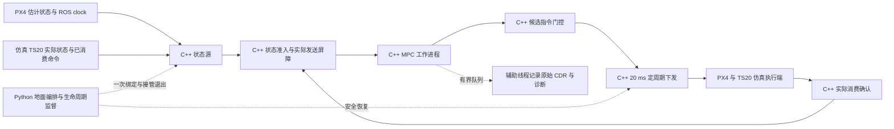

# X650 在线 MPC 的完整 C++ 计算链

本次迁移保留已经确定的 MPC 模型、权重、约束和 TS20 条件执行器模型，将在线状态转换、控制器内部状态推进和 ROS 求解工作进程改为 C++。此前的 C++ 数值库只承担矩阵组装、QP 和候选检查；Python 仍在每步准备预测上下文、调用这些库并处理记录，所以“求解器已是 C++”并不等于整条在线链已是 C++。

Python 最初用于响应建模、快速检查公式、实验编排和独立数值参考。它仍适合这些工作。现在保留的 Python 角色是地面配置检查、进程启动、实验监督、退出恢复和离线分析；ACTIVE 阶段的真实状态快照、MPC 计算与正常执行指令不应由 Python 产生。启动入口使用 Python，并不意味着控制周期需要等待 Python 求解。

## 结构与边界



| 模块 | 位置 | 在线职责 |
| --- | --- | --- |
| 完整控制器 | `control_packages/x650_wholebody_v1/native/mpc_core.*` | 管理参考、历史和热启动；预测、线性化、矩阵组装、QP、完整约束与非线性候选检查；成功后提交内部状态，失败不提交 |
| ROS 工作进程 | `ros2_ws/src/flyarm_mpc_cpp` | 接收原始 `ControlSnapshot`，直接调用 C++ Core，发布 `ControlProposal`；不会向执行器写指令 |
| 原始反馈源 | `ros2_ws/src/flyarm_state_cpp` | 接收 PX4 四类估计消息与 `/clock`，读取实际 TS20 状态及 MIT 历史，执行坐标转换、参考原点和时间检查 |
| 准入／下发／消费 | 既有 `flyarm_control_gateway` | 保留实际发送屏障、独占输出、固定周期以及关节消费确认 |
| 新仿真入口 | `simulations/x650_cpp_live_v1` | 地面加载绑定的版本与参数；接入实际仿真；保留起飞、接管、零指令确认、恢复、落地及参数还原 |

当前控制问题仍同时包含三个机体平移通道与两个关节通道，15 个预测节点、75 个优化变量。它是上层机体／机械臂协同 MPC；下层仍是 PX4 和舵机，不是直接优化整机电机力矩的全身动力学 NMPC。这次迁移没有通过减少通道或降低物理约束来取得计算余量。

## 运行契约

- 20 ms 下发周期、50 ms 指令时效／计算上限、25 ms 源状态年龄与 40 ms 最大发送间隔保持原值。模型步长使用真实接收的仿真时间差。
- 控制器只接收实际已消费的历史与实际 MIT 包。候选指令不能冒充执行历史。
- 进程在未解锁地面准备好。状态源初始为 UNBOUND；原生命周期建立固定参考与重置计数后，在旧输出仍有效时发送一次 `SourceBinding`，核对 ACK，再发送 `LiveStart`。
- C++ 工作进程不接收 Python 组装的矩阵或候选轨迹。启动清单绑定实际加载的 Core、QP、预测库和全部配置；库身份在加载时再次核对。
- 大量 JSON、哈希和磁盘写入移到辅助记录线程。在线保留的 Compact 诊断仍包含预测状态、末端、计划与检查结果；完整矩阵及包比较在离线 Full 模式进行。记录队列满或缺记录不能获得验收。
- Python 的旧控制器可继续做独立数学参考，但不能作为新在线链的静默回退。

## 2026-10-24 已完成的软件验证

最终 Core 为 `6af46a510654ff302c2f2dcec2b73c6e752776ff5cbd538254dd0c017d4cc63b`，实际 QP 依赖为 `582b0a150787333936b04c4c9b40d461db99fa884577e81e6ff230f49a4b3452`，TS20 预测库为 `9ff66d6db9afb3eb4c24ca6c0c3fcfc9453c6ab4384af134ec22b6f5c38701d8`。新入口必须使用同一组通过证明的参数和库，不能把这些结果移用于任意重编译版本。

| 验证层 | 结果 | 能说明什么 |
| --- | --- | --- |
| C++ Core 的事务、超时和热启动单测 | 通过 | 失败不推进内部状态；原 50 ms 超时检查仍生效 |
| 30 组事先确定的输入工况 | 30/30 | 矩阵、计划、预测状态、实际 MIT 量化包、独立约束检查一致 |
| 1056 条原始历史输入离线回放 | 1056/1056 | 同一真实状态和历史下，C++ 结果与既有记录一致；不会改变旧实验的失败结论 |
| 实际 C++ ROS 工作进程连续回放 | 1056/1056 | 经过真实 ROS 收发、完整 Core 和辅助记录线程后，指令与原记录一致；1056 条记录无丢失 |
| 错误配置哈希负测 | 通过 | 无效输入被拒绝，零候选、故障锁存，后续有效输入也不能继续输出 |
| 原始状态转换离线回放 | 1056/1056 | 所比较的状态、时间、关节与 MIT 历史均为零数值差；原始位置／姿态消息有逐条 rosbag 对照 |

最终 Core 离线计时：30 组工况中位数 **5.03 ms**，最大 **8.68 ms**；1056 条历史输入中位数 **2.79 ms**，最大 **5.76 ms**。这些数值只覆盖 Core，不包括 ROS 链路。

实际 ROS 工作进程回放的计算与检查区间中位数 **5.79 ms**，最大 **13.39 ms**；最大指令绝对差约 **1.16×10⁻¹³**。完整回调（包括发布和记录入队）中位数 **5.92 ms**、P99 **12.41 ms**、最大 **13.55 ms**；回放消息发出至提案发布返回最大 **13.72 ms**。`worker_timing.json` 保留各阶段时间；这些仍不包含实际状态源、准入、定周期下发与执行器消费，不能写成整条物理闭环的延迟。

本轮软件回放没有启动执行器，也没有产生新的完整末端保持验收。1056 条原始输入来自旧 hold25，其旧运行曾在约 21.17 s 因指令时效超过 50 ms 而退出；C++ 回放通过不能把旧运行改记为成功。旧记录没有原始角速度和估计器标志的 rosbag CDR，这两类转换验证使用原先保存的原始字段与接收时刻，不能声称四类消息均有完整原始 bag 对照。

## 复现与推进顺序

Core 可通过原生 CMake 构建：

```bash
cmake -S control_packages/x650_wholebody_v1/native -B /absolute/build/core -DCMAKE_BUILD_TYPE=Release
cmake --build /absolute/build/core -j2
ctest --test-dir /absolute/build/core --output-on-failure
```

ROS 包的参数、构建方式和消息契约分别见 [工作进程说明](../ros2_ws/src/flyarm_mpc_cpp/README.md) 和 [状态源说明](../ros2_ws/src/flyarm_state_cpp/README.md)。`scripts/export_x650_cpp_inputs.py`、`export_x650_cpp_recording.py`、`x650_cpp_core_replay.cpp`、`validate_x650_cpp_pipeline.py` 构成离线数学验证入口；它们与实际执行入口分开，原始文件与库的 SHA 均写入报告。离线 Python 数学参考只在该验证进程内取消其计算耗时判定，生产控制器仍执行原超时判定。

新入口启用前，先核对源状态绑定、实际 ROS 工作进程、PX4 编码和停止消费的独立证明。随后重新完成完整 30 s 末端保持，并核对全过程消费记录、PX4 ULog、原生物理末端、落地和参数恢复。只有这个新运行通过，才能继续普通八字，再推进快速八字。当前工作进程只开放 hold；不能只修改轨迹名称便宣称八字已获准。

迁到真机时复用 C++ Core 与消息／生命周期设计，替换仿真专用 TS20 CSV 输入为实际总线反馈、替换定位输入，并重新验证时钟同步、负载、电压、通信中断和 Orin 上的长尾延迟。当前服务器的 CPU 编号与时序结果不能直接移到 Orin。使用 C++ 减少了 Python 调度与对象管理对控制周期的影响；操作系统调度、DDS、总线和输入 I/O 仍需用完整闭环记录验收。
