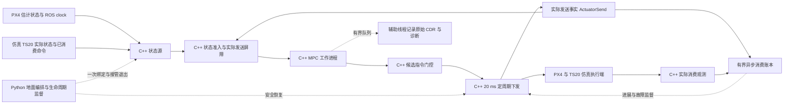

# X650 在线 MPC 的完整 C++ 计算链

本次迁移保留已经确定的 MPC 模型、权重、约束和 TS20 条件执行器模型，将在线状态转换、控制器内部状态推进和 ROS 求解工作进程改为 C++。此前的 C++ 数值库只承担矩阵组装、QP 和候选检查；Python 仍在每步准备预测上下文、调用这些库并处理记录，所以“求解器已是 C++”并不等于整条在线链已是 C++。

Python 最初用于响应建模、快速检查公式、实验编排和独立数值参考。它仍适合这些工作。现在保留的 Python 角色是地面配置检查、进程启动、实验监督、退出恢复和离线分析；ACTIVE 阶段的真实状态快照、MPC 计算与正常执行指令由 C++ 产生。启动入口使用 Python，并不意味着控制周期需要等待 Python 求解。2026-10-24 的新运行已通过完整30 s仿真末端保持及完整32 s普通八字验收。快速八字与真机仍按后续阶段分别验证。

## 结构与边界



| 模块 | 位置 | 在线职责 |
| --- | --- | --- |
| 完整控制器 | `control_packages/x650_wholebody_v1/native/mpc_core.*` | 管理参考、历史和热启动；预测、线性化、矩阵组装、QP、完整约束与非线性候选检查；成功后提交内部状态，失败不提交 |
| ROS 工作进程 | `ros2_ws/src/flyarm_mpc_cpp` | 接收原始 `ControlSnapshot`，直接调用 C++ Core，发布 `ControlProposal`；不会向执行器写指令 |
| 原始反馈源 | `ros2_ws/src/flyarm_state_cpp` | 接收 PX4 四类估计消息与 `/clock`，读取实际 TS20 状态及 MIT 历史，执行坐标转换、参考原点和时间检查 |
| 准入／下发／消费 | `flyarm_control_gateway` | 实际发送屏障、独占输出、固定周期最新有效指令流，以及独立的关节异步消费账本与进展监督 |
| 新仿真入口 | `simulations/x650_cpp_live_v1` | 地面加载绑定的版本与参数；接入实际仿真；保留起飞、接管、零指令确认、恢复、落地及参数还原 |

当前控制问题仍同时包含三个机体平移通道与两个关节通道，15 个预测节点、75 个优化变量。它是上层机体／机械臂协同 MPC；下层仍是 PX4 和舵机，不是直接优化整机电机力矩的全身动力学 NMPC。这次迁移没有通过减少通道或降低物理约束来取得计算余量。

## 运行契约

- 20 ms 下发周期、50 ms 指令时效／计算上限、25 ms 源状态年龄与 40 ms 最大发送间隔保持原值。模型步长使用真实接收的仿真时间差。
- 控制器只接收实际已消费的历史与实际 MIT 包。候选指令不能冒充执行历史。
- 下一次求解通过 `ActuatorSend` 确认前一候选已实际发送，不等待每条关节消费回执。正常跟踪按周期发送最新有效值；两关节消费观测异步更新有界账本，最早尚未得到进展证据的发送不能被后续发送刷新期限。停止仍需实际零指令被采用后释放输出权。
- 进程在未解锁地面准备好。状态源初始为 UNBOUND；原生命周期建立固定参考与重置计数后，在旧输出仍有效时发送一次 `SourceBinding`，核对 ACK，再发送 `LiveStart`。
- C++ 工作进程不接收 Python 组装的矩阵或候选轨迹。启动清单绑定实际加载的 Core、QP、预测库和全部配置；库身份在加载时再次核对。
- 大量 JSON、哈希和磁盘写入移到辅助记录线程。在线保留的 Compact 诊断仍包含预测状态、末端、计划与检查结果；完整矩阵及包比较在离线 Full 模式进行。记录队列满或缺记录不能获得验收。
- Python 的旧控制器可继续做独立数学参考，但不能作为新在线链的静默回退。

## 2026-10-24 已完成的软件验证

最终 Core 为 `6af46a510654ff302c2f2dcec2b73c6e752776ff5cbd538254dd0c017d4cc63b`，实际 QP 依赖为 `582b0a150787333936b04c4c9b40d461db99fa884577e81e6ff230f49a4b3452`，TS20 预测库为 `9ff66d6db9afb3eb4c24ca6c0c3fcfc9453c6ab4384af134ec22b6f5c38701d8`。新入口必须使用同一组通过证明的参数和库，不能把这些结果移用于任意重编译版本。

| 验证层 | 结果 | 能说明什么 |
| --- | --- | --- |
| C++ Core 的事务、超时和热启动单测 | 通过 | 失败不推进内部状态；原 50 ms 超时检查仍生效 |
| 30 组事先确定的输入工况 | 30/30 | 矩阵、计划、预测状态、实际 MIT 量化包、独立约束检查一致 |
| 1056 条原始历史输入离线回放 | 1056/1056 | 同一真实状态和历史下，C++ 结果与既有记录一致；不会改变旧实验的失败结论 |
| 实际 C++ ROS 工作进程连续回放 | 1056/1056 | 经过真实 ROS 收发、完整 Core 和辅助记录线程后，指令与原记录一致；1056 条记录无丢失 |
| 错误配置哈希负测 | 通过 | 无效输入被拒绝，零候选、故障锁存，后续有效输入也不能继续输出 |
| 原始状态转换离线回放 | 1056/1056 | 所比较的状态、时间、关节与 MIT 历史均为零数值差；原始位置／姿态消息有逐条 rosbag 对照 |

最终 Core 离线计时：30 组工况中位数 **5.03 ms**，最大 **8.68 ms**；1056 条历史输入中位数 **2.79 ms**，最大 **5.76 ms**。这些数值只覆盖 Core，不包括 ROS 链路。

实际 ROS 工作进程回放的计算与检查区间中位数 **5.79 ms**，最大 **13.39 ms**；最大指令绝对差约 **1.16×10⁻¹³**。完整回调（包括发布和记录入队）中位数 **5.92 ms**、P99 **12.41 ms**、最大 **13.55 ms**；回放消息发出至提案发布返回最大 **13.72 ms**。`worker_timing.json` 保留各阶段时间；这些仍不包含实际状态源、准入、定周期下发与执行器消费，不能写成整条物理闭环的延迟。

上述软件回放没有启动执行器，也不能单独产生新的完整末端保持验收。1056 条原始输入来自旧 hold25，其旧运行曾在约 21.17 s 因指令时效超过 50 ms 而退出；C++ 回放通过不能把旧运行改记为成功。旧记录没有原始角速度和估计器标志的 rosbag CDR，这两类转换验证使用原先保存的原始字段与接收时刻，不能声称四类消息均有完整原始 bag 对照。

## 首次完整 C++ 实际闭环的执行确认故障

运行 `x650_cpp_live_v1_20261024_153133_35311` 已使用实际 PX4／Gazebo 反馈和执行端，1374 次 Core 计算、非线性候选检查与准入均通过，Core 最大计算时间 14.818 ms。运行在原生仿真时间 41.676–69.136 s 的有效发送前缀之后，因执行确认门控退出；这段仅有 27.460 s，不能作为所要求的完整 30 s 保持验收。同期独立物理末端误差 RMSE 2.900 mm、峰值 5.883 mm，只描述这个失败运行中的有效前缀。退出后的零指令消费、写端退出、Hold 确认、落地／解除武装和参数还原均已记录。

直接触发点位于 `LiveActuator::execute()`：只要上一条命令仍在 `pending_` 中，就立即停机。第 1373 条正常命令发出后约 19.855 ms，下一发送槽到达；其消费确认在发出后约 22.571 ms 才被下发器处理，比该槽晚约 2.715 ms。第 1374 条 MPC 候选本身已经通过。这里的确认表示两个关节插件已采用对应速度命令，**不表示关节到达目标角度**。

ROS 的通信仍是异步的。逐条确认再发送是本应用为核对实际执行历史所采用的串行契约，不是 ROS 对连续控制指令的要求。此故障暴露了契约内部的不一致：名义 20 ms 发送槽附加了一个立即确认条件，而原来定义的最大发送间隔是 40 ms。若保留逐条确认，必须把“暂未收到确认”和“确认确已超出剩余预算”分开，并在等待期间继续处理确认和停止事件；不能堵住接收线程或重置指令时间戳。

现有日志没有完整逐次保存消费读取、DDS 到达及下发器取走消息的各段时间，因而尚不能把这段确认延迟唯一归因于 CSV 刷新、消费源调度或 DDS 调度。`scripts/report_x650_cpp_live.py` 生成带原始文件哈希的前缀复核，始终标记 `physical_acceptance=false`，不得用它替代整次实验验收。

新的 revision 2 正常跟踪模式使用定周期最新有效指令流与异步执行反馈，不再以每周期收到上一条消费确认作为发送前提。它维护有界发送账本，分别记录两个关节的观测结果；后来观测越过某条命令时，标记为“被替代或未单独观测”，不补造消费确认。模式接管、停止和恢复事务仍需单独的有界确认。该结构现已通过软件故障注入和下述新的完整物理仿真保持；首次运行的失败记录仍保持原结论。

正常发送仍使用绝对 20 ms 槽、50 ms 指令有效期和原来的 40 ms 最大发送间隔。另设每关节 40 ms 的异步进展预算，从最早尚未得到进展证据的实际发送时刻计起，后续发送不能刷新这个期限。这个预算是单独的失联监测参数，不能与“20 ms 周期”或“40 ms 最大发送间隔”混为一谈；本次完整仿真已按该配置验收，但这不是通用舵机或真机保证。

求解端仍保留“前一候选已实际发送”屏障，但不等待消费往返；它避免尚未发出的候选覆盖 Core 的上一指令状态。预测状态继续从实际关节参考、实际采用命令历史和实际 MIT 包重建。仅确认消息晚到不会改变被控对象的输入；实际采用晚到则会产生模型误差，必须由物理记录验收，不能因取消等待而声称任意通信延迟已被精确建模。匿名 Float64 关节桥仍依赖每关节独占、按序、一次送达的约定，接收计数并非显式端到端指令编号。

这不是 MPC 数学上的逐条 ACK 要求。[RPG 四旋翼控制框架](https://github.com/uzh-rpg/rpg_quadrotor_control/blob/master/control/autopilot/include/autopilot/autopilot_inl.h) 的控制路径使用状态预测与预期执行时间，另行接收低层反馈和监测超时。[PX4 官方 ROS 2 示例](https://github.com/PX4/PX4-user_guide/blob/main/en/ros2/offboard_control.md) 定时发布连续设定值，并将模式操作与连续设定值分开。这些是架构参考，不能替代我们的 TS20 驱动接口和延迟模型验证。

首轮失败的完整 4224 个原始文件保存在 [原始运行归档](validation/cpp_pipeline_20261024/cpp_hold_v1_full.zip)，本地已逐文件核对 SHA。另有 [前缀复核报告](validation/cpp_pipeline_20261024/hold_v1_prefix_report.json) 和 [状态源独立审计](validation/cpp_pipeline_20261024/source_independent_audit_v2/hold_v1_source_audit.json)。后者核对 6861 个源快照与 1374 个实际 worker 输入，所检查字段均零数值差，仍不表示整次保持通过。[补充软件证明归档](validation/cpp_pipeline_20261024/source_and_adapter_proofs_v1.zip) 保留原构建与独立 Release 构建的源／二进制／转换与 ROS 证明；manifest 明确指出旧探针两个已被后续构建覆盖的历史引用，未将它们冒充当前资格。

## 完整 30 s 仿真末端保持已通过

运行 `x650_cpp_live_v1_20261024_163442_43018` 使用实际 PX4／Gazebo 状态与执行端、Release 构建的 C++ 状态源及上述 C++ Core，保持窗口为仿真时间 **41.808–71.808 s**。独立后验重新核对了原始状态与提案 CDR、原生关节及 MIT 包记录、异步消费账本、PX4 ULog、原生末端轨迹、实际发送屏障、退出过程与参数恢复。[完整验收报告](validation/cpp_pipeline_20261024/hold_stream_v2/report.json) 的 `passed`、`complete`、`physical_acceptance` 均为 `true`，`hardware_qualified` 为 `false`。

| 项目 | 本次完整窗口结果 |
| --- | ---: |
| 保持时长／原生末端样本 | 30.000 s／7501 |
| 三维末端 RMSE／峰值误差 | **2.766 mm／3.807 mm** |
| 三轴 RMSE（X／Y／Z） | 2.578／0.881／0.479 mm |
| 机体倾角峰值 | 0.096728° |
| Core 计算中位数／P99／最大值 | 5.183／11.148／11.886 ms |
| 完整 worker 回调中位数／P99／最大值 | 5.352／11.339／12.082 ms |
| 实际正常发送间隔中位数／最大值 | 19.999308／37.997054 ms |
| 发送时原指令年龄最大值 | 41.313981 ms |

末端误差来自独立原生物理末端的同时刻对比，没有做相位对齐。Core 和回调时间是该运行的观测分布，不是整条链路的最坏时间保证；实际发送仍按原 40 ms 间隔、50 ms 原指令有效期与 25 ms 源状态年龄逐条核验。本次 executor 的实际 CPU 87 与声明配置一致。退出后，原 ULog 独立确认已降落并解除锁定，恢复段无 failsafe，参数还原通过。

计数分别为：**1499 次完整求解，1498 个候选进入 Gate，1500 次正常发送**。最后一个已算完的候选位于测量结束的交接尾部，尚未进入 Gate；1500 次发送包含两个已发送候选的重复发送。再加一次 STOP 零命令，共 1501 次发送、1500 条真实消费回执。对两个关节各自而言，1500 条发送在物理更新边界被采用，1 条在采用前被后续发送覆盖；报告明确 `all_sends_applied=false`，并未用回执数宣称每条发送均执行。

唯一被覆盖的 dispatch4573（candidate1373）与后续 dispatch4574 的命令完全相同，后者明确 `repeated=true`。两个关节的原 counter2580 均未在物理边界被采用，后续 counter2581 在 sim69.304 真实采用且有回执。另一处重复为 dispatch3868／candidate668。异步流允许这个受监督的最新值行为；它没有取消真实消费核对，也没有把被覆盖项伪标为执行。

首次后验被旧 ULog 匹配函数的“仿真时标必须严格递增”条件拒绝：dispatch4573／4574 共用同一个已观测状态时标69.300，但实际单调时钟发送时刻不同。新后验只在 ULog **值匹配视图**中折叠这一个同候选、同 payload、同 feedback、明确重复的等价项，得到1499行值视图；1500条原始发送及派生行完整保留，没有移动或补造时间戳。不同候选、非重复或任何 payload／feedback 差异均由负测拒绝，原 upper 审计和数值门限未修改。这表示 PX4 观测到了对应的值，不表示 PX4 为每次重复发布提供了 ACK。

[证据索引](validation/cpp_pipeline_20261024/hold_stream_v2/README.md) 保留完整报告、前后审计版本映射和17项专门审计回归；本轮相关 Python 回归合计66项通过。首次后验失败的原报告与所用代码保留在原始归档链中，不覆盖为成功。该通过结论仅针对这次配置下的完整仿真保持，尚未证明普通／快速八字、任意通信延迟、不同硬件负载或真机条件。

## 复现与推进顺序

Core 可通过原生 CMake 构建：

```bash
cmake -S control_packages/x650_wholebody_v1/native -B /absolute/build/core -DCMAKE_BUILD_TYPE=Release
cmake --build /absolute/build/core -j2
ctest --test-dir /absolute/build/core --output-on-failure
```

ROS 包的参数、构建方式和消息契约分别见 [工作进程说明](../ros2_ws/src/flyarm_mpc_cpp/README.md) 和 [状态源说明](../ros2_ws/src/flyarm_state_cpp/README.md)。`scripts/export_x650_cpp_inputs.py`、`export_x650_cpp_recording.py`、`x650_cpp_core_replay.cpp`、`validate_x650_cpp_pipeline.py` 构成离线数学验证入口；它们与实际执行入口分开，原始文件与库的 SHA 均写入报告。离线 Python 数学参考只在该验证进程内取消其计算耗时判定，生产控制器仍执行原超时判定。

源状态绑定、实际 ROS 工作进程、PX4 编码、停止消费及新的完整 30 s 末端保持现已验收。普通八字的动态当前参考与未来各节点预览也已接入同一 C++ 链路，并完成新的完整物理仿真验收，见下节。下一阶段为快速八字；当前显式开放的轨迹仅为保持和固定普通工况，不能只修改轨迹名称或周期便宣称快速工况已获准。

迁到真机时复用 C++ Core 与消息／生命周期设计，替换仿真专用 TS20 CSV 输入为实际总线反馈、替换定位输入，并重新验证时钟同步、负载、电压、通信中断和 Orin 上的长尾延迟。当前服务器的 CPU 编号与时序结果不能直接移到 Orin。使用 C++ 减少了 Python 调度与对象管理对控制周期的影响；操作系统调度、DDS、总线和输入 I/O 仍需用完整闭环记录验收。

## 完整普通八字已通过

独立入口 `simulations/x650_cpp_normal_v1` 沿用通过保持的数值库、配置与连续输出结构，新增严格普通参考与实际步长的未来预览。源与worker共享同一C++相位律，独立原Python公式用于差分核对：3,370组／53,920个目标样本、48组全矩阵及非线性候选工况全部通过。新的实际ROS worker另通过160步连续动态输入及错误目标、相位、哈希的锁存退出测试，未用旧worker的1056条回放冒充新二进制证明。

正式运行 `x650_cpp_normal_v1_20261024_172622_46636` 的物理窗口为42.848–74.848 s，包含2 s起始保持、两圈普通八字及4 s末尾保持。参考幅值为X±25 cm、Z±10 cm、12 s/圈，独立原生物理指标如下：

| 窗口 | 原生样本 | 三维RMSE | 峰值误差 |
| --- | ---: | ---: | ---: |
| 完整0–32 s | 8001 | 4.562884 mm | 7.790075 mm |
| 运动2–28 s | 6501 | 4.908519 mm | 7.790075 mm |
| 尾部28–32 s | 1001 | 1.614122 mm | 3.107416 mm |

倾角峰值0.622335°；Core中位数／最大6.958085／20.334062 ms，完整回调最大20.536500 ms。输出保留20 ms绝对周期，实际发送间隔最大24.109010 ms、指令年龄最大41.876339 ms，原40／50 ms保护均未放宽。某次计算略超20 ms时，定周期端可继续发送尚有效的最近候选，仍由异步执行进展及原有效期监督；这些观测不构成最坏时序保证。

1598个求解全部接受，1597个唯一候选实际正常发送；两次重复组成1599次正常发送。窗口结束的最后候选由停止零命令取代，总1600次发送／1600条实际消费回执。两关节各自均有1600次原生采用记录，其中1598次为同一物理步边界。原ULog独立确认活动与恢复阶段failsafe为0，已降落、解除锁定并恢复参数。

[普通八字完整说明、视频与轨迹](validation/cpp_normal_20261024/README.md) 保存完整32 s、运动与末尾三段结果、独立复核、软件证明和8616件原始归档。误差以同一世界坐标及物理时间计算，无位置／相位拟合。该结论针对本次精密EV定位条件仿真，快速八字、Orin和24 V实际负载仍需各自验收。
