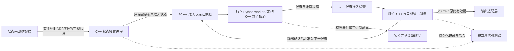

# X650 冻结 MPC 的执行隔离与真机迁移测试方法

日期：2026-10-23。本文规定可重复的测试流程、运行时边界及证据等级；[本轮实际结果](validation/isolated_runtime_20261023/README.md)单独归档。ROS 软件测试通过不等于 Gazebo 末端保持通过，更不等于真机可飞。

## 1. 本次修复的对象与冻结边界

普通八字第一次运行在 14.340 s 被 52 ms 控制更新间隔保护终止。前一周期同线程自然第 2 代垃圾回收约 24.786 ms，而 QP 仅约 2.231 ms。状态回调、计算、下发和约 96 KB/周期的诊断序列化共用 Python 执行链，是此次需要拆开的部分。见[完整失败记录](validation/native_figure8_20261023/README.md)。

冻结的数值库 SHA-256 为 `773241c1a3fe858f9d4b0e60f7f6b7465c6c0b9ef50b4ac1adac8f55590f7fef`；原末端保持任务 SHA-256 为 `f8d96cb8d70b55a9885b4723f5ea614d1978f4e50663921a2e9fe440b4357ae1`。矩阵、QP、候选检查、TS20 模型、MPC 权重/预测域/限位以及 PX4 PID 不随运行时开发而调整。已有 30 个冻结工况与 388 条记录的证明以原文件哈希核验，新过程另取独立记录与逐项复算。

当前修改是独立、可选择的 ROS 执行路径。历史仿真入口保留；它的通过证书不会自动转授给新入口。独立输出节点目前发送带时效的 **shadow 消息**，没有 PX4 或关节执行器发布器。这个范围由私有 DDS 域内的实际 topic 检查验证。

## 2. 进程与数据边界



| 组件 | 当前实现 | 禁止混入的职责 |
|---|---|---|
| 来源适配 | 200 Hz 独立软件激励；完整类型与原时间戳 | 不把软件激励称为物理响应或动捕实测 |
| 状态接收 | `state_ingress` C++ 进程；最新状态覆盖旧未处理状态；保留接收时刻/来源时刻 | 不等待 Python 求解或记录完成；不能把旧样本重新打成新时间 |
| 算法 | `isolated_node`；原 `ReferenceEngine`、适配器和冻结 C++ 库 | 不接收原始传感器 topic、不承担定时发送、不写大 JSON |
| 输出 | `periodic_dispatcher` C++ 进程；20 ms 绝对节拍；发送年龄检查 | 不把重复上一条有效指令算作新的优化结果；无无限续期 |
| 大诊断 | 同主机私有 Unix datagram + 独立记录进程 | 不通过可靠记录回执阻塞控制；不能静默忽略丢失 |
| 验收 | 独立观察器、离线复算与原始记录 | 不用“进程还在运行”代替算法或实验通过 |

工作进程交付诊断时只做一次有界二进制复制；数组在下一次计算前即脱离可变对象。JSON 转换、写盘、flush/fsync 在另一个进程。此复制仍需实测耗时，不被当作零成本。单个包上限 196608 字节；满队列、接收者退出或包过大均增加丢失计数并记下首个出错序号。发送次数与持久化行数、首尾序号及 SHA-256 全部对上，记录才算完整。

发送进程使用显式 `rclcpp::WaitSet`，在绝对节拍到达时，先有界读取已经就绪的状态、候选与故障消息，再决定本次输出。它不依赖通用执行器中定时器和订阅回调的先后顺序，也不等待未来候选来延长旧指令的有效期。

时间关键 DDS topic 用有界历史和 best-effort，使诊断观察者不成为可靠交付等待条件；消息丢失由序号和超时检测。选择这个 QoS 不等于证明中间件永不阻塞，仍以实际进程测试记录为准。

## 3. 时间契约与失败语义

每个状态/候选分别保留来源时间、接收时间、算法开始/结束时间、原快照发出时间、计划发送时刻、实际发送时刻和序号。Linux 同机 monotonic 时间用于进程间年龄，仿真时间用于预测模型的 dt；二者不能直接相减，也不能把多机时钟未经同步当作同一时钟。

- 状态提供 200 Hz 激励，准入目标 50 Hz，输出节拍 50 Hz。它们是三个不同指标。
- 一个快照最多在途一次；新状态继续接收，积压状态只保留最新一个。下一次算法 dt 使用实际选中状态时间差，仍受 50 ms 上限限制。
- 上一轮计算结束且满足 20 ms 最小间隔后，即可选择最新状态，不额外等下一个整周期。候选准入后还要等输出序号确认，才开放下一轮；防止已经“接受”却尚未输出的候选被覆盖。
- 候选检查仍要求原问题的可行性、KKT、限位、非线性检查、PVA 重构及 50 ms 截止时间。
- 输出有效期从**原快照发出时间**开始，最长 50 ms；重新收到或重复输出不会延长它。
- 同一条指令的第二次发送标记 `repeated=true`，原序号与原时间保持不变。输出周期正常、算法更新变慢、状态已过期会分别呈现。
- 来源已停更、候选过期、准入失败、时钟回退、重复/乱序候选或发送漏期会锁存故障。后续 tick 仍存在，但 `output_valid=false`，消息内不附可执行载荷。
- `RuntimeStop` 只允许结束当前 session/epoch，不能恢复同一已停止 epoch。恢复必须重新建会话和前置状态。
- 正常停止时，最多有最后一个已在途候选算完却未准入，或最后一个已准入候选未赶上输出时刻。它们分别记录，不混入已输出数量；中间序号丢失不能按正常停止解释。
- 软件验证中无效输出只表示“不再可执行”。未来真机适配层还必须实施经台架验证的停止/保持/飞控模式切换；当前没有凭空选定断力或空中悬停策略。

年龄检查发生在实际发送 tick。过期后到下一 tick 的检测延迟仍需记录；不能把“从未在发送时刻发送过期消息”解释成“执行器在有效期结束的同一瞬间就停止”。真机的独立超时监督、总线消费与物理停止时间需另测。

当前测试要求调度间隔不超过 40 ms、调度迟到不超过 20 ms；这两个是新执行器测试门槛，未改变原算法的 20 ms QP 预算或 50 ms 完整控制门槛。任何故障用例的“检测通过”都不是轨迹控制通过。

ROS 2 自身并不保证硬实时。动态分配、缺页、中间件和系统调度仍需在目标机测量；相关原则见 [ROS 2 实时系统设计](https://design.ros2.org/articles/realtime_background.html)。PX4 的 Offboard 存活信号与指令新鲜度也不同：维持心跳不能给旧计划续期，见 [PX4 Offboard 文档](https://docs.px4.io/main/en/flight_modes/offboard)。

## 4. 先注册，再执行的测试矩阵

机器可读协议：[`configs/experiments/x650_isolated_runtime_v1.json`](../configs/experiments/x650_isolated_runtime_v1.json)。正式运行前冻结输入哈希、工况、时间、门限、失败策略和报告口径。短时接线检查单独标为 commissioning，不作为 30 s 验收。每次目录必须新建，失败不覆盖、不删掉后重抽样。

| 层次 | 测试 | 主要证据 | 不能据此声称 |
|---|---|---|---|
| L0 冻结身份 | 原数值库、原参数、原证明与源码逐项核验 | 原 30/388 证明哈希 + 本次实际加载 ELF/模块来源 | 本次进行了新的物理实验 |
| L1 数值与边界 | 同一录下的完整状态/上下文/历史输入，独立调用冻结核心；候选门限、重复/乱序、年龄、停止锁存单测 | 全部指令字段差≤1e-7；类型、坐标、不可变记录测试 | 合成状态是可实现的飞行动力学 |
| L2 持续运行 | 30 s 非零时变软件状态，完整记录全部准入候选 | 新输出年龄、输出周期、计算耗时、自然 GC、记录完整性和逐项复算 | 硬实时最坏上界或末端精度 |
| L2-F1 算法停顿 | 第 2 s 对算法进程 SIGSTOP 100 ms | 接收与输出仍运行；旧指令在有效期后被拒绝；故障锁存 | 算法在停顿时仍生成新控制量 |
| L2-F2 短停顿 | 第 2 s 暂停算法 25 ms | 明确恢复或截止时间拒绝；无过期输出；节拍不被拖住 | 所有 25 ms 停顿都不会影响任务连续性 |
| L2-F3 状态停顿 | 第 2 s 暂停来源 120 ms | 状态过期被拒绝，旧状态不会续命 | 断流后物理飞行器已经自动安全停止 |
| L2-F4 记录停顿 | 第 2 s 暂停记录 1000 ms | 控制无等待；队列满可见；记录不完整则不授予实验通过 | 丢失诊断后还能完整验证轨迹 |
| L3 实际接口影子 | Gazebo/PX4/TS20 的真实反馈和实际已发历史构成快照，暂不接管 | 与原读取边界一致、时钟与方向一致、历史可用性和实际消费时间 | shadow 命令已由物理系统执行 |
| L4 仿真闭环 | 新入口完成起飞、预流、接管、30 s 末端保持、退出与恢复 | 原时轴独立末端误差、实际关节与 PVA 消费、完整 ULog、参数恢复 | 真机 24 V 执行器或动捕已标定 |
| L5 任务分级 | 普通 12 s/圈两圈 → 快速 8 s/圈两圈 | 整窗结果、相同冻结算法、全部失败保留 | 部分跑完可冒充整窗通过 |
| L6 目标硬件 | Orin 重放/处理器在环 → 无桨联调 → 初始飞行 | 真实时钟、温度/功耗、接口与停止语义、独立末端观测 | 服务器库原样复制即为真机验收 |

L2 使用非零位置、姿态、关节和速度激励；它没有动力学 plant，不计算或展示末端 RMS。记录中的数值输入逐条重算时只重置传输墙钟用于离线准入，状态、上下文、指令历史、序号和算法参数保持相同。

## 5. 仿真接管前必须实现的适配点

当前 ROS 运行时与仿真之间还需要明确的 live adapter，不能直接把测试 topic 改名成 `/arm/*` 就解锁飞行。

1. **接收端。** 将 PX4 估计、机体姿态/角速度、估计加速度与 TS20 实际反馈组成同一因果快照；保持原 25 ms 关节年龄门限。Gazebo 真值仅供独立验收与物理边界检查，不能混作算法估计反馈。
2. **命令历史。** `ControlSnapshot` 中的 MIT 参考积分状态、已消费速度命令、已发送 MIT 包，必须来自实际执行端的回报。只录到 ROS publish 返回不表示执行器消费成功。
3. **提交与确认。** 当前已实现候选 → shadow 输出确认 → 下一次准入；失效后不再调用下一轮，避免用被覆盖候选继续热启动。接管前要把 shadow 回执替换为实际执行端的 consumed/failed 回执，并验证延迟、失败时的终止或 rollback；不能把 DDS publish 返回当作总线消费成功。
4. **PX4 编码。** 保留已有 ENU/FLU→NED/FRD 转换、PVA mask、位置基准及零加速度前馈政策。重用目前经检查的 MAVLink 生命周期；切换为原生 DDS 输出是另一个可验收变化。
5. **TS20 下发。** 20 ms 上层输出不是 5 ms MIT 总线节拍。参考积分、编码量化、限位和零速/断流语义放入独立执行端，发送事实回灌算法。
6. **移交。** 起飞/预流、实验接管、故障退出、收臂和降落必须有单一输出所有者与确认。不可让旧 Python loop 与新进程同时写关节或 PX4。
7. **重验。** 接口影子和故障恢复先验收，再在新入口取得新的完整末端保持。历史通过记录不自动覆盖新的执行时序。

这些是进入 L4 的具体软件验收项。保留此列表是为了区分已完成的进程隔离证据与尚未取得的实际控制链证据。

## 6. 真机迁移的可替换部分

| 边界 | 当前仿真 | 后续真机 | 保持共同的测试 |
|---|---|---|---|
| 算法输入 | PX4 精密 EV 估计 + 仿真 TS20 状态 | PX4 估计/动捕适配 + 舵机真实反馈 | 帧、单位、原时间戳、乱序/缺失、状态年龄 |
| 末端独立评价 | Gazebo 原始物理末端 | 末端动捕标记，与机体动捕+关节 FK 分开 | 原时轴误差、外参/角度误差、时间偏置 |
| 算法库 | x86-64 已验收 ELF | 在 Orin aarch64 重新构建和测量 | 30 个工况、记录重放、数值容差、候选分类 |
| 计算环境 | 服务器普通 Linux 容器 | Orin NX 实际 JetPack、功耗/散热、通信负载 | 计算/周期/年龄、缺页、自然 GC、长时统计 |
| 飞控输出 | 现有 PX4 SITL/MAVLink | 实际 PX4 固件与串口/网络/DDS 适配 | PVA 语义、模式/参数读回、接管和失联行为 |
| 关节输出 | 条件 TS20 plant、5 ms MIT 模型 | TS20-50、24 V、最终线束与驱动 | 符号、零位、MIT 编码、回执、位置积分和停止 |

用户已确定 TS20-50 与 24 V。当前来源模型的台架条件为 20 V；本次运行时改造不会产生新的 24 V 带载辨识证据。电机增益、摩擦、负载、热态与通信周期需要后续实际响应记录。Orin 系列型号、最终功耗档及动捕 SDK 尚需落地时确认，当前不以猜测固定它们。

迁移保留的是接口契约、任务协议、故障注入方法、数据格式和判定程序。更换平台要重新绑定构建产物和计时证据，不把 x86 的耗时数值、库二进制或仿真观测精度直接移植为真机指标。

## 7. 与 NMPC 的衔接

先比较同一个五维速度接口下的 QP MPC 与 NMPC：共同状态、真实执行历史、预览时间、约束、PID、故障处理和试验轨迹，只替换算法插件。相同接口同时记录成功候选率、过期率、整窗末端误差与恢复行为；不能只比较“算出结果时的误差”。

全身力矩级 NMPC 另立接口与动力学验收，因为改变了控制权限和模型。先前用户确定的顺序“上层 MPC，再全身 NMPC”继续保持。详细研究测试族见[真机前路线](X650_REAL_FLIGHT_READINESS_AND_NMPC.md)。

## 8. 重复执行入口

已有 ROS Humble 和 px4_msgs 环境，使用独立 build/install 目录构建 `ros2_ws/src`，不修改冻结算法库。

```bash
source /opt/ros/humble/setup.bash
source /root/autodl-tmp/ros2_px4_ws/install/setup.bash
source /root/autodl-tmp/flyarm_ros2_isolated_v1_20261023/install/setup.bash
cd /root/autodl-tmp/safe-aerial-manipulator-testbed
env OPENBLAS_NUM_THREADS=1 OMP_NUM_THREADS=1 MKL_NUM_THREADS=1 \
  /usr/bin/python3 scripts/run_x650_isolated_runtime.py \
  --task-config artifacts/native_numerics_20261023/quiet_task_cpp_v5.json \
  --output artifacts/isolated_runtime_20261023/new_healthy_run \
  --case healthy --domain-id 201
```

其余 `--case` 为 `worker_pause`、`worker_short_pause`、`source_pause`、`recorder_pause`。每次换新目录；`--commissioning` 明确只做 3 s 接线检查。测试只管理自己的进程组和私有 socket；完成后核对无残留子进程。原始完整诊断留在服务器，仓库纳入较小的判定报告、来源哈希和关键图。
