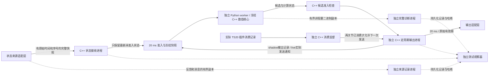

# X650 冻结 MPC 的执行隔离与真机迁移测试方法

更新日期：2026-10-24。本文规定可重复的测试流程、运行时边界及证据等级；[软件隔离测试](validation/isolated_runtime_20261023/README.md)与[实际仿真接入记录](validation/isolated_live_20261023/README.md)分别归档。**历史执行协议第 7 版的 hold_v15 已通过完整 30 秒保持；当前第 9 版候选包含经用户授权的 QP 数值修复，尚待完整回归、新保持和普通八字验收。** 历史保持不自动准入新库，普通八字尚无完整通过结果，快速八字继续后置。仿真通过不等于真机可飞。

## 1. 本次修复的对象与冻结边界

普通八字第一次运行在 14.340 s 被 52 ms 控制更新间隔保护终止。前一周期同线程自然第 2 代垃圾回收约 24.786 ms，而 QP 仅约 2.231 ms。状态回调、计算、下发和约 96 KB/周期的诊断序列化共用 Python 执行链，是此次需要拆开的部分。见[完整失败记录](validation/native_figure8_20261023/README.md)。

历史数值库 SHA-256 为 `773241c1a3fe858f9d4b0e60f7f6b7465c6c0b9ef50b4ac1adac8f55590f7fef`；原末端保持任务 SHA-256 为 `f8d96cb8d70b55a9885b4723f5ea614d1978f4e50663921a2e9fe440b4357ae1`。前期运行时隔离没有改动这些绑定。随后 hold_v16 暴露 QP 归一化后提前终止的问题，用户授权修改数值实现；第 9 版候选因此需要新的库、任务和数值资格证明绑定。控制模型、目标函数、MPC 权重/预测域/限位、TS20 参数、PX4 PID 以及外层 `2e-7` 可行性门限保持不变。原 30 个冻结工况和 388 条记录必须对新实现完整重验，原证明仍只属于原库。

独立软件测试仍使用无执行器发布器的 **shadow 路径**。实际接入另用 `x650_isolated_live_v1` 场景及显式 `simulation_live=true` 的 `live_dispatcher`，两者有不同入口和验收记录。历史仿真入口及原数值证明绑定的构造器保留原字节；历史通过证书不会自动转授给新入口。

## 2. 进程与数据边界



| 组件 | 当前实现 | 禁止混入的职责 |
|---|---|---|
| 来源适配 | 软件测试使用 200 Hz 激励；实际仿真使用 PX4 估计和 TS20 完整物理步反馈 | 不把软件激励称为物理响应或动捕实测 |
| 状态接收 | `state_ingress` C++ 进程；最新状态覆盖旧未处理状态；保留接收时刻/来源时刻 | 不等待 Python 求解或记录完成；不能把旧样本重新打成新时间 |
| 算法 | `isolated_node`；原 `ReferenceEngine`、适配器和冻结 C++ 库 | 不接收原始传感器 topic、不承担定时发送、不写大 JSON |
| 输出 | shadow 用 `periodic_dispatcher`；实际仿真用 `live_dispatcher`；20 ms 绝对节拍与发送年龄检查 | 不把重复上一条有效指令算作新的优化结果；无无限续期 |
| 消费监督 | 独立 C++ `consumption_source` 读取实际插件完整物理步，核对两个关节的计数、值和时间 | 不以 publish 返回或新候选已接受替代实际消费 |
| 大诊断 | 同主机私有 Unix datagram；算法诊断和来源反馈分别由独立记录进程落盘 | 不通过可靠记录回执阻塞控制；不能静默忽略丢失 |
| 验收 | 独立观察器、离线复算与原始记录 | 不用“进程还在运行”代替算法或实验通过 |

工作进程交付诊断时只做一次有界二进制复制；数组在下一次计算前即脱离可变对象。JSON 转换、写盘、flush/fsync 在另一个进程。此复制仍需实测耗时，不被当作零成本。单个包上限 196608 字节；满队列、接收者退出或包过大均增加丢失计数并记下首个出错序号。发送次数与持久化行数、首尾序号及 SHA-256 全部对上，记录才算完整。

发送进程使用显式 `rclcpp::WaitSet`，在绝对节拍到达时，先有界读取已经就绪的状态、候选与故障消息，再决定本次输出。它不依赖通用执行器中定时器和订阅回调的先后顺序，也不等待未来候选来延长旧指令的有效期。

时间关键 DDS topic 用有界历史和 best-effort，使诊断观察者不成为可靠交付等待条件；消息丢失由序号和超时检测。选择这个 QoS 不等于证明中间件永不阻塞，仍以实际进程测试记录为准。

## 3. 时间契约与失败语义

每个状态/候选分别保留来源时间、接收时间、算法开始/结束时间、原快照发出时间、计划发送时刻、实际发送时刻和序号。Linux 同机 monotonic 时间用于进程间年龄，仿真时间用于预测模型的 dt；二者不能直接相减，也不能把多机时钟未经同步当作同一时钟。

- 状态提供 200 Hz 激励，准入目标 50 Hz，输出节拍 50 Hz。它们是三个不同指标。
- 一个快照最多在途一次；新状态继续接收，积压状态只保留最新一个。下一次算法 dt 使用实际选中状态时间差，仍受 50 ms 上限限制。
- 上一轮计算结束且达到 20 ms 控制周期后，选择最新状态。实际仿真用原模型的仿真源时钟判断这 20 ms；软件激励用墙钟。年龄、超时和发送调度独立使用 monotonic 墙钟。不能再把墙钟 20 ms 与物理时钟 20 ms 同时作为准入最小值，否则微小偏差会将 4 ms 物理网格上的 20 ms 更新推到 24 ms。候选准入后须等实际输出序号确认，防止已经“接受”却尚未输出的候选被覆盖。
- 候选检查仍要求原问题的可行性、KKT、限位、非线性检查、PVA 重构及 50 ms 截止时间。
- 输出有效期从**原快照发出时间**开始，最长 50 ms；重新收到或重复输出不会延长它。
- 同一条指令的第二次发送标记 `repeated=true`，原序号与原时间保持不变。输出周期正常、算法更新变慢、状态已过期会分别呈现。
- 来源已停更、候选过期、准入失败、时钟回退、重复/乱序候选或发送漏期会锁存故障。后续 tick 仍存在，但 `output_valid=false`，消息内不附可执行载荷。
- `RuntimeStop` 只允许结束当前 session/epoch，不能恢复同一已停止 epoch。恢复必须重新建会话和前置状态。
- 正常停止时，最多有最后一个已在途候选算完却未准入，或最后一个已准入候选未赶上输出时刻。它们分别记录，不混入已输出数量；中间序号丢失不能按正常停止解释。
- 软件验证中无效输出只表示“不再可执行”。未来真机适配层还必须实施经台架验证的停止/保持/飞控模式切换；当前没有凭空选定断力或空中悬停策略。

年龄检查发生在实际发送 tick。过期后到下一 tick 的检测延迟仍需记录；不能把“从未在发送时刻发送过期消息”解释成“执行器在有效期结束的同一瞬间就停止”。真机的独立超时监督、总线消费与物理停止时间需另测。

**20 ms 是输出周期，50 ms 是指令从原快照起算的最长寿命，不是另一个输出周期。** 同时保留 50 ms 完整计算及模型 dt 上限，但单次计算短于 50 ms 不保证赶得上可用输出槽：旧指令在等待期间继续变老。故障后不再续发正常 PVA，PX4 暂时保持最后目标，实际行为随后由原恢复流程接管；这个仿真执行契约不等于硬实时停机保证。

当前测试要求调度间隔不超过 40 ms、调度迟到不超过 20 ms；这两个是新执行器测试门槛，未改变原算法的 20 ms QP 预算或 50 ms 完整控制门槛。任何故障用例的“检测通过”都不是轨迹控制通过。

ROS 2 自身并不保证硬实时。动态分配、缺页、中间件和系统调度仍需在目标机测量；相关原则见 [ROS 2 实时系统设计](https://design.ros2.org/articles/realtime_background.html)。PX4 的 Offboard 存活信号与指令新鲜度也不同：维持心跳不能给旧计划续期，见 [PX4 Offboard 文档](https://docs.px4.io/main/en/flight_modes/offboard)。

## 4. 先注册，再执行的测试矩阵

机器可读协议：[`configs/experiments/x650_isolated_runtime_v1.json`](../configs/experiments/x650_isolated_runtime_v1.json)。正式运行前冻结输入哈希、工况、时间、门限、失败策略和报告口径。短时接线检查单独标为 commissioning，不作为 30 s 验收。每次目录必须新建，失败不覆盖、不删掉后重抽样。

| 层次 | 测试 | 主要证据 | 不能据此声称 |
|---|---|---|---|
| L0 冻结身份 | 原数值库、原参数、原证明与源码逐项核验 | 原 30/388 证明哈希 + 本次实际加载 ELF/模块来源 | 本次进行了新的物理实验 |
| L1 数值与边界 | 同一录下的完整状态/上下文/历史输入，独立调用冻结核心；候选门限、重复/乱序、年龄、停止锁存单测 | 全部指令字段差≤1e-7；类型、坐标、不可变记录测试 | 合成状态是可实现的飞行动力学 |
| L2 持续运行 | 30 s 非零时变软件状态，完整记录全部准入候选 | 新输出年龄、输出周期、计算耗时、自然 GC、记录完整性和逐项复算 | 硬实时最坏上界或末端精度 |
| L2-F1 算法停顿 | 第 2 s 对算法进程 SIGSTOP 100 ms | 接收与输出仍运行；旧指令在有效期后被拒绝；故障锁存 | 算法在停顿时仍生成新控制量 |
| L2-F2 短停顿 | 第 2 s 暂停算法 25 ms | 明确恢复或截止时间拒绝；无过期输出；节拍不被拖住 | 所有 25 ms 停顿都不会影响任务连续性 |
| L2-F3 状态停顿 | 第 2 s 暂停来源 120 ms | 状态过期被拒绝，旧状态不会续命 | 断流后物理飞行器已经自动安全停止 |
| L2-F4 记录停顿 | 第 2 s 暂停记录 1000 ms | 控制无等待；队列满可见；记录不完整则不授予实验通过 | 丢失诊断后还能完整验证轨迹 |
| L3 实际接口影子 | Gazebo/PX4/TS20 的真实反馈和实际已发历史构成快照，暂不接管 | 与原读取边界一致、时钟与方向一致、历史可用性和实际消费时间 | shadow 命令已由物理系统执行 |
| L4 仿真闭环 | 新入口完成起飞、预流、接管、30 s 末端保持、退出与恢复 | 原时轴独立末端误差、实际关节与 PVA 消费、完整 ULog、参数恢复 | 真机 24 V 执行器或动捕已标定 |
| L5 任务分级 | 普通 12 s/圈两圈 → 快速 8 s/圈两圈 | 整窗结果、相同冻结算法、全部失败保留 | 部分跑完可冒充整窗通过 |
| L6 目标硬件 | Orin 重放/处理器在环 → 无桨联调 → 初始飞行 | 真实时钟、温度/功耗、接口与停止语义、独立末端观测 | 服务器库原样复制即为真机验收 |

L2 使用非零位置、姿态、关节和速度激励；它没有动力学 plant，不计算或展示末端 RMS。记录中的数值输入逐条重算时只重置传输墙钟用于离线准入，状态、上下文、指令历史、序号和算法参数保持相同。

## 5. 仿真接管前必须实现的适配点

实际仿真使用独立的 live adapter，下面各项均需要本次运行的证据；仅将测试 topic 改名成 `/arm/*` 不构成接管验证。

1. **接收端。** 将 PX4 估计、机体姿态/角速度、估计加速度与 TS20 实际反馈组成同一因果快照；保持原 25 ms 关节年龄门限。Gazebo 真值仅供独立验收与物理边界检查，不能混作算法估计反馈。
2. **命令历史。** `ControlSnapshot` 中的 MIT 参考积分状态、已消费速度命令、已发送 MIT 包，必须来自实际执行端的回报。只录到 ROS publish 返回不表示执行器消费成功。
3. **提交与确认。** shadow 路径以输出序号确认；live 路径以实际执行端发送通知开放下一次采样/计算，并由消费回执约束下一次发送。失效后不再调用下一轮，避免用被覆盖候选继续热启动。实际消费、超时及恢复分别核验，不能把 DDS publish 返回当作总线消费成功。
4. **PX4 编码。** 保留已有 ENU/FLU→NED/FRD 转换、PVA mask、位置基准及零加速度前馈政策。重用目前经检查的 MAVLink 生命周期；切换为原生 DDS 输出是另一个可验收变化。
5. **TS20 下发。** 20 ms 上层输出不是 5 ms MIT 总线节拍。参考积分、编码量化、限位和零速/断流语义放入独立执行端，发送事实回灌算法。
6. **移交。** 起飞/预流、实验接管、故障退出、收臂和降落必须有单一输出所有者与确认。不可让旧 Python loop 与新进程同时写关节或 PX4。
7. **重验。** 接口影子和故障恢复先验收，再在新入口取得新的完整末端保持。历史通过记录不自动覆盖新的执行时序。

这些是进入 L4 的具体验收项。实际路径的机器可读协议为 [`x650_isolated_live_v1.json`](../configs/experiments/x650_isolated_live_v1.json)，独立审计入口为 [`audit_x650_isolated_live.py`](../scripts/audit_x650_isolated_live.py)。只有完整新记录通过审计，才能继续普通八字。

### 5.1 实际接入的生命周期

1. **起飞前构造。** 在参数事务开始前完成数值证明、模型和 PID 核验，并启动算法与诊断进程。构造模板明确标为 synthetic，仅用于加载对象，不运行求解、不形成可执行指令。这样无需在空中绕过“存在待恢复参数时禁止启动新实验”的保护。
2. **通道就绪。** 检查实际 DDS 发布/订阅匹配，包括准入快照、候选、来源状态、消费回执和已有 ROS–Gazebo 关节桥。进程存在或打印 READY 不单独构成接管条件。
3. **一次性交接。** 原流程完成起飞和实际预流之后，发布带 session、epoch、配置 SHA 的 `LiveStart`。它用本次真实的参考位置、姿态、目标和已发布五维指令历史替换构造模板；在收到交接之前，算法不能计算或输出。
4. **独占执行。** 活动段暂停旧控制调度，用独立接收 pump 保留原 MAVLink 解析、心跳和完整 `read()` 状态检查；额外 ROS drain 有时间预算，不再每次等满 32 个回调。退出后恢复旧 pump。C++ 执行器继承原来的本机 SITL UDP socket，维持正确源端口；使用同一 LOCAL_NED PVA 编码、固定 yaw、2048 mask 和零加速度前馈。关节命令经已有 ROS–Gazebo 桥进入实际 TS20 插件。
5. **发送与消费分别确认。** 下一轮算法准入须等独立执行端实际发送上一候选，不能只凭候选被接受就前移历史。消费由独立 C++ 读取器根据插件完整物理步日志中的两个 `upper_sequence`、实际命令值和消费时间确认；执行端在下一个发送周期前必须收到两关节消费证据，否则故障退出。优化器不用串行等待消费回执再采样，但其状态、参考积分和包历史仍只取实际反馈，发送通知不会伪装成传感器测量。MAVLink 本地发送返回只证明发送操作完成；PX4 实际收到的目标另用完整 ULog 核对，不伪造逐指令 PX4 ACK。
6. **退出。** 正常结束或异常都发送一次关节零速，核对插件消费，再终止新写入者并恢复原调度，执行收臂、NAV_LAND、解锁解除和参数恢复。缺少零速回执，即便进程已停止，也不授予验收通过。

正常结束时“零速已消费 → 新写者退出 → 原流程恢复”的路径已由历史 hold_v15 完整保持验证。**此前关节指令的消费回执延迟或缺失、随后又发送停止零速**这一边界工况尚未完整验收：累计计数可能越过待确认的上一条记录，不能因此推定停止零速也获得了有效确认。它也可能发生在正常任务结束时，条件是末条普通命令仍待确认；无缺失且及时消费的健康结束不会必然触发。当前实现缺少零速回执时会拒绝本次验收，并先终止新写者再恢复原流程。该边界必须另做故障注入，当前证据不构成真机停止或故障退出资格。

来源适配目前仍在独立于求解、定时输出和大诊断进程的 Python 生命周期进程内，复用原 PX4 估计与 TS20 因果状态校验。它不是已经全部迁入 C++ 的原始传感器驱动。来源卡顿仍受 25 ms 年龄保护；其耗时必须与求解和输出节拍分开报告。

活动段的 20 ms 绝对发送相位由首条通过检查的候选一次性锚定，空闲 READY 时的 tick 不决定接管相位。后续候选不能移动这个相位，也不能延长旧指令的 50 ms 有效期。新鲜来源到达或实际发送通知触发状态准入，1 ms 超时检查不再选择一个即将被新状态替换的旧快照。早期接线版本将消费确认和更新状态都串行放在下一次计算之前；实际记录显示它造成相位等待和旧指令过期，因此调整为异步消费监督。下一次**发送**仍强制要求上一次消费已确认，这项约束未放宽。

### 5.2 证据及复算

新运行保存实际 `LiveStart`、原始快照/候选 CDR、C++ 下发记录、两个关节的消费回执、原始 TS20 状态/总线日志、PX4 ULog、Gazebo 独立物理末端记录，以及源码 ZIP 和实际执行二进制哈希。来源反馈及 ROS 输出/回执通过第二个独立记录进程落盘；来源进程仅保留每类消息的最新值，不再累积反馈字典与 ROS 消息对象图。两条记录通道都使用有界非阻塞二进制副本，分别核对发送计数、丢弃计数、连续序号与持久化哈希；降落后才生成便于审查的 JSON 视图。自然 GC 策略和原有状态年龄限制保持不变。

审计将每个已发关节计数与原始插件行逐项匹配；由实际下发记录和对应原始快照构成单独标注的审计视图，用于复用已验证的 PX4 PVA/内部速度目标检查，不替换原始控制日志。全部准入快照再次调用相同冻结核心，只有传输用 monotonic 时间基准重新赋值，数值状态、上下文、命令历史及实际 dt 均不改动。失败记录保留，且不会因退出过程正常而被标成末端保持通过。

### 5.3 历史通过、失败记录与当前重新资格化

历史 hold_v15（执行协议第 7 版、原数值库）的完整保持窗口为 30 秒。独立 Gazebo 物理末端在原世界坐标和原时间轴上的三维位置误差 RMS 为 **2.82782 mm**，峰值 **4.89075 mm**。全部 **1490 次**算法输入独立重放后，所核对指令字段的最大绝对差为 **0**。这些数值只属于该完整记录，不代表当前第 9 版候选已经通过。

实际执行记录包含 **1500 组双关节命令**，其中包括最终停止零速，共 **3000 条单关节命令**，均与原始插件消费计数、数值和时间匹配；**1499 次 PVA 下发**按实际记录与 PX4 ULog 核验。PVA 本地发送返回和 ULog 中的目标记录仍是分开的证据，不表述为 PX4 的逐条消息 ACK。起飞、预流、独占接管、完整保持、正常退出、降落解除解锁及参数恢复均纳入此次审计。

执行协议第 7 版首次记录、并在第 8 版保留了本次服务器的进程资源分配：来源 CPU 17，worker 可用 CPU 87/89/91/97，下发 CPU 93，准入 CPU 94，消费读取 CPU 95；其 SMT 同胞从本任务背景仿真进程的 CPU 集合中排除。仅设置本任务进程亲和性，没有修改宿主调度策略或宣称独占宿主核心。这是本次服务器上的已记录运行条件；Orin 必须另选并测量资源方案。

首次普通八字在约 3.75 秒因原指令期限保护退出，未获得完整轨迹资格。工作进程最后一轮包含 11.53 ms 的 gen2 GC。第 8 版将构造后的显式完整回收放在 READY 与起飞前，保留运行中的自动 GC、阈值和回调；不进行预飞求解、不修改控制器状态。这是执行层变化，必须重新完成保持，再进入普通八字；不能直接沿用第 7 版通过记录。

第 8 版的 hold_v16 随后在约 28.38 s、第 1416 次求解时于 QP 原始行可行性检查处失败，1415 次候选已接受。它不能归因为 GC，也没有保持通过。已定位的原始行违反量为 `3.270557920181938e-7`，对应白化后行范数约 `4.98172`；归一化违反量约 `6.565e-8`，低于原求解器聚合终止阈值 `7.6189e-8`，使求解器提前返回。独立外层 `2e-7` 门限正确拒绝了这次候选。

第 9 版候选在不改变约束和代价的前提下，增加每个原始不等式 `1e-10` 的内部收敛要求，归一化时同步变为 `1e-10 / row_norm`。返回结果须同时通过该逐行要求与原聚合条件；搜索耗尽或非有限松弛量均抛错，原内外迭代上限和外层可行性/KKT/非线性检查保留。它是需要重新资格化的数值实现变化，不是把外层门限放宽。**当前待办顺序为新库完整数值回归 → 新的完整 30 秒保持与审计 → 普通八字完整 32 秒与审计；此前均无第 9 版完成结论。**

最终候选库 SHA-256 为 `b9cbdf78c76e92f973800e07c6219611759fcb4471a1a39192c5cbf30f5e2e48`。同一故障输入复算得到零原始行违反量，独立复核的 KKT 残差约 `2.78e-17`；16 项 native 测试（含 12 个子场景）通过。这些是针对性的修复验证，不能替代待完成的全工况、全部记录回归或新物理保持。

后续普通八字使用 [`x650_isolated_figure8_v1`](../simulations/x650_isolated_figure8_v1/README.md)，沿用冻结算法和参数，采用 X±0.25 m、Z±0.10 m、12 秒/圈两圈的原解析参考，总窗口 32 秒。入口额外核验本次完整 live 保持证书及原始证据，再将实际 LiveStart 中心绑定到同一条算法前瞻/目标参考。该入口和门槛已建立，**普通八字结果尚待验证；快速八字仍未准入**。目标机和异常退出边界另行测试，不因普通轨迹入口存在而自动通过。

## 6. 真机迁移的可替换部分

| 边界 | 当前仿真 | 后续真机 | 保持共同的测试 |
|---|---|---|---|
| 算法输入 | PX4 精密 EV 估计 + 仿真 TS20 状态 | PX4 估计/动捕适配 + 舵机真实反馈 | 帧、单位、原时间戳、乱序/缺失、状态年龄 |
| 末端独立评价 | Gazebo 原始物理末端 | 末端动捕标记，与机体动捕+关节 FK 分开 | 原时轴误差、外参/角度误差、时间偏置 |
| 算法库 | 历史已验收 x86-64 ELF；第 9 版数值修复候选待重验 | 在 Orin aarch64 重新构建和测量 | 30 个工况、记录重放、数值容差、候选分类 |
| 计算环境 | 服务器普通 Linux 容器 | Orin NX 实际 JetPack、功耗/散热、通信负载 | 计算/周期/年龄、缺页、自然 GC、长时统计 |
| 飞控输出 | 现有 PX4 SITL/MAVLink | 实际 PX4 固件与串口/网络/DDS 适配 | PVA 语义、模式/参数读回、接管和失联行为 |
| 关节输出 | 条件 TS20 plant、5 ms MIT 模型 | TS20-50、24 V、最终线束与驱动 | 符号、零位、MIT 编码、回执、位置积分和停止 |

用户已确定 TS20-50 与 24 V。当前来源模型的台架条件为 20 V；本次运行时改造不会产生新的 24 V 带载辨识证据。电机增益、摩擦、负载、热态与通信周期需要后续实际响应记录。Orin 系列型号、最终功耗档及动捕 SDK 尚需落地时确认，当前不以猜测固定它们。

迁移保留的是接口契约、任务协议、故障注入方法、数据格式和判定程序。更换平台要重新绑定构建产物和计时证据，不把 x86 的耗时数值、库二进制或仿真观测精度直接移植为真机指标。

## 7. 与 NMPC 的衔接

先比较同一个五维速度接口下的 QP MPC 与 NMPC：共同状态、真实执行历史、预览时间、约束、PID、故障处理和试验轨迹，只替换算法插件。相同接口同时记录成功候选率、过期率、整窗末端误差与恢复行为；不能只比较“算出结果时的误差”。

全身力矩级 NMPC 另立接口与动力学验收，因为改变了控制权限和模型。先前用户确定的顺序“上层 MPC，再全身 NMPC”继续保持。详细研究测试族见[真机前路线](X650_REAL_FLIGHT_READINESS_AND_NMPC.md)。

## 8. 重复执行入口

已有 ROS Humble 和 px4_msgs 环境，使用独立 build/install 目录构建 `ros2_ws/src`。以下命令是原库的软件隔离复现示例，只对应历史协议；第 9 版必须使用新数值资格证明绑定的任务和库，不能将原文件名或原证书当作当前准入。

```bash
source /opt/ros/humble/setup.bash
source /root/autodl-tmp/ros2_px4_ws/install/setup.bash
source /root/autodl-tmp/flyarm_ros2_isolated_v1_20261023/install/setup.bash
cd /root/autodl-tmp/safe-aerial-manipulator-testbed
env OPENBLAS_NUM_THREADS=1 OMP_NUM_THREADS=1 MKL_NUM_THREADS=1 \
  /usr/bin/python3 scripts/run_x650_isolated_runtime.py \
  --task-config artifacts/native_numerics_20261023/quiet_task_cpp_v5.json \
  --output artifacts/isolated_runtime_20261023/new_healthy_run \
  --case healthy --domain-id 201
```

其余 `--case` 为 `worker_pause`、`worker_short_pause`、`source_pause`、`recorder_pause`。每次换新目录；`--commissioning` 明确只做 3 s 接线检查。测试只管理自己的进程组和私有 socket；完成后核对无残留子进程。原始完整诊断留在服务器，仓库纳入较小的判定报告、来源哈希和关键图。
