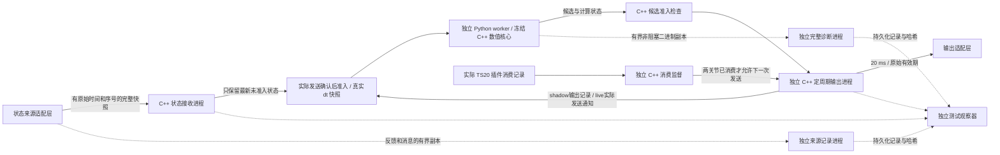

# X650 冻结 MPC 的执行隔离与真机迁移测试方法

更新日期：2026-10-24。本文规定可重复的测试流程、运行时边界及证据等级；[软件隔离测试](validation/isolated_runtime_20261023/README.md)、[历史实际接入记录](validation/isolated_live_20261023/README.md)与[新容器及当前修订记录](validation/isolated_live_20261024/README.md)分别归档。**native 数值版本 `c22078a` 已完成 344/30/388 资格，但 v8/revision 13 的 hold_v20 实际保持因指令年龄达到 64.300 ms 而失败；212 次计算数值成功，224 组发送/消费及退出恢复已核实。当前 revision 14 修订实际发送确认后的准入节拍并增加有界阶段时间记录，已通过构建、47 项 ROS Python、5 项 CTest、6 项审计、传输合同及真实 ROS 进程准入探针。hold21/progress_v5 已启动，完整物理结果待取得，没有新的完整保持或普通八字资格。** 原数值库、v8 任务及数值证明保持不变；此前失败与历史通过按各自身份保留，快速八字继续后置。仿真通过不等于真机可飞。

## 1. 本次修复的对象与冻结边界

普通八字第一次运行在 14.340 s 被 52 ms 控制更新间隔保护终止。前一周期同线程自然第 2 代垃圾回收约 24.786 ms，而 QP 仅约 2.231 ms。状态回调、计算、下发和约 96 KB/周期的诊断序列化共用 Python 执行链，是此次需要拆开的部分。见[完整失败记录](validation/native_figure8_20261023/README.md)。

历史数值库 SHA-256 为 `773241c1a3fe858f9d4b0e60f7f6b7465c6c0b9ef50b4ac1adac8f55590f7fef`；原末端保持任务 SHA-256 为 `f8d96cb8d70b55a9885b4723f5ea614d1978f4e50663921a2e9fe440b4357ae1`。前期运行时隔离没有改动这些绑定。随后 hold_v16 暴露 QP 归一化后提前终止的问题，用户授权修改数值实现；第 9 版因此绑定新的库、任务和完整数值资格证明。控制模型、目标函数、MPC 权重/预测域/限位、TS20 参数、PX4 PID 以及外层 `2e-7` 可行性门限保持不变。第 10/11 版调整地面初始化、就绪与活动阶段的交接；最终第 13 版又将预测准备优化限定在 native 实现，并合并单次诊断复制，独立参考源码恢复原字节，重新绑定完整 344/30/388 后端资格。数值回归与物理闭环分别判定。

独立软件测试仍使用无执行器发布器的 **shadow 路径**。实际接入另用 `x650_isolated_live_v1` 场景及显式 `simulation_live=true` 的 `live_dispatcher`，两者有不同入口和验收记录。历史仿真入口及原数值证明绑定的构造器保留原字节；历史通过证书不会自动转授给新入口。

## 2. 进程与数据边界



| 组件 | 当前实现 | 禁止混入的职责 |
|---|---|---|
| 来源适配 | 软件测试使用 200 Hz 激励；实际仿真使用 PX4 估计和 TS20 完整物理步反馈 | 不把软件激励称为物理响应或动捕实测 |
| 状态接收 | `state_ingress` C++ 进程；最新状态覆盖旧未处理状态；保留接收时刻/来源时刻 | 不等待 Python 求解或记录完成；不能把旧样本重新打成新时间 |
| 算法 | `isolated_node`；原 `ReferenceEngine`、适配器和冻结 C++ 库 | 不接收原始传感器 topic、不承担定时发送、不写大 JSON |
| 输出 | shadow 用 `periodic_dispatcher`；实际仿真用 `live_dispatcher`；20 ms 绝对节拍与发送年龄检查 | 不把重复上一条有效指令算作新的优化结果；无无限续期 |
| 消费监督 | 独立 C++ `consumption_source` 读取实际插件完整物理步，核对两个关节的计数、值和时间 | 不以 publish 返回或新候选已接受替代实际消费 |
| 大诊断 | 同主机私有 Unix datagram；算法诊断和来源反馈分别由独立记录进程落盘 | 不通过可靠记录回执阻塞控制；不能静默忽略丢失 |
| 验收 | 独立观察器、离线复算与原始记录 | 不用“进程还在运行”代替算法或实验通过 |

工作进程交付诊断时只做一次有界二进制复制；数组在下一次计算前即脱离可变对象。JSON 转换、写盘、flush/fsync 在另一个进程。此复制仍需实测耗时，不被当作零成本。单个包上限 196608 字节；满队列、接收者退出或包过大均增加丢失计数并记下首个出错序号。发送次数与持久化行数、首尾序号及 SHA-256 全部对上，记录才算完整。

发送进程使用显式 `rclcpp::WaitSet`，在绝对节拍到达时，先有界读取已经就绪的状态、候选与故障消息，再决定本次输出。它不依赖通用执行器中定时器和订阅回调的先后顺序，也不等待未来候选来延长旧指令的有效期。

时间关键 DDS topic 用有界历史和 best-effort，使诊断观察者不成为可靠交付等待条件；消息丢失由序号和超时检测。选择这个 QoS 不等于证明中间件永不阻塞，仍以实际进程测试记录为准。

## 3. 时间契约与失败语义

每个状态/候选分别保留来源时间、接收时间、算法开始/结束时间、原快照发出时间、计划发送时刻、实际发送时刻和序号。Linux 同机 monotonic 时间用于进程间年龄，仿真时间用于预测模型的 dt；二者不能直接相减，也不能把多机时钟未经同步当作同一时钟。

- 状态提供 200 Hz 激励，准入目标 50 Hz，输出节拍 50 Hz。它们是三个不同指标。
- 一个快照最多在途一次；新状态继续接收，积压状态只保留最新一个。下一次算法 dt 使用实际选中状态时间差，仍受 50 ms 上限限制。
- revision 14 的实际仿真首轮仍等待真实仿真源时间前进至少 20 ms；后续由匹配上一候选的实际发送确认释放一次下一轮求解，再取严格更新的真实状态。后续不再叠加独立的物理时间 20 ms 最小等待，避免发送节拍之外额外等待传感器帧；`dt` 始终等于所选状态的真实时间差。发送确认屏障、单一在途候选和原始 issue 时间保留，重复确认不能释放额外求解。软件 shadow 路径仍按墙钟原规则；年龄、超时及输出调度继续使用同机 monotonic 时间。
- 候选检查仍要求原问题的可行性、KKT、限位、非线性检查、PVA 重构及 50 ms 截止时间。
- 输出有效期从**原快照发出时间**开始，最长 50 ms；重新收到或重复输出不会延长它。
- 同一条指令的第二次发送标记 `repeated=true`，原序号与原时间保持不变。输出周期正常、算法更新变慢、状态已过期会分别呈现。
- 来源已停更、候选过期、准入失败、时钟回退、重复/乱序候选或发送漏期会锁存故障。后续 tick 仍存在，但 `output_valid=false`，消息内不附可执行载荷。
- `RuntimeStop` 只允许结束当前 session/epoch，不能恢复同一已停止 epoch。恢复必须重新建会话和前置状态。
- 正常停止时，最多有最后一个已在途候选算完却未准入，或最后一个已准入候选未赶上输出时刻。它们分别记录，不混入已输出数量；中间序号丢失不能按正常停止解释。
- 软件验证中无效输出只表示“不再可执行”。未来真机适配层还必须实施经台架验证的停止/保持/飞控模式切换；当前没有凭空选定断力或空中悬停策略。

年龄检查发生在实际发送 tick。过期后到下一 tick 的检测延迟仍需记录；不能把“从未在发送时刻发送过期消息”解释成“执行器在有效期结束的同一瞬间就停止”。真机的独立超时监督、总线消费与物理停止时间需另测。

**20 ms 是输出周期，50 ms 是指令从原快照起算的最长寿命，不是另一个输出周期。** 同时保留 50 ms 完整计算及模型 dt 上限，但单次计算短于 50 ms 不保证赶得上可用输出槽：旧指令在等待期间继续变老。故障后不再续发正常 PVA，PX4 暂时保持最后目标，实际行为随后由原恢复流程接管；这个仿真执行契约不等于硬实时停机保证。

当前测试要求调度间隔不超过 40 ms、调度迟到不超过 20 ms；这两个是新执行器测试门槛，未改变原算法的 20 ms QP 预算或 50 ms 完整控制门槛。任何故障用例的“检测通过”都不是轨迹控制通过。

ROS 2 自身并不保证硬实时。动态分配、缺页、中间件和系统调度仍需在目标机测量；相关原则见 [ROS 2 实时系统设计](https://design.ros2.org/articles/realtime_background.html)。PX4 的 Offboard 存活信号与指令新鲜度也不同：维持心跳不能给旧计划续期，见 [PX4 Offboard 文档](https://docs.px4.io/main/en/flight_modes/offboard)。

## 4. 先注册，再执行的测试矩阵

机器可读协议：[`configs/experiments/x650_isolated_runtime_v1.json`](../configs/experiments/x650_isolated_runtime_v1.json)。正式运行前冻结输入哈希、工况、时间、门限、失败策略和报告口径。短时接线检查单独标为 commissioning，不作为 30 s 验收。每次目录必须新建，失败不覆盖、不删掉后重抽样。

| 层次 | 测试 | 主要证据 | 不能据此声称 |
|---|---|---|---|
| L0 冻结身份 | 原数值库、原参数、原证明与源码逐项核验 | 原 30/388 证明哈希 + 本次实际加载 ELF/模块来源 | 本次进行了新的物理实验 |
| L1 数值与边界 | 同一录下的完整状态/上下文/历史输入，独立调用冻结核心；候选门限、重复/乱序、年龄、停止锁存单测 | 全部指令字段差≤1e-7；类型、坐标、不可变记录测试 | 合成状态是可实现的飞行动力学 |
| L2 持续运行 | 30 s 非零时变软件状态，完整记录全部准入候选 | 新输出年龄、输出周期、计算耗时、自然 GC、记录完整性和逐项复算 | 硬实时最坏上界或末端精度 |
| L2-F1 算法停顿 | 第 2 s 对算法进程 SIGSTOP 100 ms | 接收与输出仍运行；旧指令在有效期后被拒绝；故障锁存 | 算法在停顿时仍生成新控制量 |
| L2-F2 短停顿 | 第 2 s 暂停算法 25 ms | 明确恢复或截止时间拒绝；无过期输出；节拍不被拖住 | 所有 25 ms 停顿都不会影响任务连续性 |
| L2-F3 状态停顿 | 第 2 s 暂停来源 120 ms | 状态过期被拒绝，旧状态不会续命 | 断流后物理飞行器已经自动安全停止 |
| L2-F4 记录停顿 | 第 2 s 暂停记录 1000 ms | 控制无等待；队列满可见；记录不完整则不授予实验通过 | 丢失诊断后还能完整验证轨迹 |
| L3 实际接口影子 | Gazebo/PX4/TS20 的真实反馈和实际已发历史构成快照，暂不接管 | 与原读取边界一致、时钟与方向一致、历史可用性和实际消费时间 | shadow 命令已由物理系统执行 |
| L4 仿真闭环 | 新入口完成起飞、预流、接管、30 s 末端保持、退出与恢复 | 原时轴独立末端误差、实际关节与 PVA 消费、完整 ULog、参数恢复 | 真机 24 V 执行器或动捕已标定 |
| L5 任务分级 | 普通 12 s/圈两圈 → 快速 8 s/圈两圈 | 整窗结果、相同冻结算法、全部失败保留 | 部分跑完可冒充整窗通过 |
| L6 目标硬件 | Orin 重放/处理器在环 → 无桨联调 → 初始飞行 | 真实时钟、温度/功耗、接口与停止语义、独立末端观测 | 服务器库原样复制即为真机验收 |

L2 使用非零位置、姿态、关节和速度激励；它没有动力学 plant，不计算或展示末端 RMS。记录中的数值输入逐条重算时只重置传输墙钟用于离线准入，状态、上下文、指令历史、序号和算法参数保持相同。

## 5. 仿真接管前必须实现的适配点

实际仿真使用独立的 live adapter，下面各项均需要本次运行的证据；仅将测试 topic 改名成 `/arm/*` 不构成接管验证。

1. **接收端。** 将 PX4 估计、机体姿态/角速度、估计加速度与 TS20 实际反馈组成同一因果快照；保持原 25 ms 关节年龄门限。Gazebo 真值仅供独立验收与物理边界检查，不能混作算法估计反馈。
2. **命令历史。** `ControlSnapshot` 中的 MIT 参考积分状态、已消费速度命令、已发送 MIT 包，必须来自实际执行端的回报。只录到 ROS publish 返回不表示执行器消费成功。
3. **提交与确认。** shadow 路径以输出序号确认；live 路径以实际执行端发送通知开放下一次采样/计算，并由消费回执约束下一次发送。失效后不再调用下一轮，避免用被覆盖候选继续热启动。实际消费、超时及恢复分别核验，不能把 DDS publish 返回当作总线消费成功。
4. **PX4 编码。** 保留已有 ENU/FLU→NED/FRD 转换、PVA mask、位置基准及零加速度前馈政策。重用目前经检查的 MAVLink 生命周期；切换为原生 DDS 输出是另一个可验收变化。
5. **TS20 下发。** 20 ms 上层输出不是 5 ms MIT 总线节拍。参考积分、编码量化、限位和零速/断流语义放入独立执行端，发送事实回灌算法。
6. **移交。** 起飞/预流、实验接管、故障退出、收臂和降落必须有单一输出所有者与确认。不可让旧 Python loop 与新进程同时写关节或 PX4。
7. **重验。** 接口影子和故障恢复先验收，再在新入口取得新的完整末端保持。历史通过记录不自动覆盖新的执行时序。

这些是进入 L4 的具体验收项。实际路径的机器可读协议为 [`x650_isolated_live_v1.json`](../configs/experiments/x650_isolated_live_v1.json)，独立审计入口为 [`audit_x650_isolated_live.py`](../scripts/audit_x650_isolated_live.py)。只有完整新记录通过审计，才能继续普通八字。

### 5.1 实际接入的生命周期

1. **起飞前构造。** 在参数事务开始前完成数值证明、模型和 PID 核验，并启动算法与诊断进程。构造模板明确标为 synthetic，仅用于加载对象，不运行求解、不形成可执行指令。随后在原参数事务已经建立、但仍 landed/disarmed 且 `strict=false` 的 `on_loop_ready` 阶段，构造共享生命周期所需的 allocator 并缓存；空中只检查配置、模型、PID、循环对象和零步数身份，再附上实际轨迹。原共享流程仍负责用实际锚点 reset，不以构造模板替代真实初始化。
2. **地面通道就绪。** 在同一地面阶段启动 ingress、dispatcher 和 consumption，检查实际 DDS 发布/订阅匹配，包括准入快照、候选、来源状态、消费回执和已有 ROS–Gazebo 关节桥。进程存在或打印 READY 不单独构成接管条件。`LiveStart` 前接收器不准入状态，worker 不求解，执行器不发送正常输出；空闲 dispatcher 必须维持 WAITING。第 11 版将 READY 心跳迟到与活动指令漏期分开：首条真实候选接受后才启动原 20 ms 输出漏期保护，之后不可通过等待或新候选清除故障。消费读取器在实际 `LiveStart` 后启动原 25 ms 新鲜度监督，先读至 EOF 并丢弃该批积压，再由后续新完整行提供消费状态；读操作开始时刻保留为观察时间，不以解析完成后的新时间掩盖积压。`preflight_transport.json` 保存地面状态、零步数、零正常输出及准备起止时间，审计要求其结束早于实际起飞命令与 `LiveStart`。
3. **一次性交接。** 原流程完成起飞和实际预流之后，发布带 session、epoch、配置 SHA 的 `LiveStart`。它用本次真实的参考位置、姿态、目标和已发布五维指令历史替换构造模板；在收到交接之前，算法不能计算或输出。
4. **独占执行。** 活动段暂停旧控制调度，用独立接收 pump 保留原 MAVLink 解析、心跳和完整 `read()` 状态检查；额外 ROS drain 有时间预算，不再每次等满 32 个回调。退出后恢复旧 pump。C++ 执行器继承原来的本机 SITL UDP socket，维持正确源端口；使用同一 LOCAL_NED PVA 编码、固定 yaw、2048 mask 和零加速度前馈。关节命令经已有 ROS–Gazebo 桥进入实际 TS20 插件。
5. **发送与消费分别确认。** 下一轮算法准入须等独立执行端实际发送上一候选，不能只凭候选被接受就前移历史。消费由独立 C++ 读取器根据插件完整物理步日志中的两个 `upper_sequence`、实际命令值和消费时间确认；执行端在下一个发送周期前必须收到两关节消费证据，否则故障退出。优化器不用串行等待消费回执再采样，但其状态、参考积分和包历史仍只取实际反馈，发送通知不会伪装成传感器测量。MAVLink 本地发送返回只证明发送操作完成；PX4 实际收到的目标另用完整 ULog 核对，不伪造逐指令 PX4 ACK。
6. **退出。** 正常结束或异常都发送一次关节零速，核对插件消费，再终止新写入者并恢复原调度，执行收臂、NAV_LAND、解锁解除和参数恢复。缺少零速回执，即便进程已停止，也不授予验收通过。

正常结束时“零速已消费 → 新写者退出 → 原流程恢复”的路径已由历史 hold_v15 完整保持验证。**此前关节指令的消费回执延迟或缺失、随后又发送停止零速**这一边界工况尚未完整验收：累计计数可能越过待确认的上一条记录，不能因此推定停止零速也获得了有效确认。它也可能发生在正常任务结束时，条件是末条普通命令仍待确认；无缺失且及时消费的健康结束不会必然触发。当前实现缺少零速回执时会拒绝本次验收，并先终止新写者再恢复原流程。该边界必须另做故障注入，当前证据不构成真机停止或故障退出资格。

来源适配目前仍在独立于求解、定时输出和大诊断进程的 Python 生命周期进程内，复用原 PX4 估计与 TS20 因果状态校验。它不是已经全部迁入 C++ 的原始传感器驱动。来源卡顿仍受 25 ms 年龄保护；其耗时必须与求解和输出节拍分开报告。

活动段的 20 ms 绝对发送相位由首条通过检查的候选一次性锚定，空闲 READY 时的 tick 不决定接管相位。后续候选不能移动这个相位，也不能延长旧指令的 50 ms 有效期。新鲜来源到达或实际发送通知触发状态准入，1 ms 超时检查不再选择一个即将被新状态替换的旧快照。早期接线版本将消费确认和更新状态都串行放在下一次计算之前；实际记录显示它造成相位等待和旧指令过期，因此调整为异步消费监督。下一次**发送**仍强制要求上一次消费已确认，这项约束未放宽。

revision 14 进一步明确计算准入的单次释放语义：首轮满足 20 ms 真实状态时间后才计算，后续须收到上一候选的匹配实际发送确认，才能取已收到且严格更新的状态；不要求该状态是在发送通知之后才采样。发送确认只释放一次，模型使用实测 `dt`，不补造状态、不刷新旧状态 issue 时间，也不将未发送候选加入已执行历史。定周期输出仍为 20 ms，实际状态年龄和 50 ms 寿命保护保持。

### 5.2 证据及复算

新运行保存实际 `LiveStart`、原始快照/候选 CDR、C++ 下发记录、两个关节的消费回执、原始 TS20 状态/总线日志、PX4 ULog、Gazebo 独立物理末端记录，以及源码 ZIP 和实际执行二进制哈希。来源反馈及 ROS 输出/回执通过第二个独立记录进程落盘；来源进程仅保留每类消息的最新值，不再累积反馈字典与 ROS 消息对象图。两条记录通道都使用有界非阻塞二进制副本，分别核对发送计数、丢弃计数、连续序号与持久化哈希；降落后才生成便于审查的 JSON 视图。自然 GC 策略和原有状态年龄限制保持不变。

审计将每个已发关节计数与原始插件行逐项匹配；由实际下发记录和对应原始快照构成单独标注的审计视图，用于复用已验证的 PX4 PVA/内部速度目标检查，不替换原始控制日志。全部准入快照再次调用相同冻结核心，只有传输用 monotonic 时间基准重新赋值，数值状态、上下文、命令历史及实际 dt 均不改动。失败记录保留，且不会因退出过程正常而被标成末端保持通过。

revision 14 增加两份退出后写盘的有界时间记录：C++ ingress 预留内存观察状态、准入、候选门和实际发送释放；worker 用预分配标量缓冲观察引擎返回、publish 起止、CDR、pickle/socket 及回调退出。活动回调不为这些记录写 JSON，缓冲溢出明确使证据不完整。候选先发布再进行诊断复制的原顺序不变；新增观测不能被解释成发布开销已经消除。审计按原 CDR 的序号、session/epoch、issue/compute 时间和实际发送释放序号交叉核验，检查真实 `dt`、阶段顺序、缺失与重复；只允许正常结束时最多一个已完成但尚未到门的尾候选。跨进程消息可能在 publish 返回前到达，不能通过强行对齐或重写时间制造顺序。

### 5.3 历史通过、失败记录与当前重新资格化

历史 hold_v15（执行协议第 7 版、原数值库）的完整保持窗口为 30 秒。独立 Gazebo 物理末端在原世界坐标和原时间轴上的三维位置误差 RMS 为 **2.82782 mm**，峰值 **4.89075 mm**。全部 **1490 次**算法输入独立重放后，所核对指令字段的最大绝对差为 **0**。这些数值只属于该完整记录，不代表当前第 14 版已经通过。

实际执行记录包含 **1500 组双关节命令**，其中包括最终停止零速，共 **3000 条单关节命令**，均与原始插件消费计数、数值和时间匹配；**1499 次 PVA 下发**按实际记录与 PX4 ULog 核验。PVA 本地发送返回和 ULog 中的目标记录仍是分开的证据，不表述为 PX4 的逐条消息 ACK。起飞、预流、独占接管、完整保持、正常退出、降落解除解锁及参数恢复均纳入此次审计。

执行协议第 7 版首次记录、并在第 8 版保留了本次服务器的进程资源分配：来源 CPU 17，worker 可用 CPU 87/89/91/97，下发 CPU 93，准入 CPU 94，消费读取 CPU 95；其 SMT 同胞从本任务背景仿真进程的 CPU 集合中排除。仅设置本任务进程亲和性，没有修改宿主调度策略或宣称独占宿主核心。这是本次服务器上的已记录运行条件；Orin 必须另选并测量资源方案。

首次普通八字在约 3.75 秒因原指令期限保护退出，未获得完整轨迹资格。工作进程最后一轮包含 11.53 ms 的 gen2 GC。第 8 版将构造后的显式完整回收放在 READY 与起飞前，保留运行中的自动 GC、阈值和回调；不进行预飞求解、不修改控制器状态。这是执行层变化，必须重新完成保持，再进入普通八字；不能直接沿用第 7 版通过记录。

第 8 版的 hold_v16 随后在约 28.38 s、第 1416 次求解时于 QP 原始行可行性检查处失败，1415 次候选已接受。它不能归因为 GC，也没有保持通过。已定位的原始行违反量为 `3.270557920181938e-7`，对应白化后行范数约 `4.98172`；归一化违反量约 `6.565e-8`，低于原求解器聚合终止阈值 `7.6189e-8`，使求解器提前返回。独立外层 `2e-7` 门限正确拒绝了这次候选。

第 9 版在不改变约束和代价的前提下，增加每个原始不等式 `1e-10` 的内部收敛要求，归一化时同步变为 `1e-10 / row_norm`。返回结果须同时通过该逐行要求与原聚合条件；搜索耗尽或非有限松弛量均抛错，原内外迭代上限和外层可行性/KKT/非线性检查保留。这是数值实现变化，不是把外层门限放宽。完整软件回归现已取回并逐项核验来源哈希：339 项测试无失败/错误/跳过、30/30 冻结工况通过、388/388 原记录通过。见[当前数值证明和原样报告](validation/isolated_live_20261024/README.md)。

最终数值库 SHA-256 为 `b9cbdf78c76e92f973800e07c6219611759fcb4471a1a39192c5cbf30f5e2e48`；随后 hold_v19 使用的 v6 保持任务 SHA-256 为 `3759184e2e9086e032cecc680dab7da7391d0b56309fb82fc88bf2644c1e36e1`，不是当前 v8 任务身份。同一故障输入复算得到零原始行违反量，独立复核的 KKT 残差约 `2.78e-17`；16 项针对性 native 测试（含 12 个子场景）和随后完整回归已通过。数值资格与完整物理保持资格仍分别判定。

新容器 `autodl-container-edeb42a3f7-c2d98427` 可见 128 个逻辑 CPU（0–127），cgroup `cpu.max=1200000 100000` 表示 12 核时间配额。原角色 CPU 均仍有效，背景集按新宿主的 SMT 拓扑重新生成；不复用旧容器的背景编号列表。新容器重新执行 30/30 相同工况均通过，其中 `native_uninstrumented_ms` 最大为 **23.378 ms**。这是有限样本的软件计时，不是 20 ms 周期无漏期或实时最坏上界证明。

第 9 版 hold_v17 在进入 `activate` 的第一次 pump 因约 56 ms 的实际控制间隔退出，尚未形成新的完整保持。记录定位到上一 pump 返回至当前 pump 进入之间有 **34.052 ms 墙钟、30.685 ms 同线程 CPU** 的同步工作；其中重复数值证明哈希核验离线复现耗时约 24–26 ms，随后还有三个传输进程启动。这是交接边界上的同步初始化停顿，与 hold_v16 的 QP 可行性失败不同。失败运行已安全恢复，未将片段计作通过。

第 10 版将上述 allocator 构造、证明核验、三进程启动及 DDS 就绪等待前移到地面；实际参考和历史仍由起飞后的同一次 `LiveStart` 注入。新增 7 项地面准备测试及 4 项审计测试通过，未改数值库、控制参数或活动时间门限。但随后 hold_v18 在地面准备未完成时失败：消费读取器报告 `Consumption reader polling gap exceeds 25 ms`，元数据为 `complete=false`、`Isolated consumption exited 1`；没有任务时间原点、起飞状态转换或 `LiveStart`，记录含 377 个 WAITING tick、0 次执行发送，未进入 MPC。参数已恢复，运行时已关闭；不能把未起飞直接退出写成“降落验收通过”，其 `landed_and_disarmed` 字段为 false。

消费读取器在 READY 后约 12 ms 报错；原检查计时从前一次 poll 的入口起算，那一轮还包含历史 CSV 解析、DDS 图查询和 ready 文件写入。当前没有这些操作分别耗时的剖析证据，因此不能断言其中哪一项占主导。独立复查还发现 dispatcher 在无可执行命令的 WAITING 状态也会锁存 20 ms 漏期。这两项属于 READY 与 ACTIVE 生命周期未区分，初始化成功率不能靠反复重试来认定。

第 11 版保留地面缓存构造，并将消费监督从真实 `LiveStart` 起算，增加 EOF 积压清除和后续新完整行屏障；dispatcher 的执行漏期从首条接受候选开始。活动阶段原 20 ms/25 ms/50 ms 门限、故障锁存、STOP 优先及候选检查均保留。服务器已完成 C++ 包构建（41.3 s）、CTest 5/5 和地面准备 Python 7/7；此前本地审计负向测试 4/4 通过。`transport_v10` 取得 7 次发送、7 次回执及停止零速确认，活动输出间隔为 19.991–20.078 ms。构建包装脚本末尾的旧 `transport_v9` 探针因缺少 DDS 端点失败，故包装脚本退出码仍为 1；同步 Git 中已修好的正式探针后 `transport_v10` 才通过，不能把整份包装脚本表述为无差错完成。

实际 ROS 消费读取器的软件探针 2/2 场景通过：READY 暂停 81.054 ms 无输出且可恢复，ACTIVE 暂停 80.205 ms 按原 25 ms 间隔保护退出 1；错误配置哈希退出 1 且零输出。它使用合成 CSV，没有 Gazebo/PX4 或执行器 I/O，验证的是生命周期与拒绝语义，不是物理轨迹精度。7 份原样证据的字节数、来源路径及 SHA-256 见[初始化证据清单](validation/isolated_live_20261024/startup/manifest.json)，具体构建与探针结果见[当前记录](validation/isolated_live_20261024/README.md)。

hold_v19（启动标识 `20261024_111153_4885`）已完成地面准备、起飞和真实接管，`LiveStart` 原点为 41.164 s，随后因 `STALE_COMMAND`（reason 1）退出，`complete=false`。活动 tick 中候选 1 的年龄由 26.209 ms 增至重复发送时的 46.289 ms；候选 2 在年龄 44.224 ms 时发送，下一个槽已达 **64.220 ms**，原 50 ms 寿命保护正确拒绝继续发送。记录包含 3 次正常发送（含一次重复）、4 次总发送（含最终停止零速）、4 次消费回执及 2 次候选门接受；不能把 worker 的 3 次成功计算算作 3 个不同指令均已执行。

同次 worker 完整计算耗时为 **22.874/22.468/21.412 ms**，没有 gen1/gen2 GC，gen0 回收仅约 57/68 µs；source pump 最大 **4.856 ms**，来源保持新鲜。实际计算记录与输入身份见[worker 分析报告](validation/isolated_live_20261024/preparation/worker_analysis.json)。本次时序失效来自稳态调度链的时间预算：下一次求解必须等上一次候选实际发送，计算超过 20 ms 后容易等待第二个输出槽，旧指令年龄随之越过 50 ms。首条候选重锚相位、单次计算低于 50 ms、源状态及时更新，都不能单独保证连续有效输出。必须分别核验计算完成时间、实际发送槽和原始快照年龄；不能靠删除实际提交栅栏或刷新旧指令时间制造通过。

本次故障后 `zero_consumed=true`、`writer_exited=true`、`landed_and_disarmed=true`、`diagnostic_parameters_restored=true`、`runtime_closed=true`，已完成停止和恢复。这些是本次短运行的退出证据，不是完整保持或所有故障停止场景的资格。后续追加的[原样失败报告](validation/isolated_live_20261024/startup/hold19_failure.json)保存来源哈希，单独身份见[当前验证记录](validation/isolated_live_20261024/README.md)第 5 节；它不在最初 7 文件初始化清单中，原清单不变。

`NativeJointMatrices` 的未来 MIT 包批量构造及相关预测准备先取得有限范围的[离线性能和数值对照报告](validation/isolated_live_20261024/preparation/preparation_optimization_v2.json)：用 hold_v19 的 3 条原始快照顺序重放，每组重新 reset；该报告的完整调用计时不插桩，保持原 CPU 87/89/91/97，使用 20 ms 绝对计划时刻且迟到不重锚。报告的 18 次优化后完整 worker 调用为 **12.254–19.107 ms**，核对矩阵和命令的最大绝对差均为 0。**这些数据属于曾改动共享预测器的中间版本，仍使用旧双复制 adapter，没有包含下面的单次复制优化，不作为最终实现的计时绑定，也不是 Gazebo 活动负载下的完整保持结果。** 新解释器构造后空闲 0.5 s 不等于清除 CPU 缓存，同进程后续序列也重新构造算法状态；不能把短期最大值写成实时上界。

诊断复制另作独立优化：公共 adapter 默认深复制行为保留，仅 live 保持/八字构造器在求解前选择一次拥有 allocation 快照。外层 diagnostics 和 allocation 内层 diagnostics 使用不同字典，避免自引用；单步内部只共享只读使用的已拥有子树，不与控制器或其他步骤共享。原 worker 读取后，在下一回调前同步 pickle 为不可变字节，未引入可变对象的异步记录队列。新增 11 项历史隔离/无环/字段和值一致/双入口测试，连同 ROS Python 共 39/39 和原 adapter 9/9 在本机通过；[最终复制微基准](validation/isolated_live_20261024/preparation/ownership_copy_final.json)的合成诊断树复制中位耗时为 1145.2534→564.5442 µs。这只是复制边界的测量，不能直接从前述离线 worker 时间减去该差值，推定组合系统必然达标。

4 份原样小报告共 21921 字节，包含上述 worker 分析、数值准备报告及两份具有各自源码身份的复制报告；[清单](validation/isolated_live_20261024/preparation/manifest.json)保存原路径、字节数和哈希，未搬运大矩阵或原始 CDR。早一版复制报告作为历史观察保留，不替代最终实现身份。

deployment_v24 的服务器 ROS Python 39/39 已通过，首轮 `preparation_replay_v1` 仅 **386/388**：index 10 的 native 带插桩调用 51.281 ms、index 58 的 reference 带插桩调用 53.334 ms，超过原 50 ms 门限；记录为时间拒绝而非数值差异，但仍是未通过的回放，不能忽略或覆盖。第二轮 `preparation_replay_v2` 仅将资源绑定改为实际 worker CPU 87/89/91/97，源码与门限不变，取得 **344 项回归、30/30 矩阵、388/388 记录全部通过**。这些属于中间版本资格；最终源码范围收窄后又完成下述 v3 回归，没有把 v2 证书转授给新源码。

后端资格通过后已准备 v7 任务和 revision 12。`merged_engine_v1` 实际预检检查到共享 `ts20_prediction.py` 字节已变化，原 8 工况关节预测器证书的 `candidate_sha` 与新源码不符，因此拒绝准入。**这次停在预检，未起飞，不是飞行失败。** 后端回归和共享预测器独立验收是两项不同证据；不能仅更新旧证书哈希来让它通过。

随后 `preparation_oracle_v1` 对当时的新共享预测器实际重跑原 8 个工况，8/8 通过；该证据属于中间源码，不能作为最终版本资格。为避免同时改变原 hover/probe 的来源身份，最终将批量 `_rollout_native` 放入 `NativeJointMatrices` 专用 override，恢复独立参考 `ts20_prediction.py` 原字节，SHA-256 为 `f25e45d755c236cd46c0e4fd2e11fb23fe926bc1b7e286dd87c9ac03414b7b66`。没有修改旧证书、传播模型、native 二进制库或控制参数；v7/`merged_engine_v1` 预检拒绝与中间 8 工况结果仍原样保留。

最终源码已提交为 `c22078a`，服务器以最终 native 实现及单次诊断复制重新执行 **ROS Python 39/39、344 项软件回归、30/30 矩阵工况、388/388 原记录，全部通过**。13 份服务器原样报告的路径、字节数及哈希见[最终证据清单](validation/isolated_live_20261024/final_preparation/manifest.json)，[资格日志](validation/isolated_live_20261024/final_preparation/qualification.log)保留完整汇总。最终 native 证明 SHA-256 为 `f07527f471e3a0c272ac5b916c73f52e9ac7be55732f11cb9731a61dbf3a26fb`；[v8 保持任务](validation/isolated_live_20261024/final_preparation/hold_task.json) SHA-256 为 `9ef8c12c6a9591bdc80660710b0de25f8589defdf12b0362f9109444ff64cc4c`，绑定[revision 13 协议](validation/isolated_live_20261024/final_preparation/protocol.json)。

[合并引擎离线回放](validation/isolated_live_20261024/final_preparation/merged_engine.json)包含最终 native 实现和 `owned_allocation_once_v1`，在 CPU 87/89/91/97 上 6 次调用全部成功，完整计算为 **12.739778–18.463390 ms**，命令最大绝对差为 0。两组各 3 次分别使用空闲 0.5 s 后的新引擎和第二个新引擎，只重新绑定配置身份与离线 monotonic 寿命基准。报告明确 `no_flight=true`，小样本计时不能替代实际仿真负载下的全窗口验收，也不是实时最坏上界。

**hold_v20（启动标识 `20261024_113454_7214`，运行目录 `x650_isolated_live_v1_20261024_113542_7216`）实际失败，未完成 30 秒保持。** 真实任务原点为 41.632 s，最后 worker 输入任务时间为 4.444 s；212 次计算全部数值成功、无 QP 拒绝，但只有 211 条候选门接受记录。完整计算的 p50/p95/p99/最大值为 **13.672671/17.823232/21.127434/22.521692 ms**，QP 中位/最大为 **0.374779/3.431521 ms**；计算更快仍未保证整个发布及输出链按期完成。

第 211 次计算耗时 14.368327 ms，计算完成至候选门收到结果额外经过 **7.221433 ms**，错过 tick 3396 的输出槽；tick 3397 才执行该候选，快照年龄已经 44.298550 ms。tick 3398 旧指令年龄达到 **64.300282 ms**，以 `STALE_COMMAND`（reason 1）拒绝继续输出；第 212 次完整计算 21.276403 ms，完成时已比故障晚 2.460933 ms，未进入候选门或执行端。该额外间隔涵盖 worker 发布、消息交付及调度等待，当前证据尚不能确定哪一项占主导。活动段只有 8 次 gen0 GC，最大 75.447 µs，无 gen1/gen2；故障时来源仍满足原 25 ms 年龄要求。

[本次独立失败核验](validation/isolated_live_20261024/hold20/failure_report.json)逐项比对了 224 组发送与 224 组回执，以及原 TS20 消费计数、命令值和时间：223 组正常发送（含 12 次重复）与 1 组停止零速，对应 448 条单关节命令，两关节计数均为连续 1230–1453。3398 条原发布记录未发现接管区间内旧所有者输出重叠。最终零速确认后新写者退出，末次飞行采样已落地且解除解锁；56 项参数原始值/类型读回一致并同步保存，6 个自有进程退出码均 0，运行时已关闭。原样文件归档、派生时序分析及未搬运大文件的原路径/哈希见[hold20 证据清单](validation/isolated_live_20261024/hold20/manifest.json)。

这些结果证明本次失败链和退出恢复，不替代完整保持、PX4 全窗 ULog、物理末端精度或所有 pending-zero 故障场景的验收。后续 revision 14 的实际发送提交语义、20 ms 输出周期和 50 ms 寿命保持，执行层修改须重新绑定并验收。hold_v19/hold_v20 均保留失败状态，新保持通过后才执行普通八字完整 32 秒，快速八字继续后置。

### 5.4 revision 14 执行准备已完成，hold21 结果待取得

本次只调整上述准入节拍和阶段时间观察，native 数值实现仍为 `c22078a`，数值库 SHA `b9cbdf78…`、v8 任务 SHA `9ef8c12c…`、数值证明 SHA `f07527f4…` 均未变。344 项回归、30 个矩阵工况和 388 条记录继续使用已经归档的对应资格；没有把本次执行层测试重复计为重新执行这组数值验收。

服务器 `build_v26.exit=0`，两个包构建汇总 40.5 s，CTest **5/5**、ROS Python **47/47** 通过，见[构建原日志](validation/isolated_live_20261024/execution_v14/build_v26.log)。阶段时间审计 **6/6** 通过，包含时间/序号篡改、重复/缺失、溢出与单个尾候选边界，见[审计测试日志](validation/isolated_live_20261024/execution_v14/execution_audit_v26_test.log)。[安装核对](validation/isolated_live_20261024/execution_v14/installation_v26.json)确认 9 个已安装模块与部署源码字节一致，并绑定 revision 14 协议和二进制；`state_ingress` SHA-256 为 `b4f22c6a4fe1078d83680b0b5606b45194e0cb316a57f95d5acac1c40761d8fe`。

[transport_v11](validation/isolated_live_20261024/execution_v14/transport_v11/report.json) 软件合同通过，7 次发送、7 次回执及停止零速确认，活动输出间隔 19.999414–20.057059 ms；报告明确没有物理 plant。[admission_probe_v1](validation/isolated_live_20261024/execution_v14/admission_probe_v1/report.json) 在真实 ROS 进程上使用同一 ingress 二进制，证明首轮 16 ms 不准入、后续 16/20/24 ms 状态间隔与原 issue 时间保真，并通过错误/重复 ACK 及未发送不推进检查，子进程退出码 0。该探针使用合成状态/ACK，明确不具有物理飞行资格；入口为 [`probe_x650_ingress_cadence.py`](../scripts/probe_x650_ingress_cadence.py)。部署清单及上述报告共 6 份、26126 字节，服务器原样副本及 SHA-256 见[revision 14 证据清单](validation/isolated_live_20261024/execution_v14/manifest.json)。**hold21/progress_v5 已启动，完整物理结果待取得；这些执行准备检查不表示新的实际保持通过。**

后续普通八字使用 [`x650_isolated_figure8_v1`](../simulations/x650_isolated_figure8_v1/README.md)，沿用冻结算法和参数，采用 X±0.25 m、Z±0.10 m、12 秒/圈两圈的原解析参考，总窗口 32 秒。入口额外核验本次完整 live 保持证书及原始证据，再将实际 LiveStart 中心绑定到同一条算法前瞻/目标参考。该入口和门槛已建立，**普通八字结果尚待验证；快速八字仍未准入**。目标机和异常退出边界另行测试，不因普通轨迹入口存在而自动通过。

## 6. 真机迁移的可替换部分

| 边界 | 当前仿真 | 后续真机 | 保持共同的测试 |
|---|---|---|---|
| 算法输入 | PX4 精密 EV 估计 + 仿真 TS20 状态 | PX4 估计/动捕适配 + 舵机真实反馈 | 帧、单位、原时间戳、乱序/缺失、状态年龄 |
| 末端独立评价 | Gazebo 原始物理末端 | 末端动捕标记，与机体动捕+关节 FK 分开 | 原时轴误差、外参/角度误差、时间偏置 |
| 算法库与预测准备 | native 实现已重验 344 项回归、30 个矩阵工况和 388 条记录；独立参考预测器保持原字节；v8/revision 13 实际保持因指令超期失败，运行时修复后须再验收 | 在 Orin aarch64 重新构建和测量 | 矩阵工况、记录重放、独立预测器验收、数值容差与候选分类 |
| 计算环境 | 服务器普通 Linux 容器 | Orin NX 实际 JetPack、功耗/散热、通信负载 | 计算/周期/年龄、缺页、自然 GC、长时统计 |
| 飞控输出 | 现有 PX4 SITL/MAVLink | 实际 PX4 固件与串口/网络/DDS 适配 | PVA 语义、模式/参数读回、接管和失联行为 |
| 关节输出 | 条件 TS20 plant、5 ms MIT 模型 | TS20-50、24 V、最终线束与驱动 | 符号、零位、MIT 编码、回执、位置积分和停止 |

用户已确定 TS20-50 与 24 V。当前来源模型的台架条件为 20 V；本次运行时改造不会产生新的 24 V 带载辨识证据。电机增益、摩擦、负载、热态与通信周期需要后续实际响应记录。Orin 系列型号、最终功耗档及动捕 SDK 尚需落地时确认，当前不以猜测固定它们。

迁移保留的是接口契约、任务协议、故障注入方法、数据格式和判定程序。更换平台要重新绑定构建产物和计时证据，不把 x86 的耗时数值、库二进制或仿真观测精度直接移植为真机指标。

## 7. 与 NMPC 的衔接

先比较同一个五维速度接口下的 QP MPC 与 NMPC：共同状态、真实执行历史、预览时间、约束、PID、故障处理和试验轨迹，只替换算法插件。相同接口同时记录成功候选率、过期率、整窗末端误差与恢复行为；不能只比较“算出结果时的误差”。

全身力矩级 NMPC 另立接口与动力学验收，因为改变了控制权限和模型。先前用户确定的顺序“上层 MPC，再全身 NMPC”继续保持。详细研究测试族见[真机前路线](X650_REAL_FLIGHT_READINESS_AND_NMPC.md)。

## 8. 重复执行入口

已有 ROS Humble 和 px4_msgs 环境，使用独立 build/install 目录构建 `ros2_ws/src`。以下命令是原库的软件隔离复现示例，只对应历史协议；后续版本必须使用本次数值后端与共享预测器验收共同绑定的任务和库，不能将原文件名、hold_v19 的 v6 身份或任何旧证书当作新版本准入。

```bash
source /opt/ros/humble/setup.bash
source /root/autodl-tmp/ros2_px4_ws/install/setup.bash
source /root/autodl-tmp/flyarm_ros2_isolated_v1_20261023/install/setup.bash
cd /root/autodl-tmp/safe-aerial-manipulator-testbed
env OPENBLAS_NUM_THREADS=1 OMP_NUM_THREADS=1 MKL_NUM_THREADS=1 \
  /usr/bin/python3 scripts/run_x650_isolated_runtime.py \
  --task-config artifacts/native_numerics_20261023/quiet_task_cpp_v5.json \
  --output artifacts/isolated_runtime_20261023/new_healthy_run \
  --case healthy --domain-id 201
```

其余 `--case` 为 `worker_pause`、`worker_short_pause`、`source_pause`、`recorder_pause`。每次换新目录；`--commissioning` 明确只做 3 s 接线检查。测试只管理自己的进程组和私有 socket；完成后核对无残留子进程。原始完整诊断留在服务器，仓库纳入较小的判定报告、来源哈希和关键图。
