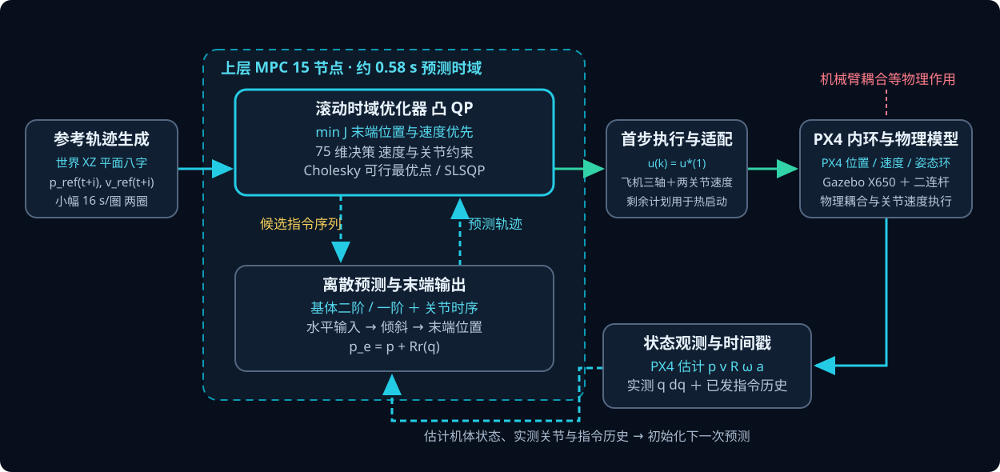

# 新版八字实验 MPC 公式与架构（实验前冻结定义）

版本依据：`d2c24a0`；控制协议：`mixed_response_prediction_chain_v2`；日期：2026-10-22。

**本文件保留八字实验前冻结的控制定义，不用后续成绩改写公式和参数。** 编写时 X650＋原二连杆已通过新版完整末端保持；后续八字状态与性能结论见[八字实验阶段结果](X650_FIGURE8_RESULTS_20261022.md)。本轮沿用精密定位、已验收的基体响应参数和原 PX4 PID；两组实际发送的加速度前馈均为零。详细保持结果见[已完成的验收报告](X650_PREDICTION_CHAIN_RESULTS_20261022.md)。

## 1. 架构与控制边界

主链为：**末端八字参考 → 上层协同 MPC → 首步五维速度指令 → PX4 飞机内环与关节速度执行 → Gazebo 中的 X650＋二连杆 → 估计状态和关节反馈**。MPC 内含两条预测链：①飞机速度命令经已辨识闭环响应产生速度、加速度，再通过姿态几何预测末端；②关节命令结合历史、源时间戳和管线延迟产生实际角速度预测，再积分得到关节位置。

架构中的“控制反馈”和“验收记录”承担不同职责：控制器使用 PX4 估计状态和带源时间的关节反馈；精密 EV 模式由 Gazebo 真值生成位置／速度外部观测，辅助 PX4 EKF，因此整个反馈链并非完全不使用真值。独立物理记录另用于检查真实末端位置、关节运动和预测一致性，不直接替代控制器状态或在线修正其误差。精密模式改善位置观测条件，但不会自动消除全部姿态估计误差。预测误差与最终物理跟踪误差分别记录，不能互相代替。

优化器同时调整飞机三轴速度和两个关节速度，以末端位置为共同任务。它是上层有限时域协同 MPC；PX4 仍负责飞机底层稳定。机体姿态由预测加速度与实测姿态残差构成，未作为独立自由变量优化；输入中也没有总推力、机体力矩或关节力矩。全身刚体动力学 NMPC 属于后续阶段。

| 符号 | 含义与单位 |
|---|---|
| $p,v,a$ | 机体参考原点在世界 ENU 系的位置、速度、加速度，m、m/s、m/s² |
| $R,\omega$ | 机体 FLU 到世界 ENU 的旋转矩阵、机体系角速度，rad/s |
| $q,\dot q$ | 两个关节的反馈角度、角速度，rad、rad/s |
| $r(q),J(q)$ | 机体系末端位置及其关节雅可比，m、m/rad |
| $t,t_s,\delta_{age}$ | 当前状态消费时刻、关节源时刻、两者之差，s |
| $u_i,h_i$ | 第 $i$ 个预测区间的命令及区间长度 |
| 上标 $ref,nom,c$ | 末端任务参考、名义分配参考、执行命令 |

## 2. 状态、输入与八字参考

预测状态与输入分别为 12 维和 5 维：

$$
x=[p_x,p_y,p_z,v_x,v_y,v_z,q_1,q_2,\dot q_1,\dot q_2,a_x,a_y]^T,
\qquad u=[v_x^c,v_y^c,v_z^c,\dot q_1^c,\dot q_2^c]^T.
$$

每轮还接收 $R,\omega$、实测世界系加速度、时间戳和近期实际发送的命令；水平加速度状态直接取观测值，不用位置差分补造。

小幅八字在世界 XZ 平面，中心 $p_c$ 由实际任务锚点确定：

$$
p_{tip}^{ref}(t)=p_c+[A_x\sin\phi(t),\ 0,\ A_z\sin2\phi(t)]^T,
\quad A_x=0.075\ \mathrm m,\quad A_z=0.03\ \mathrm m.
$$

配置为匀速段标称周期 $T=16$ s、两圈、起始等待 2 s、首尾各 2 s 相位加减速。有效轨迹时长为 $2T+2=34$ s，轨迹窗口为任务时间 $[2,36]$ s，不能把它写成 32 s 匀速截断。

令 $s=t-2$、$\Omega=2\pi/T$、$r=2$、$D=34$，并定义 $F(\xi)=2.5\xi^4-3\xi^5+\xi^6$。相位为：

$$
\phi(s)=\begin{cases}
0,&s\le0,\\
\Omega rF(s/r),&0<s<r,\\
\Omega(s-r/2),&r\le s\le D-r,\\
4\pi-\Omega rF((D-s)/r),&D-r<s<D,\\
4\pi,&s\ge D.
\end{cases}
$$

参考速度和加速度从上述相位解析求导：$v_{tip}^{ref}=p_\phi\dot\phi$，$a_{tip}^{ref}=p_{\phi\phi}\dot\phi^2+p_\phi\ddot\phi$。MPC 预览未来完整轨迹；计算参考加速度不代表向 PX4 发送加速度前馈。

## 3. 飞机闭环响应预测

水平通道采用已经训练并通过独立验证的二阶速度响应，对 $j\in\{x,y\}$：

$$
\dot p_j=v_j,\quad \dot v_j=a_j,\quad
\dot a_j=\omega_{n,j}^2(v_j^c-v_j)-2\zeta_j\omega_{n,j}a_j.
$$

垂直通道为一阶速度响应：

$$
\dot p_z=v_z,\qquad \dot v_z=(v_z^c-v_z)/\tau_z.
$$

| 参数 | 冻结值 |
|---|---:|
| $\omega_{n,x},\zeta_x$ | 2.8471958701784543 rad/s，0.695123475648465 |
| $\omega_{n,y},\zeta_y$ | 2.7956770526957433 rad/s，0.69189021293641 |
| $\tau_z$ | 0.19588596825267549 s |

每个常值输入区间采用精确零阶保持：

$$
x_{b,i+1}=A(h_i)x_{b,i}+B(h_i)u_{b,i},\qquad
\begin{bmatrix}A(h)&B(h)\\0&I\end{bmatrix}
=\exp\!\left(h\begin{bmatrix}A_c&B_c\\0&0\end{bmatrix}\right).
$$

这是原 PX4 内环下的闭环等效响应，不是直接建立旋翼空气动力学。后续改变 PID、执行接口或物理模型时，应重新检查该模型的适用性。

## 4. 关节命令、实际速度与角度传播

$$
\delta_{age}=t-t_s,\qquad
q(\tau)=q(t_s)+\int_{t_s}^{\tau}\dot q_{exec}(\sigma)\,d\sigma.
$$

积分起点保留实测 $q(t_s),\dot q(t_s)$。历史命令与未来候选命令分别在“该命令的控制消费时刻＋$d_q$”切换，期间保持常值。候选延迟 $d_q=0.024$ s，从旧日志的消费到物理响应关系选定；它包含计算、发送和执行管线，尚不是独立辨识的物理伺服时间常数。

先传播至当前时刻，再传播至各预测节点和命令切换点。对归一化决策 $z$，结果为仿射形式：

$$
q(\tau)=\bar q(\tau)+Q(\tau)z,\qquad
\dot q(\tau)=\bar{\dot q}(\tau)+D_q(\tau)z.
$$

本版本补偿范围是关节执行管线与关节测量年龄；没有增加关节一阶惯性，也未做基体显式命令延迟补偿。

## 5. 加速度、姿态与末端输出

预测加速度取 $\widehat a=[a_x,a_y,(v_z^c-v_z)/\tau_z]^T$。令 $g=9.8$ m/s²：

$$
b_3=\frac{\widehat a+ge_3}{\|\widehat a+ge_3\|},\quad
b_{1c}=[\cos\psi,\sin\psi,0]^T,\quad
b_2=\frac{b_3\times b_{1c}}{\|b_3\times b_{1c}\|},\quad
R_T=[b_2\times b_3,\ b_2,\ b_3].
$$

当前实测姿态与推力方向模型的残差 $\eta_0=\operatorname{Log}(R_T(a_0,\psi_0)^TR_0)^\vee$，其中 $a_0$ 是当前反馈提供的实测三维世界系加速度，不能把其 Z 分量替换为候选命令产生的预测 $(v_z^c-v_z)/\tau_z$。残差按 $\tau_R=0.15$ s 衰减：

$$
\widehat R(\tau)=R_T(\widehat a(\tau),\widehat\psi(\tau))
\operatorname{Exp}([\eta_0e^{-\tau/\tau_R}]_\times),\quad
\widehat\psi(\tau)=\psi_0+\tau_R(1-e^{-\tau/\tau_R})\dot\psi_0.
$$

$\dot\psi_0$ 从实测机体系角速度与姿态换算。该近似描述稳定直立飞行域的姿态输出；求解时会检查推力方向几何奇异情况。

令 $\theta_1=q_1+\beta_1$、$\theta_2=q_1+q_2+\beta_2$，模型的安装位置 $r_m$、固定肘偏置 $r_e$、长度 $\ell_1,\ell_2$ 和角度零位 $\beta_1,\beta_2$ 来自已导入模型：

$$
r(q)=r_m+r_e+
\ell_1[\cos\theta_1,0,-\sin\theta_1]^T+
\ell_2[\cos\theta_2,0,-\sin\theta_2]^T,
$$
$$
p_{tip}=p+\widehat Rr(q),\qquad
v_{tip}=v+\widehat RJ(q)\dot q+\dot{\widehat R}r(q),\qquad J(q)=\frac{\partial r}{\partial q}.
$$

因此机体倾斜对末端位置和速度的影响都进入预测；姿态不是仅在记录后用于绘图。

## 6. 滚动时域、局部线性化与目标函数

$$
N=15,\qquad h_1=\Delta t_{actual},\quad h_{2\ldots15}=0.04\ \mathrm s,
\qquad T_p=\Delta t_{actual}+0.56\ \mathrm s.
$$

请求控制间隔为 20 ms，但 $\Delta t_{actual}$ 是相邻两次控制消费状态时刻的仿真时间差，既不是固定请求周期，也不是求解器墙钟耗时。首节点必须使用该实际间隔；50 ms 是运行时允许的最大间隔。时域通常约 0.58–0.61 s，不能照参考图写成固定 1 s。

将上轮计划按实际经过时间移位，得到线性化点 $(\bar x_i,\bar u_i)$。末端非线性输出 $y=h(x,u)=[p_{tip}^T,v_{tip}^T]^T$ 每轮只线性化一次：

$$
\widetilde y_i=h(\bar x_i,\bar u_i)+H_{x,i}(x_i-\bar x_i)+H_{u,i}(u_i-\bar u_i).
$$

大部分导数解析计算，只有对加速度的局部输出导数采用中心差分；没有对全部 75 个决策变量差分。优化结束后再用完整非线性输出计算、保存预测末端，供独立审计。

名义构型将机体 XZ 平面任务增量的 20% 用于机械臂逆运动学，再令 $p^{nom}=p_{tip}^{ref}-R_0r(q^{nom})$，速度同理分解。20% 只定义名义参考和软代价中心，实际最优飞机、关节命令由闭环重新分配。

令名义臂占比 $\rho_a=0.2$，$J_{XZ}$ 为雅可比的 X、Z 两行，则：

$$
\dot q^{nom}=J_{XZ}(q^{nom})^{-1}[\rho_a R_0^Tv_{tip}^{ref}]_{XZ},\qquad
v^{nom}=v_{tip}^{ref}-R_0J(q^{nom})\dot q^{nom},\qquad
u^{nom}=\operatorname{col}(v^{nom},\dot q^{nom}).
$$

例如飞机横向位置暂时偏离，控制器可以用关节调整降低未来末端误差，同时让机体逐步回到名义位置；若关节接近边界，速度和制动约束会限制继续借用机械臂行程。不同任务中实际分配取决于预测误差、权重和约束激活情况，不能直接从名义百分比推断。

令 $D_v=\operatorname{diag}(u_{max})$、$D_a=\operatorname{diag}(\dot u_{max})$，$u_0$ 为实际上一条命令：

$$
\begin{aligned}
J=\sum_{i=1}^{15}h_i\big[&400\|\widetilde p_{tip,i}-p_{tip,i}^{ref}\|^2
+4\|\widetilde v_{tip,i}-v_{tip,i}^{ref}\|^2\\
&+0.25\|p_i-p_i^{nom}\|^2+0.02\|q_i-q_i^{nom}\|^2\\
&+0.01\|D_v^{-1}(u_i-u_i^{nom})\|^2
+0.01\|(h_iD_a)^{-1}(u_i-u_{i-1})\|^2\big].
\end{aligned}
$$

末端跟踪是主要目标；名义位置和构型用于约束冗余运动偏好。输入与变化量按各自允许范围归一化，避免把不同量纲直接相加。

## 7. 速度、变化率和关节制动约束

$$
|u_i|\le u_{max}=[0.55,0.35,0.45,0.45,0.35]^T,
$$
$$
|u_i-u_{i-1}|\le h_i\dot u_{max},\qquad
\dot u_{max}=[0.45,0.30,0.45,0.60,0.60]^T,
$$
$$
q_{min}=[-0.75,-0.35]^T\le q(\tau)\le q_{max}=[0.45,0.85]^T.
$$

前三个输入为 m/s，后两个为 rad/s；变化率相应为 m/s²、rad/s²。上述变化率是命令约束，不构成实际物理加速度的严格保证。

定义检查集合 $\mathcal T$ 为当前时刻、所有预测节点及命令切换时刻；切换时刻取执行速度的右侧值。代码在这个有限集合上使用额外制动余量，不能将其描述为对所有连续时刻及切换左右两侧速度都施加了同一约束：

$$
q_{min}\le q(\tau)+\rho\odot\dot q(\tau^+)\le q_{max}\quad(\tau\in\mathcal T),\qquad
\rho_j=\frac{\dot q_{max,j}}{2\ddot q_{max,j}}+\Delta t_{max}+d_{guard}+\delta_{age},
$$

其中 $\Delta t_{max}=d_{guard}=0.05$ s。首步还根据测得速度、待执行历史命令及一步变化率可达速度，构造 $(d_{guard}+\delta_{age})$ 内的位置上下包络；距边界 $d$ 的允许制动速度为：

$$
v_{stop}(d)=\sqrt{(\ddot q_{max}\Delta t_{max})^2+2\ddot q_{max}d}
-\ddot q_{max}\Delta t_{max}.
$$

与速度和变化率界取交集。它是保守工程保护，没有鲁棒递归可行性或碰撞避障证明。8° 倾角属于实验验收条件，未写成 QP 姿态硬约束。

## 8. QP 求解、首步执行与 PX4 桥接

将 15 个输入堆叠并归一化后，$z\in\mathbb R^{75}$，问题为：

$$
\min_z\|Az-b\|^2=\min_z\left(\frac12z^THz+g_q^Tz+\mathrm{const}\right),
\quad H=2A^TA,\ g_q=-2A^Tb,
\quad l\le Cz\le r,\ -1\le z\le1.
$$

先 Cholesky 分解 $H=LL^T$，计算无约束极小点 $z_c=-H^{-1}g_q$。若它对全部边界具有至少 $10^{-10}$ 正裕量，直接采用；否则作精确变换 $z=z_c+L^{-T}y$，用 SLSQP 求解目标 $\tfrac12y^Ty$ 与变换后的线性约束。两条路径均检查求解成功、有限解、原始约束违反量不超过 $2\times10^{-7}$、KKT 平稳性残差不超过 $2\times10^{-3}$。

20 ms 是完整实验必须通过的求解预算，不是迭代过程的硬中断时限。当前协议的求解质量失败即抛错进入实验恢复流程，不采用旧计划兜底。最优性讨论只针对所构建凸 QP：解析内点为精确最优点，迭代解按数值容差验收；不能据此推导原非线性系统的全局最优或稳定性证明。

只执行首个 $u_1^\star$，剩余计划留作下一轮热启动。PX4 接口保留名义位置，但扣除同一反馈快照下的位置 P 项：

$$
\boxed{v_{ff}=v_{MPC}^c-K_p(p^{nom}-p_{measured})}
$$

$$
K_p(p^{nom}-p_{measured})+v_{ff}=v_{MPC}^c.
$$

这是同一反馈快照下的代数等价，使 PX4 的位置＋速度组合接口重建 MPC 所优化的速度目标；PX4 异步接收和实际执行的一致性仍需由 ULog 检查，不能由该等式单独保证。发送时按同一反馈误差映射 ENU/NED，不能另加一次位置修正。接口保持任务设定航向，并忽略偏航角速度设定；前面的航向外推仅用于预测。机械臂直接发送最终 $\dot q_{MPC}^c$，也不再叠加第二次关节位置 P。当前加速度前馈发送值为零，臂反作用前馈只保留诊断计算。

## 9. 代码依据与下一步验收

| 文档内容 | 对应实现 |
|---|---|
| 预测状态、响应、目标、约束、QP | [mpc.py](../control_packages/x650_wholebody_v1/x650_wholebody/mpc.py) |
| 关节时序、推力方向姿态、末端输出 | [prediction_chain.py](../control_packages/x650_wholebody_v1/x650_wholebody/prediction_chain.py) |
| 模型报告与二连杆正运动学 | [model.py](../control_packages/x650_wholebody_v1/x650_wholebody/model.py) |
| 首步制动边界 | [baseline.py](../control_packages/x650_wholebody_v1/x650_wholebody/baseline.py) |
| PX4 位置／速度桥接、前馈策略 | [api.py](../control_packages/x650_wholebody_v1/x650_wholebody/api.py)、[adapter.py](../control_packages/x650_wholebody_v1/x650_wholebody/adapter.py) |
| 冻结权重和验收阈值 | [mixed_mpc_protocol.py](../simulations/x650_wholebody_mpc_v1/mixed_mpc_protocol.py) |
| 八字参数、相位规律、运行时保护 | [task.py](../simulations/x650_wholebody_mpc_v1/task.py)、[run_case.py](../simulations/x650_wholebody_mpc_v1/run_case.py) |

下一步在同一物理模型、PID、定位模式和参考轨迹下分别运行 PID 与 MPC 的完整小幅八字，验收末端三维 RMS／峰值、真实关节角度和速度、命令变化率、倾角及全部求解记录。当前统一门槛为末端 RMS≤5 cm、峰值≤10 cm、倾角≤8°，并要求全窗口和全部优化记录通过；这些是准入标准，不是预测结果。通过后才进入普通及快速八字。现有约 3 mm 的末端保持偏差仍包含姿态观测与物理姿态差异，不在评价前人为扣除。

实验需保留参考相位、完整起止时间、实际控制间隔和首步交接记录；不得只截取轨迹中表现较好的区间。如果约束不可行、保护触发或求解验收失败，该次记录应作为失败保存，定位原因后重新运行全窗口。通过小幅八字只能说明当前幅值、速度和模型条件下的可用性，不能直接推及大幅高速运动、接触作业或带负载的全身动力学控制。
