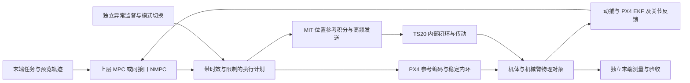

# X650 真机前验证与 MPC 至 NMPC 研究路线

日期：2026-10-22。当前目标是在 X650 自有机架、两关节机械臂、PX4 内环上，将已通过的上层 MPC 逐步转为可在机载计算机运行的系统。先补足执行器、测量、计算和异常处理证据，再扩展速度与接触任务。

本轮只开展资料审查、软件接入和离线条件重放；下列阶段中没有新证据的项目均为计划，不因列入本表而视为通过。历史控制定义及原始成绩继续见 [MPC 公式](X650_MPC_FORMULAS_AND_ARCHITECTURE.md) 和 [八字结果](X650_FIGURE8_RESULTS_20261022.md)。

## 1. 实际硬件与当前证据

| 项目 | 当前已知 | 仍需确认或验证 |
|---|---|---|
| 机架 | 自有 X650 URDF，保留原二连杆 | 实体装配后的质量、质心、惯量与机械余量；线束、外壳和变形 |
| 机载计算机 | 用户称“NX orign”，按 Jetson Orin NX 系列规划 | 具体型号、内存、JetPack/系统版本、功耗模式、散热 |
| 两关节 | 用户确认 TS20-50，供电 24 V | 实际固件、增益标度、零位/方向、负载下响应和输出轴角度 |
| 定位 | 初期采用动捕 | 厂家/SDK、频率、帧定义、采集时间、延迟、外参、遮挡行为 |
| 飞控 | 现有记录曾使用 Pixhawk / PX4 v1.14.3；当前仿真有独立版本绑定 | 当前实体飞控型号、固件和接口读回；不直接继承旧硬件记录 |
| 控制边界 | MPC 输出三轴飞机速度、两关节速度；PX4 稳定机体 | TS20 MIT 适配和真实执行动态尚需进入在线预测与耦合物理验证 |

已通过的服务器证据包括基体闭环响应训练与独立验证、完整末端保持、小幅与普通八字。普通 MPC 的整窗末端 RMS 约 4.09 mm 是精密、理想 EV 辅助估计下的仿真成绩。快速八字、24 V 带载 TS20、真实动捕与 Orin 整环实时性尚未取得同等证据。

当前关节链把命令延迟后直接当作实际速度，再积分位置。TS20 的 MIT 力位混合接口需要额外建模，见 [TS20 接入说明](X650_TS20_INTEGRATION.md)。

## 2. 要验证的系统架构

外层 MPC 周期、预测节点间隔、MIT 总线周期是三个不同的量。外层暂以 20 ms 为设计目标；TS20 按新手册要求用独立的 1–10 ms 发送周期，初始软件候选为 5 ms。同一命令持续发送不表示可以无限延用过期计划。

积分位置参考应保留自己的状态，纳入预测和日志；如果限位或限速改变实际发送量，必须将发送结果回灌预测与热启动。不能在执行端静默裁剪而让优化器仍以原计划作预测。

## 3. 分阶段工作和验收产物

| 阶段 | 工作和测试 | 进入下一阶段前的证据 |
|---|---|---|
| G0 接口冻结 | 实际固件、坐标、单位、时钟、增益标度、命令/反馈周期、停止语义 | 可读的硬件配置与版本、接口测试、原始时间戳日志 |
| G1 TS20 台架 | 每关节空载和代表性负载；保持、小阶跃、反向、低速正弦、停止；实际 24 V | 输入和 q/dq/温度/电压记录；训练/选型与独立验证分开；允许工况 |
| G2 执行器和预测链 | MIT 适配、量化、采样保持、有效时延、摩擦和实际伺服响应进入 plant 与预测器 | 单关节/双关节固定基座验证；多预报时域误差；再验证悬停摆臂和末端保持 |
| G3 仿真能力边界 | 不同负载/构型、观测误差、延迟、丢帧、风扰、输入饱和及接近关节边界 | 完整测试矩阵、重复运行分布、失败及恢复记录、批准的工作范围 |
| G4 机载计算与处理器在环 | 在实际 Orin 上运行求解器和发送器，仿真 plant；加入日志/通信负载及热降频 | 整环耗时和命令间隔分布、过期率、截止时间处置；持续运行记录 |
| G5 飞控与外设台架联调 | 动捕、机载程序、PX4、两舵机；无桨条件核对转换、故障和人工模式切换 | 实际收发闭环及停止/接管日志；若做 HIL，先验证固件和桥接兼容 |
| G6 初始飞行 | 固定/折叠臂悬停→单关节慢摆→双关节慢摆→末端保持 | 每一级独立完整验收、足够控制余量、异常处理按预先规则执行 |
| G7 任务扩展 | 小幅慢轨迹→普通轨迹→速度/幅值逐级增加→快速八字 | 原时轴误差、约束占用、重复性、时间与失败分布 |
| G8 接触研究 | 接触动力学、工具/力估计、接触切换、柔顺性 | 在自由空间任务稳定后另立协议；不沿用自由空间证书 |

当前硬件读取后端仍为只读；既有 HIL 桥接未取得完整运行监督验证。G4/G5 是待开发项。PX4 当前官方 HITL 页面还说明其由社区维护，并主要描述 Gazebo Classic 路径，不能把现有 Gazebo Harmonic 项目自动当成兼容的 HIL。[PX4 HITL](https://docs.px4.io/main/en/simulation/hitl)

## 4. 每条预测链如何验收

**关节链：** MIT 实际量化指令 → 伺服执行角速度 → 关节位置 → 末端。先从一段预先给定的命令自由预测，只用首状态初始化；不能逐帧用实测 q 重置后称为长时预测。随后再评估在线状态重置下的一步及多步误差，两种结果分别报告。

TS20 回报角是转子按带符号减速比折算的接口坐标。建议在臂末端增加独立动捕标记，核对“机体动捕 + 关节 FK”与实测末端；必要时增加独立输出轴参考，避免两套算法共用同一传动偏差。

**机体链：** 上层逻辑速度 → 实际 PX4 速度目标 → 姿态/加速度 → 位移 → 末端。按最终 PID、质量、构型和供电重新检查闭环等效模型；先用现有混合阶模型，只有独立记录显示残差有结构时才增阶或增益调度。

**时间链：** 动捕采集、PX4 时间、关节采集、控制读取、计算结束、发送、驱动接受分别记录。现有 24 ms 和上游 TS20 3.346 ms 都有合成口径，不能相加后冒充真实总延迟。采用新的明确计时契约后重新验证。

**几何链：** 动捕刚体标记到机体 base_link/IMU、肩部安装点、关节零位/方向、末端工具偏移。姿态误差对末端的影响近似为
`delta_p_tip ≈ delta_p_body - R [r(q)]x delta_theta + R J(q) delta_q`。
因此毫米级末端性能不仅取决于飞机位置，也取决于角度和外参。

## 5. 建议的测试矩阵

下列是待预注册的测试族。先做小范围单因素定位，再在允许域内做联合扰动；范围来自测量与硬件能力，不能任意放大后强行升空。

| ID | 测试族 | 主要变量 | 必须观察 |
|---|---|---|---|
| A01 | 命令方向与单位 | 两关节正负、位置/速度目标、零位 | 正方向、限位、回报与输出轴差异 |
| A02 | 低速/换向/停止 | 幅值、频率、静止时间、工作角度 | 起动阈值、滞后、残余运动、停止距离 |
| A03 | 加载适用性 | 一/二连杆负载、姿态、供电 | 响应变化、饱和、温度；模型适用域 |
| M01 | 动捕链 | 外参、时间偏置、抖动、遮挡与重定位 | 估计跳变、消息年龄、末端偏差 |
| M02 | 关节反馈链 | 反馈频率、旧包、乱序、缺包 | 状态时间一致性、计划可用性 |
| P01 | 模型失配 | 质量/质心/惯量、推力映射、臂构型 | 姿态与推力余量、预测残差 |
| P02 | 外扰恢复 | 可控风/力脉冲、不同作用方向 | 最大误差、恢复时间、约束占用 |
| C01 | 可行性边界 | 关节边界、命令变化率、可达性 | 约束冲突、退出策略、制动余量 |
| C02 | 数值与故障 | 超时、求解失败、NaN、状态过期 | 禁止执行失效结果、明确降级和接管 |
| R01 | Orin 实时性 | 负载、功耗档、温度、长时运行 | 整环 P50/P95/P99/max、漏期与失效计数 |
| R02 | 通信与模式 | 外层停顿、总线中断、Offboard 丢失 | 舵机与飞控分别执行预定策略 |
| T01 | 任务分级 | 保持、阶跃、圆/八字、幅值/频率递增 | 同时间三维误差、稳定性与重复性 |

每个有随机因素的条件保存种子。先作 3 次冒烟复核；正式范围验证建议每条件至少 10 次独立运行，并报告全部失败。若要作置信区间或成功率结论，样本数应按期望精度另行确定。不能只播放最漂亮的一次，也不需要每次都制作对比视频。

旧仿真的 RMS≤5 cm、峰值≤10 cm、倾角≤8°属于历史阶段门槛。新硬件目标应由任务允许误差、动捕/编码器误差底限和实际控制余量确定并预先冻结；不能直接把旧门槛当作真机安全保证。

## 6. 计算和异常处理

记录三类时间：求解耗时、整环处理耗时、实际相邻命令间隔。旧的 20 ms 求解预算与 50 ms 退出门槛不等于 50 Hz 整环已实现。测试覆盖 Orin 的实际 CPU 线程、功耗和温度；优化器不会因为机上有 GPU 就自动加速。

建议将规划器与发送/监督器解耦，计划携带状态源时间、执行时间、序号和有效期。监督器可拒绝过期、不可行或无效计划；发送器按已验证的规则切入预定保持/停止/飞控模式。舵机“停止参考”与撤销力矩不同，具体行为取决于负载和已核实接口，不在空中默认断力。

PX4 的 ROS 2 Offboard 心跳与设定值可以分开发送；有心跳不代表优化结果新鲜。其切出动作由固件对应参数决定，应实测状态变化。[PX4 v1.14 Offboard](https://docs.px4.io/v1.14/en/flight_modes/offboard)

动捕接口先建立厂商 SDK/ROS 适配层，再向所选固件支持的外部里程计接口输出。核对父子坐标、姿态四元数、测量时刻和 EKF 延迟；不要假设所有动捕系统都输出 ENU。[PX4 外部位置估计](https://docs.px4.io/v1.14/en/ros/external_position_estimation)

## 7. MPC 与 NMPC 的两层比较

NMPC 属于 MPC。当前实现更准确地称为“基于闭环响应与逐轮输出线性化的上层 QP MPC”，它已经包含非线性末端几何和姿态输出的局部处理；不是完全忽略非线性的积分器。

### 第一层 同一接口下的上层 QP MPC 与 NMPC

保持同一 PX4 内环、TS20 MIT 桥接、状态/时间戳、5 维逻辑速度输入、工况、约束、预览时长和计算平台。QP 采用当前逐轮一次输出线性化；NMPC 在同一执行器响应和几何模型上直接优化非线性问题。

首先检验大幅运动、关节边界、换向和扰动是否确实降低误差；同时检验计算代价、不可行率与时序违约。复杂模型不保证一定更好，也不预设 NMPC 必然更慢。可选 CasADi/acados 作为 NMPC 候选，需另行完成接口与数值验证。[acados](https://docs.acados.org/)

### 第二层 上层控制与全身动力学 NMPC

加入浮动基体—机械臂耦合、旋翼推力与真实执行器模型。若使用关节力矩，必须有可信的力矩尺度、执行映射与物理参数；若仍使用位置舵机，应把位置闭环动态包含在全身模型中。两种方案都可研究，但实验接口与结论不同。

该层比较同时改变了模型和控制架构，不能把全部收益归结为“非线性求解”。如果要分离原因，可以安排“更完整模型 + 相同上层接口”和“更底层接口”两个独立实验。

### 共同实验约定

- 共同开发集、独立验证集和相当的调参机会；调参后冻结，两算法都不在验证上选参。
- 同任务、观测、质量、限值与扰动种子；不把某算法额外的控制权或真值信息混入。
- 分别报告“共同计算预算”与“各自可实际维持的运行频率”，避免让一个在减速仿真运行、另一个在实时运行。
- 保留 PID 作为回归参照；研发日常以模型误差、约束和运行可靠性为主，只在阶段验收时作算法对照。

## 8. 统一记录与指标

主指标为原时轴、同一时刻的独立末端三维误差；保存时间加权 RMS、峰值和样本 P95，另存分轴误差与均值。路径最近距离和拟合相位后的误差可作诊断，不替代主指标。

同时记录关节角/角速度误差、限幅和变化率占用、预测残差、机体姿态/推力余量、恢复时间、整环时延和过期率。一次成功不能抹去其他失败。没有可信电气/力矩测量时，不把控制输入平方和称为实测能耗。

每次产物包含硬件/固件/模型/代码版本、完整原始日志、预注册任务、参数、时间同步配置、故障和恢复记录。TS20 上游模型与我们的集成代码分别保存哈希，历史八字与新执行器阶段分别出具证据。

## 9. 论文阅读结论与应用位置

| 资料 | 可借鉴的方法 | 对本项目的适用边界 |
|---|---|---|
| [Kamel 等 Linear vs Nonlinear MPC](https://arxiv.org/abs/1611.09240) | 共同内环；保持、阶跃、快速轨迹和风扰；同时报告计算开销 | 飞行器不同，无机械臂；论文数字不移植为本机门槛 |
| [Lunni 等 2017](https://hdl.handle.net/2117/108724) | 上层末端 NMPC、冗余任务、关节/机体约束与机载实验 | 速度输入与低层跟踪假设；该真机设置 2 Hz/5 s，不是力矩级全身 NMPC |
| [Li 等 2025](https://arxiv.org/abs/2503.02408) | 把闭环响应与残差纳入预测，按任务协调机体和机械臂 | 本地 v1 全文的验证为 Gazebo/PX4 数值实验，不能当作真机证据 |
| [Minniti 等 2019](https://arxiv.org/abs/1902.10415) | 平衡、末端任务与动力学在同一优化问题中处理 | 载体为地面球平衡移动机械臂，不直接提供飞行执行器参数 |
| [Martí-Saumell 等 Full-Body Torque-Level NMPC](https://arxiv.org/abs/2107.03722) | 全身动力学、代价与预览任务构建、不同 NMPC 策略 | 该论文的主要验证是仿真，不把它与后续平台实验混为一谈 |
| [Borinot](https://arxiv.org/abs/2307.14686) | 推力/关节力矩执行与机载全身控制架构 | 其硬件开放力矩和可变阻抗，不能假定我们的接口等价 |
| [Liu 等 2026 Contact-Aware Incremental MPC](https://arxiv.org/abs/2609.11661) | 实际位置控制关节也可通过闭环关节动态进入 NMPC；接触与鲁棒内环 | 单关节、接触任务，作为后期扩展参考，不直接复制系数 |
| [Garimella 等 RNN-NMPC](https://asco.lcsr.jhu.edu/wp-content/uploads/2018/10/nonlinear-model-predictive-3.pdf) | 同时学习 autopilot 和 servo 的闭环输入输出模型，分离训练与测试 | 学习模型只覆盖训练域；当前优先用可解释的 TS20 模型 |
| [Lee 等 2020 开门任务](https://arxiv.org/abs/2003.08256) | MPC 规划与抗扰内环结合；考虑接触环境约束 | 接触、力估计及环境辨识应另立阶段 |
| Kim 2018 / 既有 ADRC 论文 | 耦合、扰动估计与内环稳定性的分析路线 | 将来可研究 MPC+观测器；增加补偿后须重验基体响应，不提前叠加多套控制 |

本地目录检索了 16 份 PDF 条目，并重点核对上述相关论文的架构与实验章节；其中“全身MPC算法”与 2107.03722v2、“耦合性”与 Kim 2018 是同一工作的不同命名，不能算作独立文献。TS20 厂家资料与实测接口模型的出处及适用条件另见接入文档。

## 10. 近期执行顺序

1. 固定 TS20-50 来源与接口，完成纯软件适配、起动/换向检查及旧 MPC 命令重放。
2. 获取 24 V、最终增益、实际连杆装配下的响应记录；固定零位、方向和增益编码标度。
3. 独立验证执行器预测近似，连同 MIT 适配状态接入新的 MPC 协议；再验证悬停摆臂与末端保持。
4. 将动捕实际延迟/丢帧与 Orin 运行条件放入测试框架，完成 G3/G4。
5. 在相同执行接口下实现上层 NMPC，作阶段性对照；全身动力学 NMPC 在物理尺度和执行接口准备后推进。

前四步中的诊断默认只需数字报告和关键曲线；视频用于阶段展示，不要求每个开发试验都做 PID/MPC 对照。
