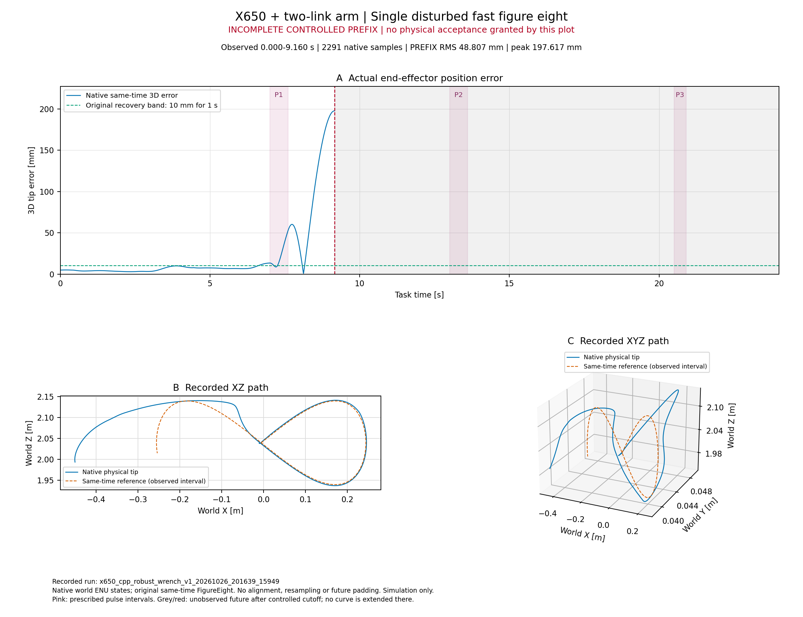
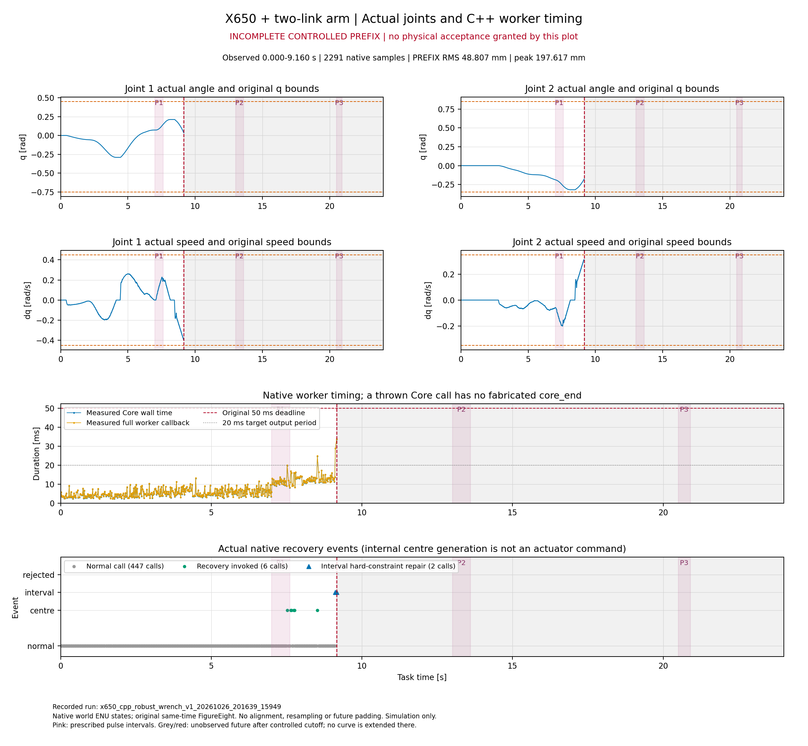

# ABI 3 节点间硬约束接入受扰闭环：2026-10-26

**实际 PX4／Gazebo 重跑已经执行，但本次没有完成原定 24 秒。** 0–9.16 s 的有效受控测量段后，下发器因 `STALE_COMMAND`（旧候选年龄超过 50 ms）触发退出。455 次 Core 调用全部接受；不能将这一点写成整段抗扰或执行验收通过。末端前缀峰值 197.617 mm 也已超过原 100 mm 门槛。

本次保持上一版 Core、QP、TS20 模型、PID、轨迹和约束不变，不加松弛变量、不放宽 ±0.42／±0.32 rad/s 预测内界，也不注入延迟。完整生命周期、诊断、失败前缀与未执行的后续波形分别保留。

## 实际运行与原工况

- Launch：`x650_cpp_interval_launch_20261026_201556_15925`。
- Run：`x650_cpp_robust_wrench_v1_20261026_201639_15949`。
- 平台：新容器中的 PX4 SITL／Gazebo，导入 X650 机架＋原二连杆，TS20-50／24 V 条件模型，精密定位模式，总质量约 3.495 kg。
- 参考轨迹：世界 XZ 平面八字，X 幅值 0.25 m、Z 幅值 0.10 m、8 s／圈、两圈；完整任务应为 24 s。
- task SHA-256：`7b168599e2a182f1a3d3dd860b88d2f87cfb0c23ca258964c0126f4c499af388`；protocol SHA-256：`16e1fb80312f43caef3760392fd67a5ceeda4f2c528becc24d114c5027e16401`。均为原文件逐字节复制。

| 原定外扰，矩形波 | 任务区间 | 本次实际情况 |
|---|---|---|
| 世界 X 向 +1.5 N | 7.0–7.6 s | 已完整施加，物理步增量冲量 0.9 N·s |
| 世界 X 向 −1.5 N | 13.0–13.6 s | 未到达，不能据此报告恢复结果 |
| 机体质心处世界 Y 向自由力矩 +0.04 N·m | 20.5–20.9 s | 未到达，不能据此报告恢复结果 |

施扰器使用原生 ECS 的 wrench 增量，启动锚点与 LiveStart 对齐；该记录是物理步施加证据，不冒称力传感器测量或物理引擎逐步 ACK。

## 新后端接入验证

新入口 `simulations.x650_cpp_interval_v1.launch` 使用单独的 ABI 3 qualification，不把旧 ABI 2 资格直接授予新库。此前软件证明仍见[节点间硬约束验证](../cpp_interval_hard_20261026/README.md)。

本次又以原记录的 429 条状态／执行历史生成一个**自行连续推进新 Memory** 的 C++ 顺序 oracle，再驱动实际 ROS 工作进程。实际 worker 的全部 429 次结果、输出字段和诊断与该新 oracle 对照通过；原失败输出没有充当新输出答案，旧的逐次固定 Memory 没有冒充新的连续 Memory。只刷新消息的发出时钟，不创建执行器 publisher。这是接入证明，不能替代下述真实飞行。

| 组件 | 实际 SHA-256 |
|---|---|
| Core ABI 3 | `d38fd4e7956ec49b6e558fb74093bff82c1e97d460a7e35c0ce26a8277dbd173` |
| QP／矩阵组装库 | `5188f6f6af9b5c07f9508d756dc20d09552f597bc2f0bd09ed9e341cf54c3ff6` |
| TS20 预测库 | `9ff66d6db9afb3eb4c24ca6c0c3fcfc9453c6ab4384af134ec22b6f5c38701d8` |
| 匹配 ROS C++ worker | `c559b58d159d2ccb4fd5ddc3b6e60c6a9a92436b882d0ffd31967f4ea97f8429` |

准入、实际 worker 回放、ABI 3 审计、原外扰协议与绘图相关测试合计 **55／55 通过**。随后只调整图中重叠标注并重跑绘图测试，**7／7 通过**；下文所述动态行数审计修复后，相关三组审计测试 **38／38 通过**。这些集合有重叠，不相加为独立测试数量；控制实现未改。

## 末端误差与节点间硬约束

误差来自原生物理状态与同刻世界坐标参考，不做偏置拟合、相位对齐、插值补尾。2291 条样本只覆盖 0–9.16 s；时间加权三维 RMS 为 **48.807 mm**，三维峰值为 **197.617 mm**。撤扰后虽然短时经过小误差区，但在退出前没有形成“≤10 mm 连续 1 s”的恢复段。不能把前缀 RMS 当作整段 RMS，也不能因 RMS 小于 50 mm 就忽略已超过 100 mm 的峰值。

误差在保护退出前已经增长。停止原因和抗扰精度不足是两个需要分别解决的问题，不能将后者全部归咎于停机。

新增区间恢复在真实调用 454、455 中被触发，分别添加 25、32 条区间硬约束，各用两次正式 QP。完整原生模型检查后的候选恢复到原速度内界；两次 Core 都接受。第 455 次结果在下发器停机后才计算完成，**没有实际执行**，不得把它写成已应用补偿。

## 停止的时间边界

原门槛同时要求单次候选在 50 ms 内完成、下发时所用候选年龄不超过 50 ms，以及实际输出间隔不超过 40 ms。它们是不同条件。

第 454 次 Core 计算约 28.8 ms，首次在绝对 20 ms 槽下发时，该候选已约 42.67 ms。当前状态源还要求前一候选实际首发后才发下一次求解快照。第 455 次虽然仅计算约 33.7 ms，但到下一个下发槽时尚未完成；旧候选年龄已约 **62.71 ms**，因此 `STALE_COMMAND` 锁存退出。此刻状态源年龄约 **1.59 ms**，不是 25 ms 状态新鲜度门槛，也不是关节逐条消费往返等待。

本次保留所有门槛和失败原件，没有更改候选时间戳、延长租期或重复跑到偶然通过。后续应针对“完整求解＋首发屏障＋20 ms 槽＋50 ms 候选有效期”的组合建立可调度预算，再决定计算优化或执行架构调整。直接移除首发屏障会影响实际执行历史与 Memory 一致性，不能仅删一个判断。

## 验收边界

[完整审计报告](physical_audit.json)保持失败状态。有效前缀的消费、预测修复、PX4 编码和退出专项检查见[独立复核](independent_review.json)、[区间前缀检查](interval_prefix_check.json)及[停止时间线](timing_failure.json)。它们只证明各自已经发生的过程，不签发未完成 24 s 的证书。

检查中修复了一处**审计工具**假设：原 QP 组装器会省略可行的全零常数行，基础行数并非每次都是 230。Compact 记录现在按原实现验证动态行数范围与新增 cut 的索引，不把合法的 224 行误判为控制失败；它仍未独立重建缺失的完整基础矩阵，原实现身份与此前 Full 矩阵证明继续绑定。初次审计覆盖错误及修正后复核分别存为 v1／v2，未改 Core、候选、实际飞行或原失败结论。

| 专项 | 原始记录核对结果 |
|---|---|
| 下发次数 | 459 次＝458 次正常发布＋1 次最终零指令；含重复发布，与 455 次 Core 调用不是同一个计数 |
| 停止前连续下发 | 458 个原定槽均为 20 ms、无跳槽；实际发送最大间隔 37.800449 ms，小于 40 ms；已实际下发命令最大年龄 45.639651 ms，小于 50 ms |
| 逐关节实际采用 | 每关节 458 次采用、1 次在采用前被后续命令替代；替代有相邻物理行对账，不伪称全部执行 |
| 成对回执 | 458 个；440 次两关节在同一物理边界采用 |
| 正常消费进度观测最大耗时 | 12.194475 ms，低于原 40 ms 界 |
| 最终零指令确认 | 两关节均 2.320973 ms，随后 writer 释放，无输出所有权重叠 |
| PX4 编码／控制退出 | 前缀实际 PVA 值与 ULog 对照通过；最终落地并解除锁定，退出段 failsafe 样本为 0 |
| 参数恢复 | 原类型逐值恢复与同步 storage save 均通过 |

运行已退出，未留下 PX4／Gazebo／控制工作进程。原始失败报告、ULog、原生状态、实际命令与消费记录、源码／二进制快照、实际 worker 回放及绘图数据均归档；原件未被修改，曲线没有延展到未执行的 13 s 或 20.5 s 外扰。

## 原件与复现

使用[交付清单](delivery_manifest.json)中的顺序拼接 `interval_flight_evidence.zip.part*`，按完整 ZIP SHA 校验后解压；分片不可分别解压。[逐件清单](archive_manifest.json)记录每件原始文件 SHA，[工作站核验](local_archive_verification.json)复核分片、完整 ZIP、成员 CRC／SHA 和待提交源码。历史固定输入软件证明已在上一份独立归档中交付，本次的[外部依赖身份](external_dependencies.json)明确引用它，没有将历史测试当作本次飞行。

本次归档为 **36,913,317 bytes**，含 4,164 件原件及两份内嵌清单，共 4,166 个 ZIP 成员。完整 SHA-256 为 `a6b4e29d320fb3e3ccc87bef51e27936f6a01a87e2d2747b71cec0b3fb2ebfbe`。本次仅有 [part01](interval_flight_evidence.zip.part01)，复制或改名为 `.zip` 即可按完整 SHA 核验；工作站已核对全部原件 SHA、ZIP CRC、完整哈希和 10 份当前源码字节一致性。

实际复现先加载既有 ROS／PX4 环境，再加载匹配 ABI 3 worker overlay，用归档的 task、startup、qualification、protocol 运行新入口。路径迁移或重新编译时应生成新的派生身份，不覆盖原证据中的路径和 SHA。该次运行本身是失败样本，不应作为普通／快速飞行或真机准入依据。
