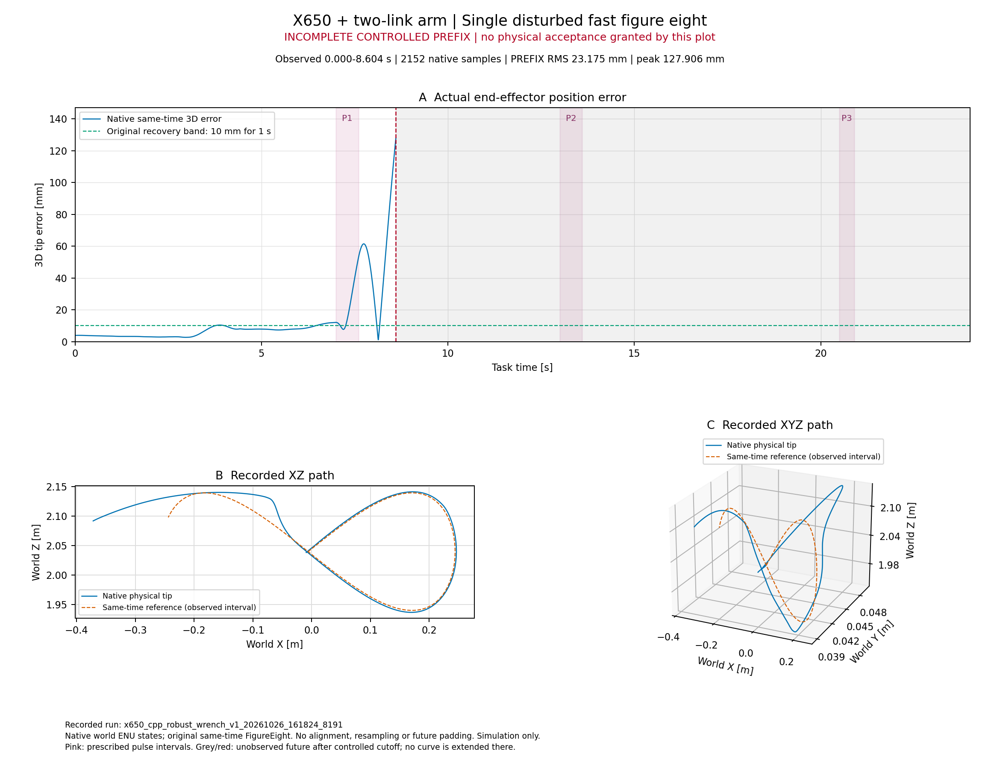

# 原波形外扰重跑：2026-10-26

**本版后端尚未通过完整 24 s 受扰验收。** 第二次真实施扰运行在任务 **8.604 s／第 429 次调用**因候选关节速度安全余量不足拒绝，之后完成归零、交接、落地、解除锁定和参数还原。这里只报告到拒绝快照的真实受控前缀，不把接管／落地补成完整八字或抗扰恢复。

| 实验尝试 | 原始 run | 结果 |
|---|---|---|
| physical_v1 | `x650_cpp_robust_wrench_v1_20261026_160337_6729` | 控制完成 24 s，但施扰启动标记竞态导致插件 `FAILED: stod`，未锚定，task_rows=0；**无效受扰实验** |
| physical_v2 | `x650_cpp_robust_wrench_v1_20261026_161824_8191` | 原子发布修复后正确锚定，第一脉冲完整；8.604 s 候选拒绝，后两脉冲未到达；**整段不通过** |

两次均在服务器 `autodl-container-3187449845-10f5a45f` 的真实 PX4 SITL／Gazebo 执行，使用 X650＋原两连杆和精密 EV。首次失败不是控制器无扰性能的受扰对照。没有为获得通过而改 Core、PID、QP、TS20、半径、物理边界或时限，也没有注入延时。方法与复现入口见 [受扰验证说明](../../X650_MPC_RECOVERY_DISTURBANCE_FLIGHT.md)。

## 可查看结果

- [结果汇总](result_summary_v1.json)：版本、截止时刻、前缀指标、分项检查与明确的失败结论。
- [第二次完整验收报告](audit_v2_report.json)：拒绝授予物理证书，保留原错误、原生记录和受控前缀。
- [失败前缀及退出独立诊断](execution_diagnostic_v2_report.json)：所有原始 CDR、428 条已接受输出、连续下发、实际消费、PX4 PVA 值／接管、ULog 落地和参数还原逐项核验；**这是诊断附录，不是完整飞行证书**。
- [首次施扰启动竞态证据](activation_failure_v1.json)和[首次拒绝报告](audit_v1_report.json)。
- [42 项服务器回归测试](tool_tests_v2.log)：含原子发布的空／部分写入可见性、不覆盖已有文件及异常清理反例。
- [末端误差与同刻轨迹 PNG](endpoint_recovery.png)／[PDF](endpoint_recovery.pdf)。
- [实际关节、工作进程计时及恢复事件 PNG](joints_and_backend.png)／[PDF](joints_and_backend.pdf)。
- [图表来源清单](plot_manifest.json)、[原生图表数值](native_chart_data.csv)及[worker 图表数值](worker_chart_data.json)。

图中红虚线是拒绝快照 **8.604 s**，灰色区域是未完成的任务区间；没有延长误差曲线。粉色 P2／P3 只标原定时间，不表示已经施加。XZ／XYZ 子图也只画实际观察区间内的参考。

## 原协议与实际施扰

任务文件仍是原件，SHA-256 `7b168599e2a182f1a3d3dd860b88d2f87cfb0c23ca258964c0126f4c499af388`。原矩形波形为世界 ENU X 向 +1.5 N（7.0–7.6 s）、−1.5 N（13.0–13.6 s），以及世界 Y 轴 +0.04 N·m 自由力偶（20.5–20.9 s）。快速八字为 X/Z±0.25/0.10 m、8 s 一圈、两圈、总窗 24 s。

第二次插件起点 `t0_sim_s=47.132` 与 LiveStart 相同；第一脉冲已记录 **0.9000000000000007 N·s** 原生 ECS 力增量冲量，最大分量重建误差约 `3.33e-16`。8.6 s 拒绝后施扰器随保护退出成为 `ABORTED`，不能用第一脉冲完成冒充三段波形完成。日志是物理步的 `ExternalWorldWrenchCmd` 增量记录及独立实际运动，不是力传感器或物理引擎逐步 ACK。

## 已得到的结果

下表指标只适用于 **0–8.604 s**，共有 **2,152 条**有效原生物理样本。误差为末端真实位置对原世界坐标系同刻参考，没有偏置拟合或相位对齐，RMS 为时间加权。

| 项目 | 实际结果 | 判定范围 |
|---|---:|---|
| 末端三维 RMS | **23.1754 mm** | 失败前缀，不能当作整段 RMS |
| 末端三维峰值 | **127.9058 mm** | 已超过原 100 mm 峰值门槛 |
| 机体最大倾角 | **4.2400°** | 前缀内小于原 8° 界 |
| 已接受／被拒 Core 调用 | **428／1** | 第 429 次未下发 |
| 正常实际下发 | **430 次** | 原 20 ms 绝对槽，无跳槽 |
| 最大实际发送间隔 | **33.4248 ms** | 小于原 40 ms 门槛 |
| 最大命令年龄 | **48.2198 ms** | 小于原 50 ms 门槛；不能称为零延迟 |
| 已接受调用 Core 中位／P99／最大 | **5.0997／12.8623／20.7462 ms** | 原服务器观测，不是 Orin 最坏时限保证 |
| 原 25 ms 状态年龄及真实发送屏障 | 独立检查通过 | 到失败前缀，不能外推未来 24 s |
| 关节发送，包括最终 STOP 零命令 | **431 对** | 两关节各 431 条均在原生物理记录中采用 |
| 上层 receipt 数 | **430** | 物理账本完整确认 431 对，不能单凭 receipt 数判丢命令 |
| 双关节最终归零／writer 释放 | **通过** | 归零采用后交接，无输出所有者重叠 |
| PX4 PVA 值、接管和退出 | **通过** | 原始 ULog 与真实发送值核对；不是重复 setpoint 的逐条硬件 ACK |
| ULog 落地／解除锁定 | **通过** | 退出段 failsafe 样本为 0 |
| 参数逐类型还原、同步存储保存 | **通过** | 与原读回／存储记录一致 |
| 撤扰后 ≤10 mm 持续 1 s | **未通过验收** | 中断前未建立该恢复段；后两外扰未运行 |
| 完整 24 s 与整段恢复结论 | **不通过／不可取得** | 保留原判据，没有补写后续数据 |

实际物理关节在前缀中的范围为：q1 `[-0.235253, 0.319330]` rad、q2 `[-0.329211, 0.0000000114]` rad；dq1 `[-0.190474, 0.275661]` rad/s、dq2 `[-0.180603, 0.075696]` rad/s。它们没有撞到原角度和速度界。不要把下述未来候选计划包络与这些实际运动混为一谈。

## 新后端已恢复的情况和剩余拒绝

本次实际闭环确有两次 QP 不可行恢复：

| 原生调用／任务时间 | 恢复 | Core 耗时 |
|---|---|---:|
| 379／7.588 s | 一个 `slew_limited_brake` 可信中心、两个正式 QP、无辅助投影，原约束和节点制动检查通过 | 20.746151 ms |
| 383／7.684 s | 同上 | 16.586565 ms |

它说明重建中心分支能在真实闭环里被触发并接受，没有扩大 0.02。它不能证明整体抗扰已经解决，也不能将本次与原 7.544 s 失败运行的差异全部归因为该分支，因为实际初态和采样不相同。

第 429 次调用是另一条失败路径：QP 本身有解，原行残差约 `6.52e-15`、KKT stationarity 约 `4.44e-16`，计算 **12.971842 ms**，q／dq 线性化误差约 `0.0002958 rad`／`0.0114994 rad/s`，均未触发各自门限。完整 TS20 候选传播预测关节 1 的最小速度为 **−0.4279884 rad/s**。原候选门要求加上 0.03 rad/s 预留余量后仍在 ±0.45 rad/s 内：

\[
-0.4279884-0.03=-0.4579884 < -0.4500002.
\]

所以**速度安全余量不足约 0.0079882 rad/s**。原始预测速度本身仍在 ±0.45 以内；这不是已发生的物理关节超速，也不是硬件计算能力不足。拒绝时实际 q／dq 为 `[0.318629, -0.327642]` rad／`[-0.075043, 0.074194]` rad/s。第 429 次候选没有发出，也没有被当成已执行未来轨迹。

当前恢复只处理已识别的 QP 不可行；`actual_bounds=False` 的候选包络拒绝不进入该恢复分支。下一版本首先应从第 429 份固定输入和完整 Memory 重放入手，处理规划约束与非线性验收余量的一致性，再视证据增加有界的候选拒绝恢复；仍须保留最终检查及总时限。本轮不改 Core 来改变这份失败结果。即使后续消除拒绝，127.9 mm 峰值和恢复精度也仍需重新验收。

## 原件和版本

| 件 | SHA-256 |
|---|---|
| Core ABI 2 | `f90c565fdda137771fd0e85bc22386a3b30c41ac928246e177536bc102947011` |
| 匹配 C++ worker | `cb56065779d6ab3f451d177e198d75a788dce5089b75112afc6255a46b1c2e35` |
| 原 QP 库 | `582b0a150787333936b04c4c9b40d461db99fa884577e81e6ff230f49a4b3452` |
| 原 TS20 库 | `9ff66d6db9afb3eb4c24ca6c0c3fcfc9453c6ab4384af134ec22b6f5c38701d8` |
| 原子发布修复 `disturbance.py` | `1ca285d09d97c599818edb62f0dd3fede9d4cd06dbda4bab0336841e068661ac` |

完整原始归档保留两次尝试各自的 launch/run、执行源码及二进制快照、原始 CDR、worker 诊断、物理轨迹、ULog、逐关节消费、退出、审计和绘图来源。归档前后的原件 SHA、ZIP 每件 SHA／CRC 和分片重组均须验证。私有 mesh 与凭据文件不入归档。`current_source` 只表示打包时源码，实际执行身份以各 launch 内原有 `sources.zip`／`runtime_binaries.zip` 为准；首次缺陷与第二次修复来源分开保留。

完整 ZIP 为 **69,526,737 bytes**，带 **5,263 件**逐件 SHA 的原件，未压缩 319,926,150 bytes。工作站已独立核对全部分片、重组后完整 ZIP、全部成员 SHA／CRC，以及 51 份本地当前源码，均通过。完整 ZIP SHA-256 为 `1821ec9d0bb075aef00cf7246ca783ebc8df70f151a59c9825ed69e6df256a31`。

| 分片 | Bytes | SHA-256 |
|---|---:|---|
| [part01](recovery_flight_evidence.zip.part01) | 41,943,040 | `ab3d68e331bdabf1dcd1ab55830d679d40bdcab51d29021dffbec9caec57781b` |
| [part02](recovery_flight_evidence.zip.part02) | 27,583,697 | `89aee7b6c07fd16fc3b1b08f94447b47eaeeb9d9844a1c5b95311b421bb2b152` |

详见[交付清单](delivery_manifest.json)、[逐件输入清单](archive_manifest.json)和[工作站校验](local_archive_verification_v1.json)。分片按清单顺序拼接为 `recovery_flight_evidence.zip` 后校验完整 SHA 并解压；不要把分片当成可分别解压的 ZIP。原始绝对路径随证据保存，迁移后应建立新的派生路径绑定，不修改原证据来假装路径没变。
