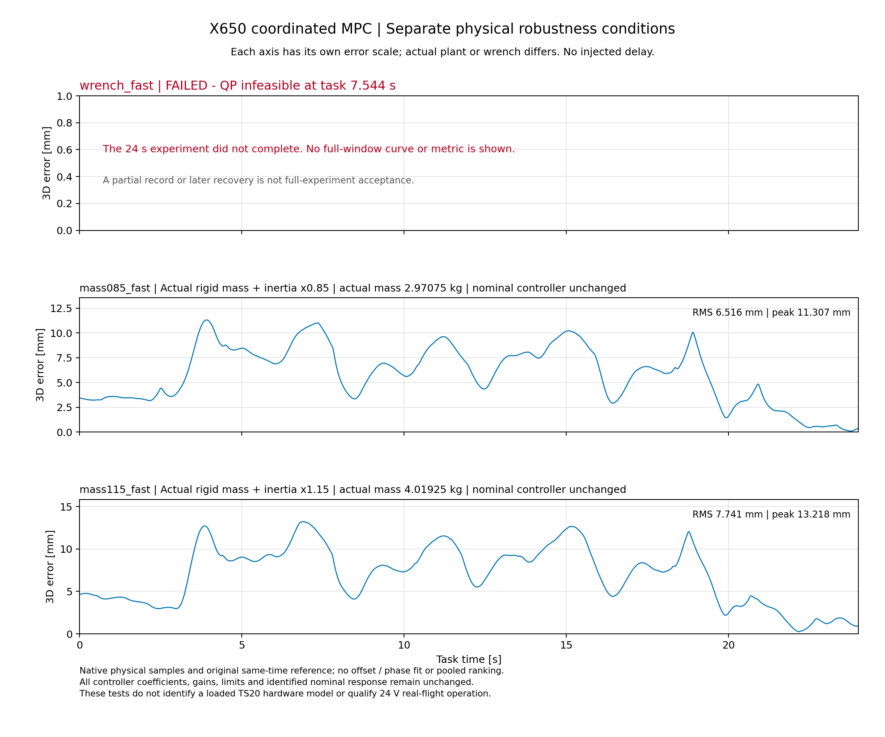
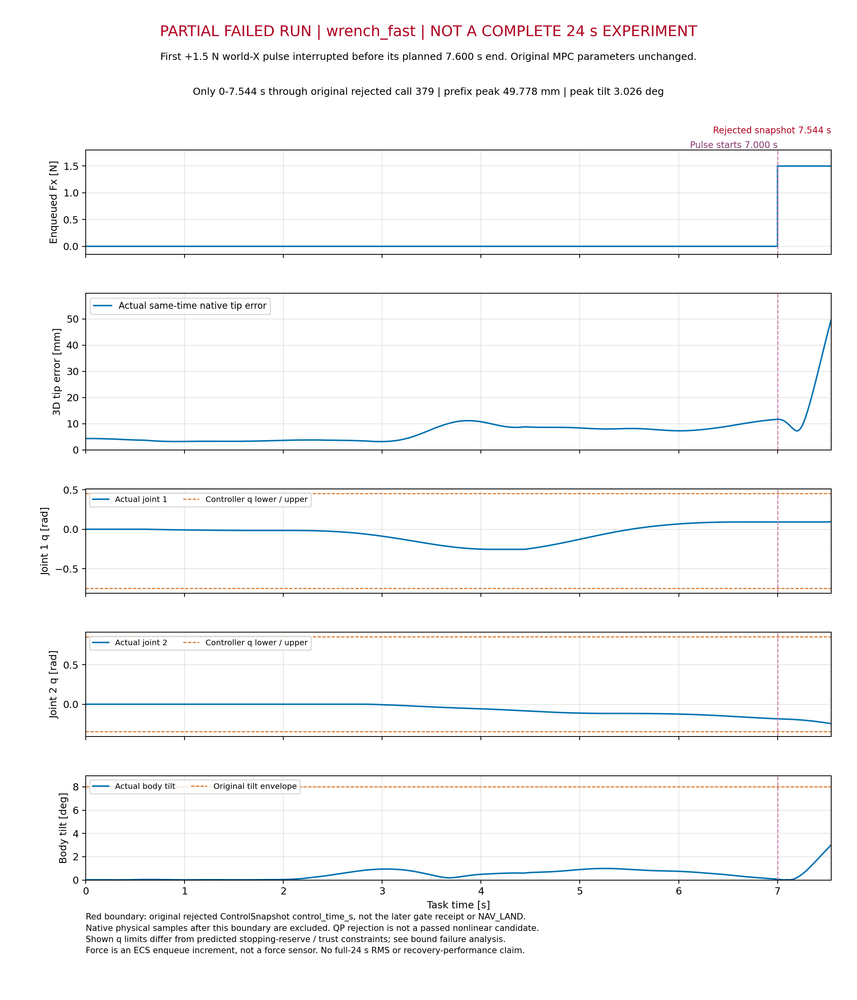

# X650 协同 MPC：外扰与模型偏差筛查（2026-10-24）

**两个质量／惯量偏差工况完整通过；1.5 N 水平外扰工况失败，已定位到预测约束冲突。** 本轮没有注入通信延时，也没有为了通过测试重整 PID、修改 MPC 权重、减小八字或放宽验收门限。这里同时保存成功和失败原件。

## 本轮到底测了什么

使用此前通过快速八字的同一 C++ 上层机体／机械臂协同 MPC，保持 Core、QP、TS20 预测库和 PX4 数值参数不变。它联合优化机体三个平移通道和两个关节通道；底层仍是 PX4 和舵机接口，尚不是力矩级整机动力学 NMPC。

三个条件都在运行前确定：世界 XZ 平面八字，X±0.25 m、Z±0.10 m，8 s/圈、2 圈；包括原 C2 加减速和前后保持的预定完整窗口为 24 s。轨迹中心和时间原点由当次 LiveStart 绑定。误差取独立 Gazebo 物理末端相对原始同刻参考的三维距离，不拟合位置偏置或相位，不用飞控估计位置代替物理末端。

| 条件 | 实际物理改动 | 结果 | 完整 24 s 三维 RMSE | 完整 24 s 峰值 | 倾角峰值 |
| --- | --- | --- | ---: | ---: | ---: |
| mass085_fast | 全部七刚体质量、质心惯量矩阵同时 ×0.85，整机 2.97075 kg | **通过** | **6.516 mm** | **11.307 mm** | **1.007°** |
| mass115_fast | 同时 ×1.15，整机 4.01925 kg | **通过** | **7.741 mm** | **13.218 mm** | **1.052°** |
| wrench_fast | 名义 3.495 kg，第一段为世界 X +1.5 N、预定 7–7.6 s | **失败：7.544 s 快照的 QP 不可行** | —，未完成 | —，未完成 | 失败前缀见下文 |

每个物理条件独立运行一次，属于首轮可复现筛查，不是多次统计或已经确定的鲁棒边界。原完整实验门限仍为 RMSE≤50 mm、峰值≤100 mm、倾角≤8°，且必须同时通过原始反馈、关节执行、候选、时序、完整 ULog 和退出恢复核查。

两张模型偏差图使用各自的纵轴尺度，不能根据曲线视觉高度直接排序；上表给出了绝对误差。两个工况都没有额外外扰，外扰失败记录没有画成完整 24 s 曲线。

## 两个模型偏差结果

| 指标 | 质量／惯量 ×0.85 | 质量／惯量 ×1.15 |
| --- | ---: | ---: |
| 独立原生物理样本数 | 6001 | 6001 |
| 跟踪段 2–20 s 三维 RMSE | 7.369 mm | 8.751 mm |
| 尾段 20–24 s 三维 RMSE | 2.132 mm | 2.415 mm |
| 尾段峰值 | 4.840 mm | 4.480 mm |
| 成功 MPC 调用数 | 1198 | 1199 |
| Core 耗时中位数／最大值 | 8.065／22.392 ms | 8.089／21.933 ms |
| 实际定周期发送最大间隔 | 23.681 ms | 23.583 ms |
| 实际关节发送数（含停止零指令） | 1201 | 1200 |
| 两关节均采用所有发送值、零指令已采用、旧输出无重叠 | 是 | 是 |
| 完整 ULog、落地解除锁定、参数还原 | 通过 | 通过 |

这次实际 plant 的质量和惯量发生变化，但控制器仍使用名义工况辨识得到的水平二阶、垂直一阶闭环响应模型。结果说明这个预测先验在这两种物理偏差和这条轨迹下仍能工作；不能据此声称任意 ±15% 参数偏差都已经覆盖。

全部七刚体（包括四个旋翼 link）的质量和惯量同时缩放，相当于整体密度变化。几何、质心位置、旋翼气动／推力参数、碰撞、传感器与 TS20 内部响应参数不变，因此没有分别区分质量、惯量和质心偏移的独立影响。TS20 仍是速度接口代理，本轮不等同于 TS20-50 在 24 V 实际负载下的响应验证。

- [×0.85 完整轨迹／误差图](plots_v2/mass085_fast/endpoint_validation.png)、[PDF](plots_v2/mass085_fast/endpoint_validation.pdf)、[原生同刻图表数据](plots_v2/mass085_fast/endpoint_chart_data.csv)、[独立验收报告](mass085_fast/report.json)。
- [×1.15 完整轨迹／误差图](plots_v2/mass115_fast/endpoint_validation.png)、[PDF](plots_v2/mass115_fast/endpoint_validation.pdf)、[原生同刻图表数据](plots_v2/mass115_fast/endpoint_chart_data.csv)、[独立验收报告](mass115_fast/report.json)。

## 外扰为什么没有通过

运行前预定的脉冲是：7–7.6 s 世界 X +1.5 N、13–13.6 s 世界 X −1.5 N、20.5–20.9 s 世界 Y +0.04 N·m 自由力偶。力和自由力偶加在 base_link 自身质心；插件在地面绑定本次真实 ECS 对象，用同一 LiveStart 定时。记录的 wrench 是同一 PreUpdate 的 ECS 指令增量，不是测力传感器或独立物理消费 ACK。

第一脉冲开始后，第 379 次原始输入快照对应任务时间 **7.544 s**，QP 返回 `QP infeasible`。此前 378 次候选已经接受；故障当次 Core 为 **7.940 ms**，门控收到结果约 **9.110 ms**，拒绝原因是优化失败，而非计算超时。随后停止零指令被采用，系统落地解除锁定并还原参数。

这张图只显示 **0–7.544 s 的 1887 条原生物理样本**；末端误差峰值 **49.778 mm**、倾角峰值 **3.026°**。这些是失败前缀指标，不能与上表完整 24 s 指标混用。图中物理关节位置仍在限制内：第二关节最后约 −0.2461 rad，距 −0.35 rad 下限还有约 0.104 rad；其实际角速度约 −0.2016 rad/s，也未达到原限制。

实际关节未越限，不等于当前局部预测问题一定有解。控制器一方面要求预测关节保留足够制动余量，另一方面围绕上一条计划施加局部信赖域，限制新计划能改动多少。扰动后，这两组约束的可行集合不再相交。例如预测索引 7（约 0.30 s 后）的第二关节制动约束，在组装后的线性不等式中要求 C₁₂₂z≥−0.1055741，而局部信赖域内 C₁₂₂z 的最大值只有 −0.1059974，相差约 0.0004232 rad。这些是移项后的仿射约束数值，真实关节角下限仍为 −0.35 rad。

原 QP 由同一数值库独立重放三次均不可行；另一套线性规划可行性检查也判无解。仅保留关节预测约束与信赖域就已冲突，离线诊断去掉任意一组即可恢复可行。这些放松只用于定位，**没有把放松后的指令送入仿真**。

本次插件在任务约 7.572 s 因停止路径终止，第一脉冲实际排入的部分冲量约 0.858 N·s，未达到预定 0.900 N·s；后两脉冲没有执行。本轮没有取得撤扰后的完整控制窗口，预先约定的“绝对三维误差≤10 mm 持续 1 s”恢复性能**不可评估**。后续落地动作不能计为 MPC 的撤扰恢复。

[原始失败分析](wrench_fast/wrench_failure_analysis_v1/analysis.json)、[QP 可行性检查](wrench_fast/wrench_failure_analysis_v1/qp_feasibility_probe.json)、[约束分组隔离](wrench_fast/wrench_failure_analysis_v1/constraint_isolation.json)、[直接冲突行](wrench_fast/wrench_failure_analysis_v1/direct_trust_conflict.json)、[正式失败报告](wrench_fast/wrench_failure_analysis_v1/formal_failed_audit_v1/report.json)、[图表证据身份](wrench_fast/diagnostic_plot_v2/diagnostic_figure_manifest.json)。

下一步应先修复这类局部 QP 不可行时的可行性恢复机制：在保留真实关节位置、速度与制动安全要求的前提下，检查信赖域的自适应扩大、重建计划或分阶段恢复方案，再用同一原始失败输入回放和同一 1.5 N 完整工况复验。不能只删门控、减小扰动力或修改图表把失败算作通过。延时测试继续留在后面。

## 原件、审计修订与可复现性

控制执行核心、参数和原始物理记录在这些测试后均未改动。离线审计第一版错误地要求当前 robustness source ZIP 直接包含旧 fast task／qualification 两个共享源文件，导致两个已完整运行的偏差工况初审被拒。第二版改为沿上游已接受证书、不可变旧 ZIP／源清单和当前 SHA 逐一核验这两个共享静态证明，同时核验当前场景自身输入和源文件；没有改写任何原始 ZIP、运行记录或性能门限。修订前后和重审原件保存在增量归档的 `audit_code_v1/`、`audit_code_v2/`。

另一个测试后修改仅补齐以后启动归档的父包源码覆盖，保存在 `post_run_packaging_fix_v1.json`；实际执行的旧 `launch.py` 仍保存在原包，不宣称测试后文件字节与旧执行源码相同。图表 v2 只改善失败条目的显示，v1 和原错误信息仍保留。图表程序的整体非零退出表示三例没有全部通过，不等于重新生成了成功证书。

增量包封存时服务器的绘图测试文件仍为旧 8 项版本；新增的 3 项呈现保护测试在本地最终 11 项版本通过，并随本次 Git 交付，未声称其已在服务器执行。该文件后续部署及旧／新 SHA 单独记在 [测试源码补充说明](post_delta_plot_test_source_note.json)；不改原增量包，也不影响封存的实际绘图源码、报告或图表身份。

| 原始归档 | 内容 | ZIP SHA-256 |
| --- | --- | --- |
| [wrench_fast/raw_v1.zip](wrench_fast/raw_v1.zip) | 外扰原运行、失败、源归档、执行日志和物理记录 | `632b36f7bf5c23448909df3373e5e2e2a71c7f2443dddb71dcf85b07a37d2e40` |
| [mass085_fast/raw_v1.zip](mass085_fast/raw_v1.zip) | ×0.85 完整物理记录及未改写的第一版审计 | `6fff3bcd1fb85190cea8dd217d83f8383e66752edcc7198e049dedb1ec62d79e` |
| [mass115_fast/raw_v1.zip](mass115_fast/raw_v1.zip) | ×1.15 完整物理记录及未改写的第一版审计 | `e4b5719bb45f3b1635c001ed7ec35524ca4d60be16537575e6727ea13b835604` |
| [support_raw_v1.zip](support_raw_v1.zip) | 原始批次脚本、输入构造、模型生成和回归测试 | `9204262d56fe236e655274997b7e058389949b968a73c93997a50a47c1b2b05c` |
| [support_delta_v2.zip](support_delta_v2.zip) | 不改原包的审计修订、最终报告、失败分析、图表及结果索引 | 见 [独立 receipt](support_delta_v2_receipt.json) |

每个 ZIP 均有外置 manifest／receipt 和内置 `_archive_manifest.json`，保留原绝对路径、字节数和 SHA。本地另做逐成员核查：[原包验证](local_raw_verification_v1.json)、[增量包及交付文件验证](local_delivery_verification_v2.json)。模型网格不重复打包；原模型完整资源身份保留在物理模型核查清单中。相邻的 [case_manifest_v1.json](case_manifest_v1.json)、各 case 的 task／protocol／startup／qualification 和 [final_results_v2.json](final_results_v2.json) 可直接检查。

[测试方法与复现入口](../../X650_CPP_ROBUSTNESS.md)。本轮最终本地相关单元测试 **54/54 通过**；物理结果按上表分别报告，单元测试通过不会覆盖外扰物理失败。
