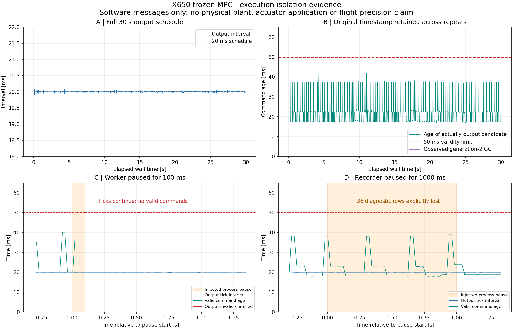

# 冻结 MPC 的执行隔离：服务器测试结果

2026-10-23，AutoDL 容器 `autodl-container-f64b45a5b8-51661812`，ROS 2 Humble，普通 Linux 调度。测试通过已授权 SSH 实际运行，使用独立 DDS 域和独立构建目录，没有启动 PX4/Gazebo、解锁或创建执行器发布器。

**最终版本通过 30 s 软件持续运行、1405 次新的数值复算和四项进程暂停测试。它验证执行架构及失败处理，不是新的物理末端保持或八字实验。** 总结见 [summary.json](summary.json)，统一流程见[执行隔离与真机迁移测试方法](../../X650_EXECUTION_ISOLATION_AND_TEST_METHOD.md)。

## 改动与冻结范围

状态接收、算法计算、定周期输出、完整诊断分为独立进程：

- C++ `state_ingress` 接收最新状态，保留原始时间与序号；只允许一个候选在途。
- Python worker 调用原适配器与冻结 C++ 数值库；只交付有界二进制诊断副本。
- C++ `periodic_dispatcher` 使用绝对 20 ms 时刻和显式 WaitSet，先读取已经就绪的消息再判定输出；不用定时器与订阅回调的默认优先顺序。
- 上一候选取得 shadow 输出序号确认后才进行下一轮，防止“已接受、尚未输出”的候选被覆盖。
- 完整 JSON 转换、写盘、fsync 在单独记录进程。队列满不阻塞控制，但会明确使记录不完整。

数值库 SHA-256 保持 `773241c1a3fe858f9d4b0e60f7f6b7465c6c0b9ef50b4ac1adac8f55590f7fef`，任务 SHA-256 保持 `f8d96cb8d70b55a9885b4723f5ea614d1978f4e50663921a2e9fe440b4357ae1`。MPC 参数、模型、约束、PID、20 ms QP 预算和 50 ms 控制门限均不变，原控制包与物理仿真入口没有修改。

原 30 工况/388 记录证明按原文件身份重新核验。本次另外记录新输入，逐条独立调用冻结核心；并未将旧证明或合成状态算作新的飞行精度成绩。

## 最终正常工况：healthy_v4

来源进程提供 200 Hz 非零时变位置、速度、姿态与关节软件激励；没有动力学 plant，也没有根据算法输出生成物理状态。完整任务窗口为 30 s，结束交接的消息也保留。

| 指标 | 实际结果 |
|---|---:|
| 已记录计算 / 准入候选 / 有输出确认的独立候选 | **1405 / 1405 / 1405** |
| 逐条独立复算数量 | **1405** |
| 所有指令字段最大绝对差 | **0** |
| 窗口内输出 tick 数 | 1500 |
| 窗口内有效输出 tick / 重复有效指令 tick | 1497 / 93 |
| 输出间隔：中位数 / P99 / 最大 | 19.9999 / 20.0390 / **20.0771 ms** |
| 相对计划发送时刻的最大迟到 | 0.1487 ms |
| 有效输出使用的原快照最大年龄 | **43.0642 ms**，小于 50 ms |
| worker 完整计算：中位数 / P99 / 最大 | 13.8353 / 17.0467 / **26.1068 ms** |
| QP：中位数 / 最大 | 0.2238 / 2.0096 ms |
| 诊断交接：中位数 / 最大 | 0.3724 / 0.5233 ms |
| 诊断丢失 | **0** |
| 自然 GC：第 0 / 1 / 2 代次数 | 42 / 4 / **1** |
| 自然第 2 代 GC 最长观测区间 | **11.4264 ms** |
| 控制准入拒绝 / 输出失效 | **0 / 0** |

输出确认数量包含结束交接；30 s 窗口内独立候选为 1404，最后一个在结束交接记录中确认。没有把重复指令当作新算法更新。约 50 Hz 的发送节拍与算法的新解频率分别统计；1405 次计算不能被表述为“每个 20 ms 都算出一个新解”。

GC 始终启用，没有主动关闭、调阈值或安排强制回收来获得通过。观测到一次第 2 代回收仍不能证明所有负载/长时间运行的最坏耗时。详细报告：[runtime_report.json](healthy_v4/runtime_report.json)、[worker_final.json](healthy_v4/worker_final.json)、[逐 tick 原始证据归档](runtime_evidence.zip)。

图 A 是真实输出 tick 间隔，蓝线稳定在 20 ms 附近。图 B 是正在输出的候选所用原快照的年龄；重复输出时不会重置年龄。紫线标记自然第 2 代 GC。图 C 暂停算法后，输出进程继续打 tick，但过期候选被标为无效。图 D 暂停记录进程后，状态接收与控制输出继续，诊断丢失单独记录。

## 最终版本四项故障注入

各用例为预先规定的 6 s 独立运行，第 2 s 对对应进程组发送 SIGSTOP，达到规定时长再 SIGCONT。实际暂停边界写入报告；操作只涉及本次测试自行启动的进程。

| 工况 | 实际观察 | 验收含义 |
|---|---|---|
| 算法暂停 100 ms | 暂停期间接收 20 次状态，输出进程继续 5 个 tick；下一过期输出被拒绝并锁存 | 状态接收与发送节拍不被算法进程冻结，旧指令不会重新标为新指令 |
| 算法暂停 25 ms | 接收与 tick 继续；本次仍因候选年龄超限而锁存退出 | **故障处理通过，连续控制未保持**；不宣称任意 25 ms 停顿均能恢复 |
| 状态来源暂停 120 ms | 暂停期间无新状态，输出进程继续 6 个 tick；来源过期被拒绝 | 不用旧状态持续续期 |
| 记录进程暂停 1000 ms | 期间接收 200 次状态、输出 50 个 tick；控制未失效；280 次交接中 244 条持久化、**36 条明确丢失** | 控制与大记录解耦；该次记录不完整，不能拿去授予物理实验通过 |

最终故障测试的输出间隔最大值分别为 20.0645、20.0244、20.0560、20.0527 ms。测试所有有效输出都满足原 50 ms 年龄限制，没有故障锁存之后重新输出有效指令的情况。

25 ms 人为暂停还要叠加已有指令年龄、计算、传输和发送相位，因此可能越过 50 ms。此处没有通过放宽门限、改打时间戳或无限复用旧指令来掩盖停顿。下一 tick 才报告失效也不等于执行器在有效期结束瞬间停止；真实消费、超时处置和物理停止要在实际接口阶段测量。

worker 暂停 100 ms 的那次 SIGSTOP 恰好覆盖一次诊断交接，因此该条交接墙钟耗时包含约 100 ms 的人为停止；它不是记录进程造成的同步等待。正常工况的 0.5233 ms 上界只描述本次正常样本。

用例报告：[100 ms 算法暂停](worker_pause_v2/runtime_report.json)、[25 ms 算法暂停](worker_short_pause_v2/runtime_report.json)、[来源暂停](source_pause_v2/runtime_report.json)、[记录暂停](recorder_pause_v2/runtime_report.json)。

## 单元/回归检查

- 两个 C++ CTest 均通过：原 shadow 准入与新增周期/有效期/停止锁存检查。
- 52 项 Python 检查通过：16 项算法消息/进程清理/来源检查、11 项原记录器检查、4 项新诊断通道检查、13 项原驱动/清理回归、8 项记录核验回归。
- 新诊断检查实际覆盖可变数组交接后不可改写、满队列非阻塞且丢失可见、超大包拒绝、接收者消失。
- 四个 ROS 包使用服务器已有依赖编译，未下载新程序。所有测试子进程已退出，没有启动中的仿真实例。

原始输出：[regression_final.log](regression_final.log)、[最终构建及 CTest 日志](healthy_v4.log)。

## 开发中的未通过记录

这些不是额外成功样本，也没有删除后重复抽取通过结果。每次重测前均有对应代码或报告逻辑修复。

| 记录 | 结果与后续修复 |
|---|---|
| commissioning_v1 | 合成预流总线起点与最早历史包不一致，准入正确拒绝；同时检查到微秒级提前唤醒与记录网格不同。修复测试时间范围及调度计时。 |
| commissioning_v2 | 3 s 计算和输出正常，150 次逐条一致；报告错误要求“停止时仍在途的计算”也必须已准入。修复结束交接计数，保留原失败报告。 |
| healthy_v1 | 只在 20 ms 回调处检查是否空闲，会为稍晚返回的候选额外等待一个周期，旧指令年龄达到 58.18 ms 后正确拒绝；改为最小周期满足后立即准入最新状态。 |
| healthy_v2 | 持续测试通过，但进一步序号核对发现接受候选与输出槽可能错位；新增输出确认后才推进下一候选的契约。该版不作为最终迁移版本。 |
| healthy_v3 | 有确认的版本暴露定时器/订阅处理顺序问题：下一候选已在准入端通过约 0.116 ms，发送端仍先处理 tick、沿用旧候选而拒绝。改成有界 WaitSet 显式先取就绪消息再输出，取得最终 healthy_v4。 |

healthy_v3 的两端时间证据指向处理顺序/交付边界，不能仅凭准入端时间证明消息当时已进入发送端 DDS 队列。最终实现消除了默认执行器顺序依赖，但不宣称消除网络和系统调度延迟。

早期原始报告位于 [development](development/)；最终矩阵为 `healthy_v4` 和四个 `*_v2`，不混用早期版本的故障结果授予最终版本通过。

## 证据、重现与下一关

- [机器可读总结](summary.json)：软件契约通过，`physical_hold_qualified=false`、`hardware_qualified=false`。
- [精确执行源码归档](runtime_sources.zip)及[源码哈希](runtime_sources_manifest.json)。归档内 52 个文件均与本地交付源码逐字节一致。
- [交付清单](delivery_manifest.json)：65 个小型原始文件的服务器路径、长度、SHA-256；全部下载核验通过。
- [完整交付归档](runtime_evidence.zip)保留上述原始文件；SHA-256 为 `a32a03035cdf2d3b14548281b4ba4ae9aae386bfc60f0199e858a418b1494e2e`。为便于代码审阅，逐 tick、状态接收与准入事件三类大 JSON 只以归档提交，不铺成十余万行 Git 差异。展开归档后按清单核验即可读取；本地展开副本在 `artifacts/isolated_runtime_20261023/raw_traces/`。
- 大体量完整 JSONL 诊断仍保存在服务器各运行目录下的 `recording/diagnostics.jsonl`；总结绑定了它们的路径与哈希。没有下载或拼接代替原始记录。
- 服务器根目录为 `/root/autodl-tmp/safe-aerial-manipulator-testbed`，本轮根目录为 `artifacts/isolated_runtime_20261023`，构建目录为 `/root/autodl-tmp/flyarm_ros2_isolated_v1_20261023`。

接下来应把同一契约接入实际 Gazebo/PX4/TS20 状态与消费回执，先做实际接口 shadow 运行，确认坐标、时间、历史和输出所有权，再在新入口重做完整末端保持。通过后才继续普通八字和快速八字。本轮没有为新运行时签发末端保持、普通八字或快速八字证书。

真机保留接口契约、测试程序、阶段顺序与验收口径；Orin 上重建并复测，动捕/舵机换成实际适配器和真实时间戳。TS20-50/24 V、实际负载和最终固件需要新的台架响应验证，当前 20 V 条件模型不会因运行时通过而自动获得 24 V 资格。
