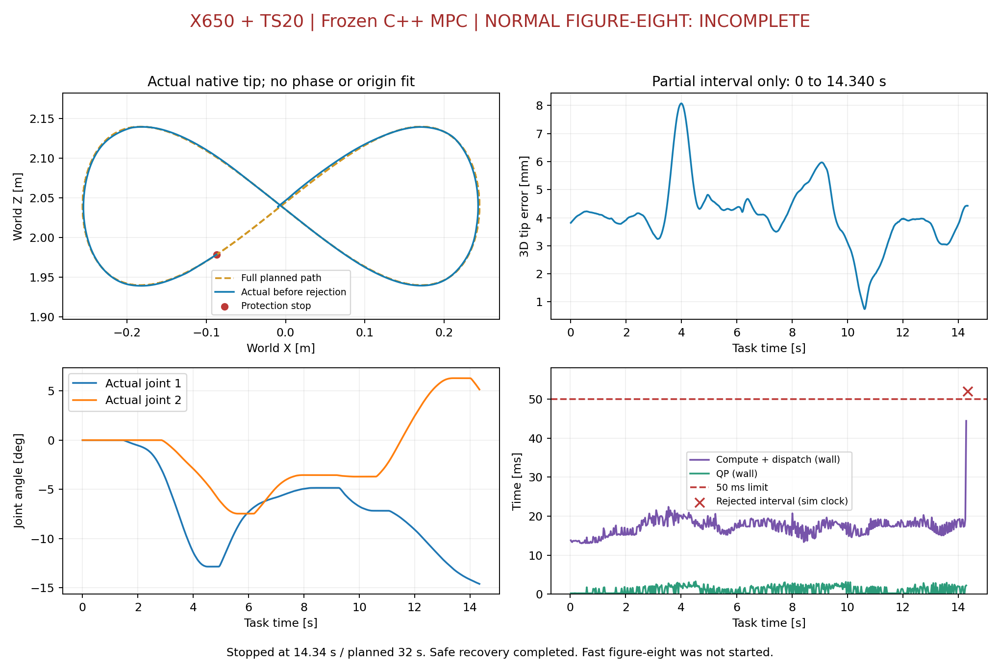
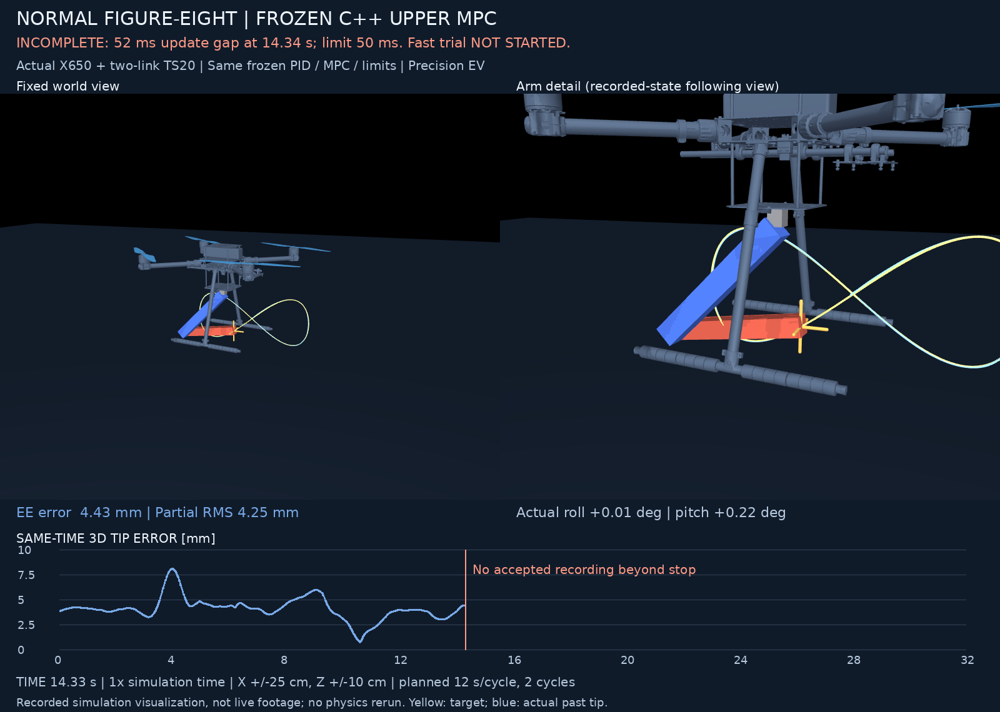

# 冻结 C++ MPC 的普通八字：首次实验未通过

2026-10-23，AutoDL 服务器，PX4 SITL + Gazebo，导入的 X650 URDF + 原二连杆机械臂，TS20 条件模型、精密 EV 定位。

**普通八字在任务时间 14.340 s 发生 52 ms 控制更新间隔，超过冻结的 50 ms 门限，实验因此未通过。快速八字未启动。** 仿真随后完成收臂、降落、上锁和参数恢复，运行实例已关闭。

## 冻结条件与前置检查

- 数值库、全部 MPC 配置、TS20 响应模型及限位与上一轮完整末端保持相同。
- 42 项实际 PX4 PID 参数与冻结文件逐项相同，最大绝对差为 0。
- 没有修改计算预算、更新间隔门限、轨迹尺寸或速度以获得通过。
- 新增独立轨迹入口及顺序准入检查，5 项测试通过，普通八字起飞前检查通过。
- 原软件证明、30 个冻结工况和 388 条记录的一致性证明均按文件哈希重新核验；本次没有把旧软件证明称为新的飞行结果。
- 新轨迹入口和任务协议在飞行之前保存。运行前后平台和控制源文件字节一致。

详见 [freeze_verification.json](freeze_verification.json)、[normal_task_v1.json](normal_task_v1.json)、[protocol.json](protocol.json) 和 [protocol_tests.log](protocol_tests.log)。

普通八字采用 X ±0.25 m、Z ±0.10 m、12 s/圈、2 圈；C2 相位加减速和起止保持共计完整任务 32 s。快速八字原定同尺寸、8 s/圈、完整任务 24 s。快速配置和运行均没有生成。

## 实际取得的部分记录

下表仅覆盖任务开始至保护触发的 **0–14.340 s**。这些数值描述实际记录，不能替代完整两圈实验验收。

| 指标 | 结果 |
|---|---:|
| 独立物理末端采样数 | 3586 |
| 成功返回的控制更新数 | 509 |
| 部分区间末端三维 RMS | 4.254 mm |
| 部分区间末端三维峰值 | 8.074 mm |
| 已记录运动段 2–14.340 s 的三维 RMS | 4.289 mm |
| 最大机体倾角 | 0.641° |
| 两关节实际角速度峰值 | 0.1498、0.0917 rad/s |
| QP 求解中位数 / 最大值 | 0.247 / 3.287 ms |
| 控制计算及下发中位数 / 最大值 | 17.323 / 44.424 ms |
| 已返回更新的最大间隔 | 36 ms |
| 随后被拒绝的更新间隔 | **52 ms** |

所有 509 次已返回的候选均通过原检查，没有旧计划兜底。52 ms 的失败发生在下一轮调用优化器之前；该轮没有生成或发布新指令。`36 ms` 只统计已返回的更新，不包含被拒绝的下一轮，不能用它代替整个实验的最坏间隔。

误差由 Gazebo 独立物理末端位置与同一时刻的解析目标相减得到；RMS 使用原始时间采样的梯形积分。没有时间、相位或空间平移拟合。原始数据哈希保存在 [partial_report.json](partial_report.json)。

[矢量图 PDF](normal_partial.pdf)

## 时序故障定位

保护前一轮的控制快照时间为任务时间 14.288 s。记录显示：

1. 该轮 QP 求解耗时 **2.231 ms**。
2. 同一控制线程内发生第 2 代自然垃圾回收，墙钟耗时 **24.786 ms**，线程 CPU 时间 **24.782 ms**，实际回收 41 个对象。
3. 垃圾回收发生在状态读取返回与首个关节发布之间。该轮整个记录的控制计算及下发耗时增至 **44.424 ms**。
4. 加上外层循环处理，下一次控制快照时间到达 14.340 s，与前一次间隔 **52 ms**，原门限拒绝继续执行。

这是实际事件时间的重叠证据。它将本次延迟定位到仍运行在同一 Python 线程中的外层路径；不是 QP 自身超过了 20 ms 求解预算。保留了完整 [control_failure_snapshot.json](control_failure_snapshot.json)。

上一轮 30 s 悬停没有观察到第 2 代回收，这次动态参考触发了该情形。因此，之前的单次悬停时序通过不能证明动态参考或长时间运行的时序也会通过。本次没有关闭垃圾回收、放宽门限或反复重跑筛选通过样本。

## 回放视频

视频为这一次原始 Gazebo 记录的可视化：左侧固定世界视角，右侧机械臂细节，下方相同时刻末端误差。画面始终标注 `INCOMPLETE`，32 s 时间轴在实际停止之后留空。

视频为 1600×1140、24 fps、345 帧、1 倍仿真时间，已完成整段解码检查。使用实际机体位置、姿态和关节角，视觉几何与执行 URDF 的哈希一致，全采样正运动学核对通过。没有重跑动力学，也没有补造未记录的旋翼角度。

本地视频位于项目的 `artifacts/native_figure8_20261023/X650_normal_CPP_MPC_INCOMPLETE.mp4`，大媒体不纳入 Git。服务器同一文件在 `artifacts/native_figure8_20261023/delivery_failed_normal_v2/`。

[渲染与解码检查记录](render_status.json)。首次离线绘图因 Conda 的 C++ 运行库与系统字体依赖冲突中止；第二次仅对离线渲染进程设置系统 `libstdc++.so.6` 的 `LD_PRELOAD`，没有影响任何物理实验或控制环境，见 [render_environment_v2.json](render_environment_v2.json)。

## 复核入口

服务器项目根目录：`/root/autodl-tmp/safe-aerial-manipulator-testbed`。

运行目录：`runs/x650_ts20_figure8_v1_20261023_190155_32917`。

启动目录：`runs/x650_ts20_figure8_launch_20261023T110124Z_32913`。

独立入口及协议说明：[simulations/x650_ts20_figure8_v1](../../../simulations/x650_ts20_figure8_v1/README.md)。

本目录保存本次部分报告、配置、失败快照、运行状态和原始平台来源记录的字节副本。[delivery_manifest.json](delivery_manifest.json) 含各服务器来源、文件尺寸和哈希。原始 CSV、JSONL、ULog 和执行源码归档仍在上述运行目录内。失败运行没有生成通过证书；实际顺序驱动见 [sequence_driver_v1.py](sequence_driver_v1.py)。

下一阶段应保持数值库和控制参数冻结，处理 Python 外层的时序停顿，特别是状态接收、定周期下发和大诊断记录与对象生命周期的隔离。先用本次故障记录和包含自然第 2 代回收的持续运行检查验证修复，再重新做完整普通八字。普通八字通过后才进入快速八字。
