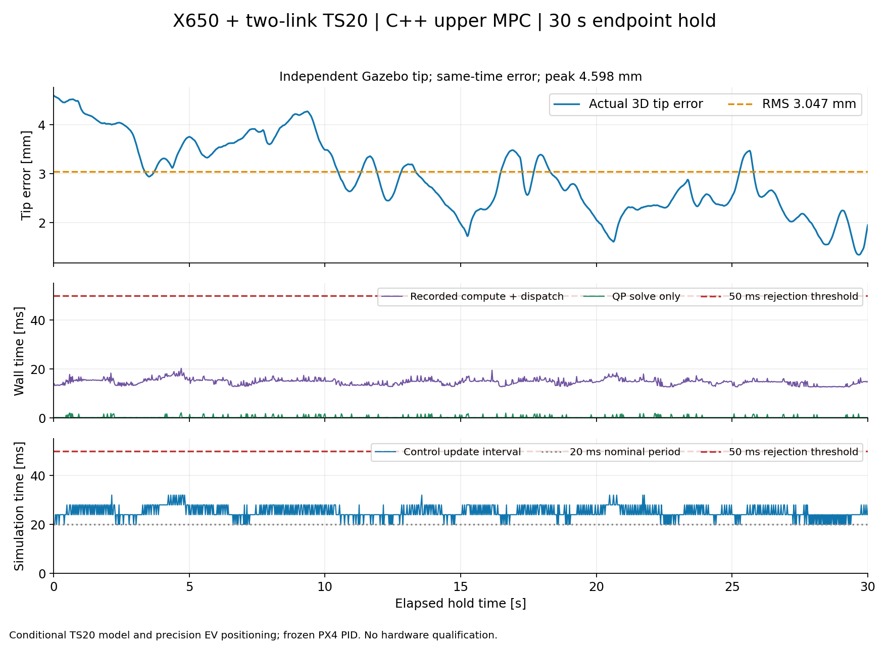

# X650 上层 MPC 的 C++ 数值核心与完整末端保持验收

2026-10-23：矩阵组装、QP 求解、完整约束/KKT 校验及候选指令检查已接入显式选择的 C++ 后端。最终源码通过 332 项软件回归、30 个冻结工况、388 条已有控制记录复核，以及服务器上新的悬停、摆臂、30 秒末端保持完整流程。快速八字尚未执行。

平台为 AutoDL 服务器的 PX4 SITL + Gazebo，模型为导入的 X650 URDF 加原二连杆机械臂，使用 TS20 条件响应模型和精密 EV 定位模式。PX4 PID、MPC 代价权重、物理/软件约束、候选检查容差以及 50 ms 拒绝门限保持原值。

## 实际控制结构

```text
实际机体状态 + 因果关节状态/已执行 MIT 数据
    ↓ Python 状态、目标预览及接口数据准备
C++ 机体/关节预测矩阵 → 代价与约束组装
    ↓
C++ QP 求解 → 原完整约束及 KKT 校验
    ↓
原生 TS20 非线性预测 → C++ 候选位置/速度/包络检查
    ↓ Python 原有事务提交、超时保护、ROS 2/PX4 调用
PX4 机体 PID + 两关节执行器 → 实际状态反馈
```

这是冻结 PX4 内环之上的速度层 MPC。Python 仍负责观测、接口数据准备和仿真生命周期；数值核心已有独立 C ABI。原始参考控制器和 TS20 物理/预言机预测器保持不变，`NativeJointMatrices` 只在明确选择 C++ 后端时启用。当前还没有进行力矩级全身 NMPC 或 Orin NX 实时性验收。

代码与构建/调用方法见 [NATIVE_NUMERICS.md](../../../control_packages/x650_wholebody_v1/NATIVE_NUMERICS.md)。实现提交为 `d4c5765` 和 `a19d691`。

## 数值和进程一致性

冻结协议在比较前保存于 `native/validation_protocol.json`。比较使用相同的实际状态、前一控制计划、目标、约束以及截至观测时刻已执行的数据，不使用未来物理状态。

| 检查 | 最终结果 |
|---|---:|
| 软件回归 | 332 项通过，0 失败、0 错误、0 跳过 |
| 冻结工况 | 30/30 通过 |
| 原有记录逐次调用 | 388/388 通过 |
| 记录复核的最大矩阵差 | 4.159 × 10⁻¹¹ |
| 最大归一化控制计划差 | 7.352 × 10⁻¹³ |
| 最大预测状态差 | 1.951 × 10⁻¹³ |
| 最大归一化目标函数差 | 5.131 × 10⁻¹⁶ |
| 候选接受/拒绝结果、MIT 包 | 所有比较一致 |
| 最终配置的 ROS 2 正常往返 | 50/50，通过；11.954–13.565 ms |
| ROS 2 工作进程停止 | 通过；停止后接受指令数为 0 |

软件计时中，30 个不加剖析的冻结调用最大 14.092 ms。388 条记录的带仪器调用，C++ 后端最大 24.975 ms，Python 参考最大 33.566 ms。这些是本次实测值。它们不构成最坏耗时上界，也不能代替下面的闭环记录。

原有 56 ms 周期间隔拒绝记录保持原样。388 条比较对应其中实际返回的控制调用，不把被拒绝的间隔改写为成功样本。

## 新的物理闭环验收

同一最终源码依次完成以下三阶段。三个运行均完成收臂、降落、上锁、参数恢复、PX4 ULog/独立 Gazebo 记录审计及执行源码前后的一致性核对。

| 阶段 | 主要结果 |
|---|---|
| 折叠悬停，20 s | 机体三维位置 RMS 1.543 mm，峰值 2.414 mm |
| 双关节摆臂，30 s | 两关节双向运动、指令方向均正确；角度跟踪 RMS 0.184°、0.202°；机体最大偏移 9.345 mm，最大倾角 0.158° |
| MPC 末端保持，30 s | 末端三维误差 RMS **3.047 mm**，峰值 **4.598 mm** |

最终末端保持使用 7501 个独立物理末端采样，包含 1205 次控制更新。全部解通过原始约束和非线性候选检查；没有使用旧计划兜底，也没有触发求解或整体控制超时拒绝。

误差定义为世界系下同一时刻的 `e = p_tip_actual − p_tip_target`，三维 RMS 为整个 30 s 上 `||e||²` 的时间加权均值开根号。实际末端来自 Gazebo 原生记录器，不使用控制器预测末端充当测量；没有做时间、相位或位置偏差拟合。

| 完整末端保持计时 | 中位数 | P99 | 最大值 |
|---|---:|---:|---:|
| 记录的控制计算及下发，墙钟 | 14.865 ms | 18.025 ms | **20.333 ms** |
| 其中 QP 求解，墙钟 | 0.223 ms | 1.787 ms | **2.188 ms** |
| 控制更新间隔，仿真时钟 | 24.000 ms | 32.000 ms | **32.000 ms** |
| PVA 本地发送返回间隔，墙钟 | 25.147 ms | 29.724 ms | **32.236 ms** |

名义控制周期为 20 ms，实际更新间隔为 20–32 ms。审计字段 `max_actual_send_interval_s` 按控制记录中的仿真时间计算；额外列出的 PVA 墙钟间隔仅说明本地发送调用返回，不等同于下游执行器确认。完整运行未触发 50 ms 门限。本次自然垃圾回收观察到 115 次第 0 代、10 次第 1 代和 0 次第 2 代回收；没有关闭或主动触发回收。因此本次通过不构成长时间运行、所有 GC 情形或 Orin 负载下的硬实时证明。



[矢量 PDF](endpoint_hold.pdf) · [数据摘要](hold_summary.json) · [末端保持验收证书](tip_hold_certificate.json)

## 本轮发现并修复的问题

- 数值库接口使用借用指针，避免 NumPy 1.21 `ndpointer/data_as` 产生 ctypes 所有权循环；同步调用期间始终保留数组强引用。
- 关节滑动分支的灵敏度递推进入 C++。模型的精确 A/B 转移、延迟数据包索引、量化和非线性检查定义保持一致。
- 候选传播独占的新包络直接交给诊断记录，减少逐个极值字典的重复复制。
- 正常收臂时，TS20 已切换到物理安全反馈；现在同时清除旧估计器诊断，避免把它误标为仍在使用的反馈，也避免对空加速度迭代。回归测试覆盖实际 `ControlLoop.pump()` 的该过渡，保留原收臂及保持输出。

先前失败运行完整保留：

| 运行目录末尾 | 状态 |
|---|---|
| `20261023_174809_26309` | 25.916 s 时发生 52 ms 间隔拒绝；之前一轮计算重叠约 27.4 ms 的自然第 2 代回收；安全降落 |
| `20261023_180950_28031` | 完成 30 s 测量，随后收臂记录因空加速度失败；安全降落，未作为阶段通过 |
| `20261023_182434_30924` | 修复后新的完整记录；测量、收臂、降落、恢复和独立审计全部通过 |

上表前两次运行没有被补写成成功实验。完整路径与元数据 SHA256 见 [verification_summary.json](verification_summary.json)。

## 证据及复核入口

服务器项目根目录：`/root/autodl-tmp/safe-aerial-manipulator-testbed`。

最终实验目录：`runs/x650_ts20_damped_hold_v1_20261023_182434_30924`。

最终软件证明：`artifacts/native_numerics_20261023/software_v4`；最终运行配置：`artifacts/native_numerics_20261023/quiet_task_cpp_v5.json`。

最终优化库：`/root/autodl-tmp/x650_native_optimization_build_v2/libx650_optimization.so`。

其 SHA256 为 `773241c1a3fe858f9d4b0e60f7f6b7465c6c0b9ef50b4ac1adac8f55590f7fef`。

本目录保存以下实际文件的原始字节副本，逐文件哈希见 [delivery_manifest.json](delivery_manifest.json)：

- 软件：[native_acceptance.json](native_acceptance.json)、[software_acceptance.json](software_acceptance.json)、[package_report.json](package_report.json)。
- 数值：[matrix_report.json](matrix_report.json)、[recorded_calls_report.json](recorded_calls_report.json)。
- 进程：[ros2_healthy.json](ros2_healthy.json)、[ros2_worker_timeout.json](ros2_worker_timeout.json)。
- 物理：[hover_folded_certificate.json](hover_folded_certificate.json)、[joint_probe_certificate.json](joint_probe_certificate.json)、[tip_hold_certificate.json](tip_hold_certificate.json)。
- 执行版本：[platform_verification.json](platform_verification.json)、[quiet_task.json](quiet_task.json)。

原始 CSV、JSONL、ULog、执行源码 ZIP 仍在证书指向的服务器运行目录内。证书包含准确哈希，服务器 Git HEAD 之外的工作区源文件由每次运行的归档绑定；上述实现提交不冒充整个服务器工作区的唯一版本标识。复核应使用归档及绑定配置。

已有服务器依赖和数据盘资产下，重做独立审计并绘图可运行：

```bash
cd /root/autodl-tmp/safe-aerial-manipulator-testbed
export PYTHONPATH=/usr/lib/python3/dist-packages:/root/autodl-tmp/amsim-venv/lib/python3.10/site-packages
export OPENBLAS_NUM_THREADS=1 OMP_NUM_THREADS=1 MKL_NUM_THREADS=1
/usr/bin/python3 simulations/x650_ts20_hold_v1/audit.py \
  --run-dir runs/x650_ts20_damped_hold_v1_20261023_182434_30924 \
  --launch-dir runs/x650_ts20_launch_20261023T102402Z_30920 \
  --output artifacts/native_numerics_20261023/review_audit_NEW
/usr/bin/python3 scripts/report_x650_native_hold.py \
  --run-dir runs/x650_ts20_damped_hold_v1_20261023_182434_30924 \
  --certificate artifacts/native_numerics_20261023/review_audit_NEW/ts20_stage_certificate.json \
  --output artifacts/native_numerics_20261023/review_figure_NEW
```

输出目录须使用未存在的新路径。源码或已绑定文件发生变化时，应保留原证据并重新验证相应版本。

这一验收建立了继续轨迹实验的基础。后续按普通八字、快速八字的顺序推进。当前 TS20 模型仍基于约 20 V 台架数据，实际 24 V 带载空中机械臂、定位硬件和 Orin 时延需要各自独立验证。
