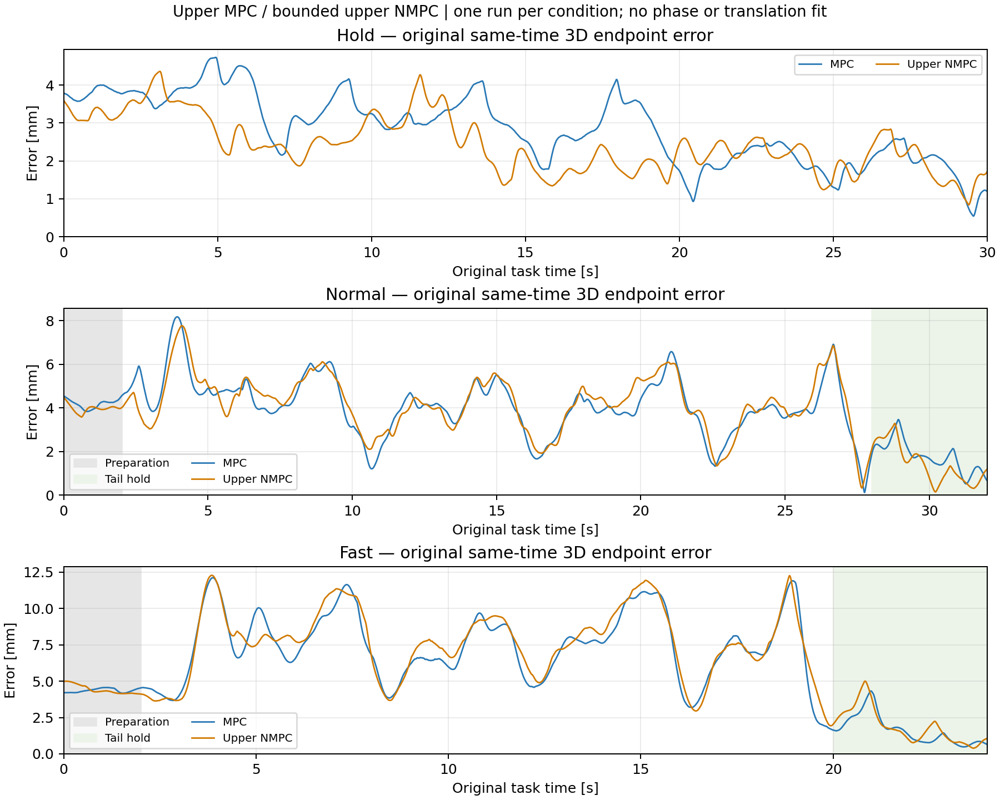

# 上层 MPC／NMPC：新的完整仿真验收与同条件对照

2026-10-27，X650 导入机架＋原二连杆机械臂，在实际 PX4／Gazebo 反馈和执行端完成六次新实验。两种后端各自按**完整末端保持 → 普通八字 → 快速八字**的顺序通过独立验收。本轮没有用旧 MPC 记录替代新的物理对照，也没有为得到更好分数调整模型、权重或约束。

**当前结论：闭环执行链已跑通；这版上层 NMPC 没有显示一致的精度优势，计算开销高于保留的 MPC。** 保持工况 NMPC 的误差略低，普通八字指标各有优势，快速八字中 MPC 的误差略低。每个组合只有一次新运行，不能据此推出统计显著性或普遍鲁棒性优势。

## 相同条件

| 项目 | 两种后端的共同设置 |
|---|---|
| 物理平台 | X650 URDF 导入机架＋原二连杆、同一 TS20 执行模型 |
| 执行接口 | 飞机三轴速度＋两个关节速度；共用 PX4 内环与关节执行桥 |
| 定位 | 原精密定位模式，实际外部位置／速度／高度融合参数逐字段核对 |
| 上层准入／周期下发 | 名义 25 Hz／50 Hz，最小准入间隔 40 ms／发送周期 20 ms |
| 候选原始请求时限 | 50 ms，原始 issue 时间不能在排队或求解后重置 |
| 候选指令有效保持上限 | 160 ms |
| 模型、PID、权重与限位 | 从同一现有 multirate 配置派生；保留原节点间硬约束，无松弛变量 |
| 预测节点 | 15 个，后续节点间隔 40 ms |
| 诊断模式 | 两种后端均 Full，辅助线程记录，完整性独立检查 |
| 保持 | 新的完整 30 s |
| 普通八字 | X ±0.25 m、Z ±0.10 m、12 s／圈、两圈；完整窗口 32 s |
| 快速八字 | 同幅值、8 s／圈、两圈；完整窗口 24 s |
| 外扰 | 本组六次均未注入外扰；不是新的抗扰或模型偏差结论 |

六组的模型 SHA、原生 Config SHA、PID SHA、实际 PX4 参数、数值库、执行二进制、时序和 CPU 资源配置均经精确核对。每一配对的参考轨迹、时长、生成位置、悬停高度、名义分配、前馈及 TS20 输入一致。各次起飞后的实测初态并非声称逐位相同；原始 LiveStart 目标中心和初态保留在 `comparison/comparison.json`，没有事后拟合平移或相位。

## 末端误差

下表使用**独立物理末端 `native_trace.csv`** 与同一时刻参考的三维距离。RMSE 按原始时间戳作梯形积分加权；图与表由完整原始窗口重新计算，并与独立审计逐项交叉验证。

| 工况／窗口 | MPC RMSE（mm） | NMPC RMSE（mm） | MPC 峰值（mm） | NMPC 峰值（mm） |
|---|---:|---:|---:|---:|
| 保持，全 30 s | 2.988 | 2.533 | 4.730 | 4.361 |
| 普通八字，全 32 s | 4.099 | 4.152 | 8.173 | 7.772 |
| 普通八字，运动段 2–28 s | 4.332 | 4.423 | 8.173 | 7.772 |
| 普通八字，回零保持 28–32 s | 1.909 | 1.690 | 3.469 | 3.288 |
| 快速八字，全 24 s | 6.865 | 7.091 | 12.108 | 12.274 |
| 快速八字，运动段 2–20 s | 7.741 | 7.986 | 12.108 | 12.274 |
| 快速八字，回零保持 20–24 s | 1.890 | 2.208 | 4.323 | 5.003 |

运动段包含原有平滑起止段；前 2 s 与末尾 4 s 没有从完整窗口分数中删除。原验收阈值仍为末端 RMS 50 mm、峰值 100 mm、倾角峰值 8°，未为本轮结果放宽。



蓝线为 MPC，橙线为上层 NMPC；灰区为开始保持，绿区为末尾回零保持。图中没有插入平移、相位修正或额外平滑。

## 计算与执行时效

| 工况 | MPC 核心 P95／最大（ms） | NMPC 核心 P95／最大（ms） | MPC 原 issue→gate 最大（ms） | NMPC 原 issue→gate 最大（ms） |
|---|---:|---:|---:|---:|
| 保持 | 10.122／13.500 | 25.571／30.451 | 13.944 | 31.124 |
| 普通八字 | 13.331／16.981 | 29.365／38.581 | 17.404 | 39.260 |
| 快速八字 | 16.642／19.596 | 32.609／41.497 | 22.205 | 41.918 |

快速 NMPC 的个别调用超过名义 40 ms 周期，因此不能写成“每一周期均在 40 ms 内算完”。最大原始 issue→gate 耗时为 41.918 ms，仍在既定 50 ms 接收期限内。下发器与求解器独立运行，继续发送仍有效的指令；六组最大发送间隔为 26.529 ms。上述是本次实际测量，不能当作硬实时最坏执行时间证明或 Orin NX 资格。

在线 NMPC 每个原始请求最多生成四个重新线性化提案，并依据完整非线性六项代价及硬约束检查选择候选。40 ms 是启动新提案的软预算；不可抢占的数值调用超出总期限后，其结果必须拒绝。该实现是有界的上层非线性优化原型，不声称一般非线性规划全局收敛，也不是推力／力矩级全身 NMPC。

## 连续下发、关节消费和退出

| 工况 | 后端 | 数值候选／真实发送后提交 | 未发送尾项丢弃 | 正常下发＋停止 | 两关节实际采纳 |
|---|---|---:|---:|---:|---:|
| 保持 | MPC | 717／716 | 1 | 1498＋1 | 各 1499 |
| 保持 | NMPC | 715／714 | 1 | 1497＋1 | 各 1498 |
| 普通八字 | MPC | 770／770 | 0 | 1598＋1 | 各 1599 |
| 普通八字 | NMPC | 760／759 | 1 | 1597＋1 | 各 1598 |
| 快速八字 | MPC | 573／573 | 0 | 1198＋1 | 各 1199 |
| 快速八字 | NMPC | 566／566 | 0 | 1197＋1 | 各 1198 |

- 4101 个通过检查的在线候选（按一次请求的最终选择计数，内部多次提案另记），4098 次真实发送后提交；三个未发送尾项正确丢弃，不推进内部 Memory。
- 8585 次正常发送＋6 次停止＝8591 次；两个关节各采纳全部 8591 次。
- 所有运行均无诊断丢失、无门控或下发故障；完成控制权交接、停止消费、落地上锁及参数恢复。
- 这里的“采纳”是 Gazebo 执行插件物理边界记录的实际采纳，不是实体舵机总线 ACK。独占写入、桥接顺序与计数映射假设保留在各报告中。

上层仍不等待每条关节命令的完整消费往返。真实 `ActuatorSend` 负责确认指令已交给执行接口并提交一次内部状态，独立消费账本异步监督关节采纳。

## 软件验证与本轮修复

原生非线性目标、事务、在线准入测试，以及 ROS worker 的发送提交、Full 诊断与 JSON 编码测试通过。两个后端的健康回放各 24／24 通过；过期 issue 与不安全关节状态均正确拒绝且零状态提交。原生测试还覆盖数值调用迟到后的拒绝。这些软件测试使用私有 DDS 域和明确标注的合成发送通知，没有被计为物理消费或飞行成功。

接入时定位到完整诊断编码吞吐不足：旧 JsonCpp 编码与 DOM 组装合计可能超过 40 ms。新 worker 使用保留所有字段与 double／整数精度的 `std::to_chars` JSON 编码，并保持四槽有界队列和辅助记录线程；没有通过删除记录或扩大队列掩盖问题。六次物理运行均验证记录完整。

## 文件与复现入口

- [仿真入口与架构](../../UPPER_CONTROLLER_SIMULATION.md)
- [保留的 MPC 调用接口](../../../control_packages/x650_mpc_controller_v1/README.md)
- [NMPC 数值调用接口](../../../control_packages/x650_nmpc_controller_v1/README.md)
- [ROS 2 worker、真实发送事务与记录协议](../../../ros2_ws/src/flyarm_nmpc_cpp/README.md)
- [全部窗口及差异表](comparison/comparison.md)、[机器可读对照](comparison/comparison.json)、[PDF 图](comparison/endpoint_error.pdf)
- 六份独立审计：[MPC 保持](mpc_hold/report.json)、[NMPC 保持](nmpc_hold/report.json)、[MPC 普通](mpc_normal/report.json)、[NMPC 普通](nmpc_normal/report.json)、[MPC 快速](mpc_fast/report.json)、[NMPC 快速](nmpc_fast/report.json)
- `comparison/*_endpoint.csv`：六份已核验的原窗口物理末端／参考／误差派生视图，17 位有效数字；完整原始物理 trace、CDR、数值候选、ULog 和生命周期日志仍保留在服务器。
- `local_delivery_manifest.json` 记录本地文件与服务器原文件的 SHA256 对应；原始报告内的服务器路径未改写，也不将这份精简交付冒充完整原始日志归档。

服务器完整结果根目录为 `/root/autodl-tmp/safe-aerial-manipulator-testbed/artifacts/nmpc_live_20261027`。正式物理输入为 `nmpc_hold_inputs_v2`，以及其他后端／工况各自的 `*_inputs_v1`；最终图表来自 `paired_summary_v2`。早期未通过的软件探针和第一版图表仍留在服务器，不覆盖失败或被替代的证据。

准备、启动和审计命令见仿真入口文档。新工况的审计命令为：

```bash
python3 scripts/audit_x650_upper_controller.py \
  --launch-dir "$LAUNCH" --run-dir "$RUN" --output "$NEW_AUDIT"
```

只有六份新的审计全通过后，才运行 `scripts/summarize_x650_upper_comparison.py --reports ... --output "$NEW_SUMMARY"`。汇总会重新校验原文件身份、配对条件和原始物理误差；它不启动仿真、不更改记录，也不补写成功状态。
