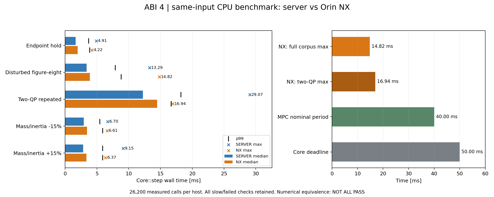

# 当前 ABI 4：服务器与 Orin NX 同输入及双 QP 压力测试

日期：2026-10-27。**时间预算通过，完整数值一致性尚未通过。** 本次保持生产 Core ABI 4、QP ABI 2、TS20 预测器及控制参数不变，把上一轮配对方法用于当前 25 Hz MPC／50 Hz 下发配置。两端各 26,200 次正式调用，均没有超过 40 ms；NX 有 9 个不同输入超过原数值容差，失败记录保留，未放宽门槛。



## 覆盖的计算工况

使用完整历史实际反馈记录，按原 LiveStart 和每一步成功提交重建 Memory；每次调用前恢复相同 Memory。包括全部 711 条末端保持、570 条受扰快速八字、569 条质量／惯量 −15%、570 条质量／惯量 +15%，共 **2,420 个不同输入**。每个正式重复 10 次，另有 2 次预热。

重工况按原算法分支预先选取：受扰记录的 **351、354、358、364** 号调用均需要 2 次 QP 求解。这四条各重复 500 次，额外 2,000 次正式调用。没有按本轮测出的耗时挑选样本。当前问题规模为 75 个优化变量、230 条通用线性约束行；本批重工况触发可信中心恢复，但未触发附加区间约束行。

受扰快速八字的原物理实验虽完整运行，**轨迹精度验收未通过**；原结论原样保留。质量变化和保持记录的原物理验收通过。使用这些记录测 CPU 不能替代重新飞行或恢复原失败实验的物理证书。

## 同输入结果

以下为正式调用的 Core 墙钟耗时，单位 ms。统计包括所有数值比对失败的调用；百分位从全部单次样本计算，没有平均各分块百分位。

| 工况 | 正式调用／端 | 服务器中位数 | 服务器 P99 | 服务器最大 | NX 中位数 | NX P99 | NX 最大 |
|---|---:|---:|---:|---:|---:|---:|---:|
| 末端保持 | 7,110 | 1.640 | 3.694 | 4.905 | 1.978 | 3.852 | 4.224 |
| 受扰快速八字 | 5,700 | 3.390 | 7.881 | 13.292 | 3.880 | 8.827 | 14.822 |
| 质量／惯量 −15% | 5,690 | 2.941 | 5.456 | 6.701 | 3.459 | 5.917 | 6.611 |
| 质量／惯量 +15% | 5,700 | 2.825 | 5.901 | 9.149 | 3.337 | 5.912 | 6.369 |
| 双 QP 重复压力 | 2,000 | 12.226 | 18.232 | 29.068 | 14.485 | 16.686 | 16.939 |

当前周期必须分开解释：

- 上层 MPC 名义更新周期 **40 ms（25 Hz）**。
- 独立连续下发周期 **20 ms（50 Hz）**，不要求每次下发重新求解。
- 原 Core 单次计算上限 **50 ms**，没有为了测试改变。
- 第一条候选命令的保持检查覆盖 **160 ms**，这不是计算时间预算。`max_dt=0.1` 是允许的建模步长上界。

NX 双 QP 最大正式耗时占 40 ms 的约 **42.3%**，本批剩余约 23.1 ms；这是已测样本的余量，不能作为任意负载下的最坏情况保证。冷启动阶段另行保留，双 QP 的 NX 首次调用为 **17.316 ms**。包括首次与预热在内，每端 **31,057 次**调用均返回，保持检查及原候选约束通过，无超过 40／50 ms 的调用。

服务器双 QP 中位数更低，但这轮最大值更高；不能据一个最大值把 NX 描述为普遍比服务器快。线程 CPU 时间也单独记录：双 QP 中位数服务器 **12.226 ms**、NX **14.437 ms**。墙钟与线程 CPU 的差包含计时顺序和系统效应，不直接命名为纯调度延迟。

## 未通过的数值检查

协议在测量前确定，沿用上一轮显式 `recorded-derived-v2`：命令／速度等为 1e-7，位置参考为 1e-9；关节加速度采用 `1e-7 / 本步 dt`，并单独检查其是否严格满足速度差分公式。全部历史十字段参考仍保留。

服务器复现历史结果的全部十字段最大绝对误差为 **4.86e-15**。NX 对历史以及 NX 对服务器的同输入比对均有 **9／2,420 个不同输入**超过原命令或速度容差：

- 受扰：180、498、501。
- 质量／惯量 −15%：374、376、379。
- 质量／惯量 +15%：373、375、378。

它们各正式重复 10 次，共 **90 次正式逻辑配对**失败；加预热后为 108 次。历史参考和跨端检查分别计数时是 216 条检查失败，不能把它们误算成 216 个不同输入。四条双 QP 重工况通过本协议。

最大关节速度差 **4.758823581e-7 rad/s**，最大基座速度前馈差 **1.730207362e-7 m/s**，最大关节加速度差 **1.189705895e-5 rad/s²**。位置参考最大差 **4.44e-16 m**。各端仍通过自身 QP／非线性／保持检查，没有计算超时；这不等于跨端输出已通过预设容差。

额外统一十字段均按 1e-7 的旧严格检查也完整保留：139 个输入、1,390 次正式逻辑配对失败。该额外结果与上述正式误差传播协议并列记录，未把它用于掩盖 9 条主命令失败。

已确认差异来自同一输入在不同平台的计算结果；**尚未定位具体算子或编译差异**。浮点乘加、矩阵组装与 QP 数值敏感性应通过这九条固定快照进一步排查，不能仅凭数量小就放宽容差或宣称可直接上机。当前计算时间没有显示迫切的 CUDA 需求；应先定位这些差异，再做算子级 CPU／CUDA 数值和耗时对照。

## 测试边界和机器条件

同一源码包 SHA-256：`4ed0bd1b22d1d0d25550d050ff042d251c43680c2da9f5e4d83e322a47c578b9`。两端均 GCC 11.4 系列、CMake Release、FP64；分别绑定实际加载的四个 ELF SHA。生产 Core、优化器、预测器源文件与原 ABI 4 实验字节一致。新增内容是测量工具、ABI 检查和计时结束后的诊断导出。

两端固定到各自 CPU 2。NX 为约 16 GB Orin NX、MAXN、schedutil，CPU 2 可用范围 0.7296–1.984 GHz；没有改功耗、频率策略或真实执行器状态。NX 测试前后 CPU 温度约 53.125／53.218 °C，仅为端点采样。服务器为 x86_64 AutoDL 容器，宿主仅报告匿名 Intel 型号，不能据此猜测具体 CPU。内核、库版本、频率和负载不是跨硬件相同条件。

计时覆盖 `Core::step` 内的预测、矩阵组装、QP、恢复、非线性／保持检查和成功状态提交。输入解码、哈希、Memory 恢复、oracle 对比、JSON 编码、SSH、日志保存均在计时区间之外。程序完成全部测量后才开始输出，因此服务器长时间结果回传未计入算法耗时。后续传输启用 SSH 压缩，原命令和数据哈希不变；原始 transport 记录明确保留每块实际选项。此改进不计为算法提速。

NX 的专用目录最终只有 **4 个 ELF，共 615,648 字节**，SHA 未变；构建和测试在 RAM 内完成，临时目录已清除。输入、结果和日志均留工作站。服务器 `/dev/shm` 挂载为 `noexec`，首次测试未能启动的记录保留；随后在服务器数据盘临时目录构建并清理。未修改系统挂载。

两端分别 **8／8** 原生及进程测试通过，工作站 **41 项**相关回归通过。没有测 ROS 至执行器的总延时、带视觉并发时的长期热稳态、所有三次 QP／区间修复分支或更大规模 NMPC，也没有使用 CUDA。

## 文件与复现

- `summary.json`：汇总、时间与数值结论、全部分组、环境及不同口径的失败计数。
- `numerical_failures.csv`：正式协议失败的输入、字段及最大差异。
- `protocol.json`：测量前确定的协议。
- `code_only_sources.tar.gz`、`source_manifest.json`：实际构建源码与成员哈希。
- `production_source_unchanged.json`：生产数学源码未更改的核验。
- `abi4_timing.png`、`abi4_timing.pdf`：屏幕／矢量图。
- `tests.log`：相关回归记录；原生 CTest 原输出见工作站完整归档。
- `raw_evidence_receipt.json`：完整输入、原始结果、失败、构建及传输记录的本地归档哈希。原始归档保留工作站，未在 NX 留存，也未纳入 Git。

在仓库根目录准备当前完整输入（输出目录必须不存在）：

```powershell
python scripts/prepare_x650_abi4_benchmark.py --output artifacts/abi4_reproduce --cpu 2
```

准备工具读取两组已有完整 ZIP／receipt，检查所有使用成员的 SHA、原始 CDR、源码及连续提交，然后输出九块 JSON。所有输入、历史初值、重工况选择和原物理失败结论均保留。重新准备时路径等 provenance 可能使输入整体 SHA 改变；两个目标必须使用同一份新字节，不能混合新旧输入的哈希。

`scripts/build_x650_benchmark_in_ram.py` 可通过 SSH `python3 -c` 接收源码 tar 的 stdin；参数 `--sha256` 绑定实际源码包，`--runtime-root` 指向专用代码目录。NX 保持默认 `/dev/shm` 构建根；服务器如需处理 `noexec` 可显式指定 `--build-root /root/autodl-tmp`。该工具在测试通过后仅保留四个 ELF。

两端分别用 `scripts/run_x650_orin_benchmark.py`，传入相同 `--input`／`--input-sha256`、本端代码路径及四个实际 SHA。结果保存到工作站。逐块复核必须显式使用：

```text
compare_x650_paired_core_benchmark.py ... --field-policy recorded-derived-v2 --timing-profile abi4_mpc25_dispatch50
```

完整汇总入口为 `scripts/report_x650_abi4_benchmark.py --root <工作站记录目录> --preparation <准备目录> --output <新报告目录>`。本次整体 `pass=false`，报告生成后返回非零退出码；`complete=true` 仅表示记录与核查完整。不要把报告文件成功生成或单独的耗时达标等同于全部验收通过。
