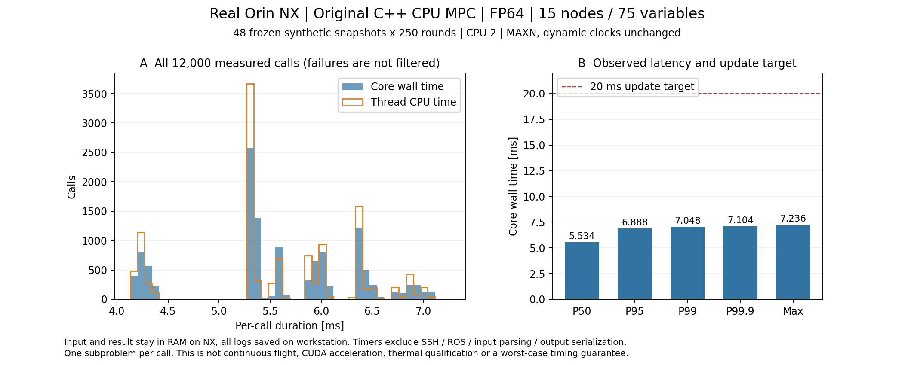

# 真实 Orin NX：MPC Core 首轮 CPU 基准

2026-10-25已在用户的实体Orin NX上完成CPU基准，首轮96次正式调用通过后，执行48个固定快照×250轮，共12,000次正式调用；另有240次预热和单独保留的首次Core调用。模型、权重、限制、double精度和生产50 ms规则保持原值。

这48个案例来自已验收快速八字归档中的独立合成数值工况，覆盖12个相位与12/16/20/24 ms首步长。它们不是实际快飞1198次状态的完整记录。每次计时前恢复同一案例的完整Memory与输入，独立核对命令、位置参考和速度前馈。来源、每条原始记录和实际加载代码SHA均保存在工作站。

## 结果

| 指标 | Core墙钟时间 | 同线程CPU时间 |
|---|---:|---:|
| 中位数P50 | 5.534336 ms | 5.487264 ms |
| P95 | 6.888320 ms | 6.866272 ms |
| P99 | 7.048384 ms | 7.022368 ms |
| P99.9 | 7.103968 ms | 7.072864 ms |
| 最大值 | 7.236192 ms | 7.135520 ms |

正式样本全部通过；20 ms更新目标和50 ms原计算上限的超期数均为0。输出最大绝对差2.697773e-13。首次Core调用8.925984 ms单独列出，不混入正式分位数，也不代表整个进程冷启动时间。分位数使用nearest rank。

计时包围原生产 `Core::step()`，包含该函数内部的分配、预测、矩阵组装、QP、非线性候选检查、输出与成功的Memory提交。输入读取／解析、Memory恢复、SSH、ROS、JSON序列化和写盘都在计时外。墙钟保留真实系统抢占和内存等待影响；线程CPU时间只作辅助，不能把墙钟减线程CPU直接命名为网络延迟。

## 条件与边界

- 板上Ubuntu22.04.5、Jetson Linux36.5.0、CUDA12.6，g++11.4、Eigen3.4.0、JsonCpp1.9.5、OpenSSL3.0.2。CUDA编译环境就绪，但本次后端完全是CPU。
- CPU2固定亲和性，沿用原有MAXN功耗模式和schedutil动态调频，CPU频率上限配置1984 MHz；未改功耗、锁频、实时优先级或服务。
- 只在测试前后采环境快照，没有并行遥测或Profiler；不能由两个温度点证明全程无降频或持续热稳态。
- 全部正式调用只有1个子问题／1次候选尝试；尚未覆盖多次重线性化、完整控制栈、通信负载、连续闭环或飞行硬件，也不构成最坏时延保证。

## 数据只留工作站

NX只保留一个可执行文件和3个动态库，共518,048字节。源码、编译目录和构建工具临时日志全部在 `/dev/shm` 内完成并移除。测试输入经stdin一次性进入RAM，测量中只缓冲结果，结束后才stdout回传。本机保存原始输入、原始stdout、stderr、构建日志、代码身份及复核；专用NX代码目录最终逐项核对仅有上述4个ELF文件。

工作站原件位于 `artifacts/orin_nx_mpc_20261025/`：`cpu_long_v1/native_stdout.json`、`cpu_long_v1/transport_report.json`、`preparation_long_v1/input.json`、`build_report_v1.json`、`independent_review_v1/report.json` 和 `no_remote_data_v1.json`。本目录提供[可分享的汇总与内容SHA](summary.json)；原始硬件环境、连接细节和完整调用输出留在工作站。

工作站12项工具回归通过。板上另检查了错误输入SHA、缺失preview、禁止输出路径参数，以及无效Core步长：3个故意失败调用仍有原始计时且Memory未提交。独立复核不调用生产runner验证函数，重算全部12,000条的案例／轮次、oracle、计数、分位数和实际ELF身份，全部通过。

[测试方法与运行入口](../../ORIN_NX_MPC_BENCHMARK.md)。下一阶段先补实际飞行记录和重线性化压力覆盖，再按分段热点尝试CUDA算子；GPU event与CPU侧结果真正可用的完整调用时间必须分别比较。
