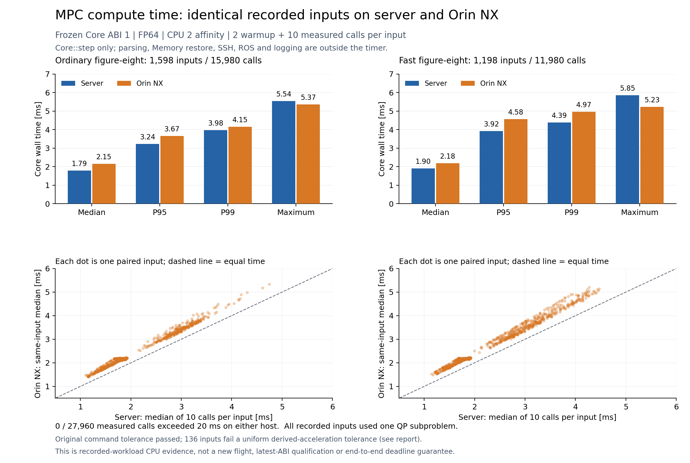

# 同一输入下的服务器／Orin NX MPC 配对测试

2026-10-27。**两端各完成 27,960 次正式调用，原有指令容差全部通过，均无超过 20 ms 的正式调用。** 同一输入、同一历史状态下，NX 的计算时间通常比这台服务器略长，绝对耗时仍有余量。本轮检验的是历史八字工况的算法计算能力，不是一次新的闭环飞行。

为承接 2026-10-25 的 NX 基准，使用同一份已验收的 **2026-10-24 Core ABI 1** 源码。当前工作区的 Core 已继续演进到 ABI 4，本报告不为新版本背书，也没有回退生产算法、参数或安全门控。

## 结果

以下均为 `Core::step()` 墙钟时间，单位 ms。每条真实历史输入测量 10 次，分位数从全部调用按 nearest-rank 重算，不对分块分位数求平均。

| 工况 | 主机 | 正式调用 | 中位数 | P95 | P99 | 最大 | >20 ms |
|---|---|---:|---:|---:|---:|---:|---:|
| 普通八字 | 服务器 | 15,980 | 1.793088 | 3.235789 | 3.980866 | 5.538730 | 0 |
| 普通八字 | Orin NX | 15,980 | 2.148288 | 3.666848 | 4.153664 | 5.368992 | 0 |
| 快速八字 | 服务器 | 11,980 | 1.897819 | 3.921650 | 4.393654 | 5.854942 | 0 |
| 快速八字 | Orin NX | 11,980 | 2.184416 | 4.575552 | 4.971456 | 5.229088 | 0 |

逐条同输入、同轮次计算 NX／服务器耗时比，其中位数为普通 **1.1883**、快速 **1.1949**。逐条耗时差的中位数为 **0.326 ms**、**0.415 ms**。这些比值描述本批输入与两端当时的运行条件，不是处理器性能的通用排名，也不等同于两组独立中位数之比。NX 的最大值较小不意味着其每条输入都更快。



图上方是全部正式调用的统计；下方每个点对应一条输入在两端各 10 次调用的中位数。点在虚线上方表示该条输入在 NX 上耗时较长。图不把各次调用当作独立飞行重复，也没有给出无法支持的最坏情况保证。

同线程 CPU 时间同时记录：普通八字服务器／NX 中位数 **1.793794／2.146208 ms**，快速 **1.898576／2.178784 ms**。与墙钟统计接近，未见这批计算被大段通信等待主导。两种计时的边界略有嵌套，少量样本 CPU 时间略大于墙钟时间是可解释的；差值不是精确的调度延时估计。

冷启动与预热另列，未混入上表，也未丢弃。两端各保留 **7 次首次调用、5,592 次预热调用**；首次调用最大服务器 **11.985765 ms**、NX **4.827328 ms**，预热最大服务器 **6.966453 ms**、NX **5.367904 ms**。首次调用数量很少，不据此外推稳定的冷启动分布。所有阶段均无 Core 错误或原 50 ms 保护超时。

## 输入和计时边界

- 输入覆盖原普通八字全部 **1,598** 次、快速八字全部 **1,198** 次实际闭环记录，没有按当前耗时筛选样本。状态、关节反馈、参考和历史命令绑定原始记录及 SHA-256。
- 原日志未直接保存完整 `Memory`。准备工具按原 `LiveStart` 的 reset／prime 和每一条成功历史结果的 commit 顺序重建，包含历史计划、命令队列、前次命令与时间；未跳过中间记录。每次基准调用前恢复同一份 `Memory`，避免两端各自的输出改变下一次输入。
- 预测参考来自原 C++ 轨迹公式的逐式移植，不是用当前位置做常加速度外推。当前参考与记录的核对，以及服务器重放与原结果的核对，均单独进行。服务器对历史十字段的最大误差为 **5.56e-15**；这验证了重建链，没有宣称预测数组与历史内存逐字节相同。
- 自定义 CDR 解析还用服务器实际 `rclpy.serialization.deserialize_message` 交叉检查：两种工况的 LiveStart、首／中／末快照和发布 proposal 共 **14 条**，所有字段一致。
- 两端使用 SHA 为 `863598291ac36cba09bd0d9e929600d69dc7d9d6bab37b060b80abf411f65c40` 的同一源码包，FP64，CMake Release，原有约束、权重、候选检查、50 ms 生产保护不变。两种架构的 ELF 自然不同，分别绑定实际加载库的 SHA。
- 计时覆盖 `Core::step()` 内部预测、矩阵组装、QP、候选指令检查、内部内存分配和成功状态提交。输入解析、历史状态恢复、JSON 编码、SSH、ROS、日志、进程启动不在计时区间。结果先存内存，整批测量结束后才回传。
- 每端都绑定本机 CPU 2，沿用原功耗和调频策略。这里的同编号 CPU 不表示同型号、同频率或无抢占。没有运行 Gazebo/PX4，也没有改变真实执行器状态。

所有 2,796 条输入都只需要 **1 次 QP 子问题**。这批记录没有覆盖需要第 2／3 次重线性化的高压力调用、长期热稳态、视觉等任务并发，也未测状态接收至实际关节消费的总延时。75 变量 QP 的本批结果不能直接外推到更大 NMPC。

## 数值一致性与加速度容差

本轮保留两种检查，避免把检查口径的变化写成算法精度提升。

| 检查 | 结果 |
|---|---|
| 原有命令／速度前馈绝对误差 ≤1e-7，位置参考 ≤1e-9 | 两端全部通过 |
| 额外对其余输出统一使用绝对误差 ≤1e-7 | **未全部通过**：NX 136／2,796 条输入仅关节加速度参考超限 |
| 显式 `recorded-derived-v2`：原命令阈值不变，派生加速度按差分传播误差，并独立检查公式关系 | 所有首次、预热、正式调用通过 |

跨端最大命令差 **9.9497135364e-8**，最大关节速度差 **8.9349086407e-8 rad/s**，最大位置参考差 **4.44e-16 m**。最大命令差已接近原阈值，不能称为逐位相同，后续版本仍应执行同样的独立检查。

冻结 Core 输出的关节加速度参考是同一步速度指令的差分：

\[
\ddot q_{\mathrm{ref},k}=\frac{u_{q,k}-u_{q,k-1}^{\mathrm{frozen}}}{\Delta t_k}.
\]

两端前一条指令相同，因此跨端差满足：

\[
\Delta\ddot q_{\mathrm{ref},k}=\frac{\Delta u_{q,k}}{\Delta t_k}.
\]

例如 20 ms 时，速度差放大 50 倍；原速度容差 1e-7 对应的派生加速度容差为 **5e-6 rad/s²**，而不是仍为 1e-7。实际最大加速度差 **4.4674543204e-6 rad/s²**。工具逐条使用真实 `dt` 计算 `1e-7/dt`，另外在浮点舍入预算内检查每端自己的加速度是否确实等于上述公式；不能用较大的派生容差放过算错公式的输出。

首次全量严格筛查的失败保留原状。之后才显式冻结 v2 检查协议，并重新做正式测量；原三字段的 native oracle 和全部历史十字段参考均保留。没有通过改权重、换输入或调低浮点精度让结果通过。

正式阶段严格失败为普通 **33**、快速 **103** 条不同输入，各重复 10 次，合计 **1,360 个逻辑配对样本**。加上预热及首次调用，为 **1,633 个逻辑配对样本**；历史参考检查和跨端检查分别计数时，为 **3,266 条字段失败记录**。它们全部见 `strict_failure_checks.csv`；`summary.json` 明确保留 `strict_uniform_full_field_pass: false`。

## 机器条件与数据保留

| 项目 | 服务器 | Orin NX |
|---|---|---|
| 架构／系统 | x86_64，Ubuntu 22.04.3 | aarch64，Ubuntu 22.04.5，L4T 36.5.0 |
| CPU 标识 | 宿主报告为 `Genuine Intel(R) CPU $0000%@`，不猜测零售型号 | NVIDIA Jetson Orin NX，系统内存约 16 GB |
| 原有策略 | powersave 动态调频，CPU 2 范围 0.8–3.7 GHz | MAXN，schedutil，CPU 2 范围 0.7296–1.984 GHz |
| 公共依赖版本 | Eigen 3.4.0、JsonCpp 1.9.5、OpenSSL 3.0.2 | 同左 |
| 编译方式 | GCC 11.4 系列，Release | 复用首轮已构建 GCC 11.4 系列 Release ELF |

NX 当前只读检查的编译器补丁版与首次构建记录存在差别，因此没有声称两端工具链、系统库、频率或后台负载完全相同。服务器 cgroup 配额相当于 16 个 CPU，测试前后限流计数未增加；这也不能证明宿主无其他竞争。NX 测试前后 CPU 温度为 53.125／52.312 °C，仅是端点采样。

遵守“NX 只运行代码”：输入从 stdin 进入 RAM，结果在测量结束后从 stdout 回工作站。结束检查确认 NX 专用运行目录仍只有原 **4 个 ELF、518,048 字节**，SHA 未变，原临时 RAM 构建目录不存在。原始输入、失败记录、结果、SSH stderr、图和报告均保存在工作站；这不是对操作系统自身日志或 swap 的全盘无写入承诺。

## 文件及复现

- `summary.json`：全部调用汇总、原始输入／加载代码身份、每端墙钟和线程 CPU 分布、首次与预热、失败口径、运行条件。
- `case_comparison.csv`：全部 2,796 条输入的配对统计。
- `strict_failure_checks.csv`：完整严格容差失败表，未删除失败。
- `protocol.json`：正式测量前冻结的原始协议字节。
- `latency_comparison.png`、`latency_comparison.pdf`：上图的屏幕和矢量版。
- `code_only_sources.tar.gz`、`source_manifest.json`：本轮实际源码包及成员身份；不依赖当前生产 Core 恰好仍为 ABI 1。
- `tests.log`：35 项工具回归测试全部通过。
- `raw_evidence_receipt.json`：工作站完整归档的名称、字节数与 SHA-256。归档包含严格筛查失败、正式输入输出、原始元数据和构建记录；未把连接地址等原始信息另行复制进此公开摘要。

准备输入使用原已验收 ZIP。以下命令在仓库根目录执行，输出目录必须不存在；普通、快速分别运行：

```powershell
python scripts/prepare_x650_recorded_core_benchmark.py `
  --stage normal --output artifacts/paired_reproduce_normal `
  --chunk-size 400 --warmup-rounds 2 --measured-rounds 10 --cpu 2 `
  --field-policy recorded-derived-v2 `
  --comparison-protocol docs/validation/orin_paired_20261027/protocol.json
```

使用 `--stage fast` 和另一个输出目录准备快速八字。此次实际七块输入均已由此工具逐字节重建成功，SHA 见摘要。两端运行沿用 [benchmark runner](../../../scripts/run_x650_orin_benchmark.py) 的 stdin／stdout 接口和各自 ELF SHA；连接信息通过本机参数提供，不写入 NX 数据目录。每块最多 400 条输入，分块只为限制传输包大小，不截断或重置其历史 `Memory`。

若在另一台工作站改变原始归档所在路径，provenance 中的路径及整个输入 JSON 的 SHA 会相应改变。仍须让两端读取同一个新输入包，并重新绑定其 SHA；数学输入相同不代表文件字节自动相同。直接复核本次测量应使用工作站归档内的原始输入字节。

逐块独立核查（实际构建报告及结果目录来自工作站归档）：

```powershell
python scripts/compare_x650_paired_core_benchmark.py `
  --input <同一块输入.json> `
  --server-result <该块服务器返回目录> --nx-result <该块NX返回目录> `
  --source-manifest docs/validation/orin_paired_20261027/source_manifest.json `
  --source-package docs/validation/orin_paired_20261027/code_only_sources.tar.gz `
  --server-build <服务器构建报告.json> --nx-build <NX构建报告.json> `
  --field-policy recorded-derived-v2 --output <新的配对报告.json>
```

工作站批次目录保留原布局时，可一条命令重新核查七块，再聚合全部样本及绘图：

```powershell
python scripts/report_x650_paired_core_benchmark.py `
  --evidence artifacts/paired_core_20261027 `
  --source-manifest docs/validation/orin_paired_20261027/source_manifest.json `
  --source-package docs/validation/orin_paired_20261027/code_only_sources.tar.gz `
  --server-build artifacts/paired_core_20261027/server_build_report.json `
  --nx-build artifacts/orin_nx_mpc_20261025/build_report_v1.json `
  --output artifacts/paired_report_reproduced --plot
```

`--plot` 需要 matplotlib，其余验证仅用 Python 标准库。准备与配对工具默认保留 `strict-v1`，v2 必须明确指定。工具不连接硬件、不修改控制代码；用于以后换硬件或换后端时重复同一套核验。

## 对下一步的意义

这批历史普通／快速八字输入下，NX 的 CPU 计算不是 20 ms 预算的主要障碍，暂时没有证据要求必须先做 CUDA 才能进入后续测试。NX 正式最大 5.369 ms 约占预算 26.8%，剩余时间不能直接当作完整闭环的保证余量。

下一轮应先为当前 ABI 4 建立明确的独立输入批次，补上重线性化、边界约束、长时间与代表性后台负载，再在 NX 上测本地完整控制链。跨机状态年龄、通信、关节消费分别计量。CUDA 可以作为随后独立的算子实验，保持相同输入、FP64 和正确性口径，比较包含数据交接与同步的完整调用耗时；不以异步 kernel 的发射时间替代计算完成时间。
