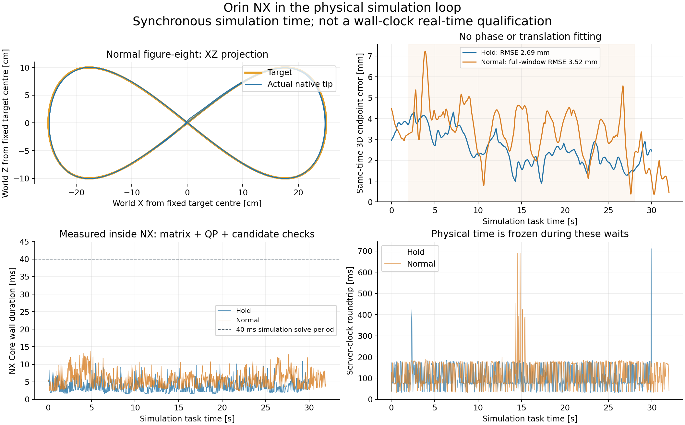

# Orin NX 在环调试记录（2026-10-27）

## 连续记录流结论

这是 ABI 4 控制核心在真实 NX 上的持久进程测试：初始化一次，连续保留 Memory，使用历史物理快照；不是新的物理反馈闭环。与逐帧恢复内部状态的配对基准相比，它能发现累计数值分歧。

| 记录流 | 步数 | 最大五轴指令差 | NX Core P99 / 最大耗时 |
|---|---:|---:|---:|
| hold | 711 | 4.314e-13 | 10.590 / 12.725 ms |
| wrench | 570 | 1.231e-11 | 25.497 / 36.470 ms |
| mass085 | 569 | 1.760e-12 | 17.151 / 18.050 ms |
| mass115 | 570 | 2.091e-12 | 17.117 / 17.965 ms |

四组共 2420 次全部满足原数值误差门限和输入链核验。未改变模型、权重、约束、QP 门限或输入样本。Core 计算预算仍为 50 ms。

## 实际发现与修复

1. 跨 x86/ARM 重算参考轨迹时，浮点严格相等导致实际 `8.67e-19` 差值被判错。仅将重算参考值的比较改为 `64 × epsilon × max(1, |a|, |b|)`；配置、序号、状态与哈希仍严格检查。普通/快速轨迹原契约回归与新增边界测试通过。
2. 默认 NX 编译的连续流出现最大 `6.416e-5` 指令差。使用独立、明确标注的 `-ffp-contract=off` 构建后，最大差降至上述表格量级。17 个数学/预测源文件保持字节一致。此结果支持编译浮点策略会影响该连续求解过程；没有据此声称某条具体机器指令已定位。
3. 实际 NX 故障与发起端准入测试共 25 项通过。覆盖重复、乱序、错误会话、状态/参考错误、截断、断开、超时、故障锁存及重启。不能据此声称实际电机安全停机已通过。

## 公网路径

第一次 100 次服务器→工作站→NX 往返有 7 次超过 50 ms，最大 583.640 ms；NX Core 最大仅 11.384 ms。复测 100 次无超限，最大 45.671 ms。两轮均保留，短时通过不能消除先前长延迟。

用户选择的服务器同步仿真时间 PIL 已完成新的末端保持和普通八字。Gazebo 等 NX 返回后推进物理时间，分别记录 NX 计算、真实通信和仿真控制时间；不作为墙钟实时认证。

## 新的实际物理闭环

链路为：服务器 PX4/Gazebo 实际状态 → 持久 SSH 通道 → Orin NX 上的 ABI 4 C++ Core → 有界候选检查 → 服务器 PX4 与两个 TS20 仿真关节 → 下一段物理反馈。服务器不运行备用优化器，不向 NX 提供历史最优解。NX 连续保留自己的 Memory。

| 新实验 | 仿真窗口 | 求解 / 任务下发次数¹ | 三维末端 RMSE | 最大末端误差 | NX Core P99 / 最大 |
|---|---:|---:|---:|---:|---:|
| 完整末端保持 | 30 s | 749 / 1498 | 2.691 mm | 4.314 mm | 9.132 / 10.880 ms |
| 普通八字，完整窗口 | 32 s | 799 / 1598 | 3.517 mm | 7.229 mm | 12.094 / 13.758 ms |
| 普通八字，运动段 | 2–28 s | 同一次运行 | 3.720 mm | 7.229 mm | 同一次运行 |

¹ 此处指任务阶段的正常下发记录（允许某轴数值恰为零），另外各有一次退出零指令下发及消费核验。首 20 ms 沿用实际预发送保持指令，首个 NX 求解在 40 ms；终点只观测，不发送随即被退出指令覆盖的候选。

八字幅值 X±0.25 m、Z±0.10 m，12 s/圈、两圈，含原有平滑起停及尾部保持。误差来自 Gazebo 原生记录器测得的末端三维位置，以原时间戳积分求 RMSE；没有做相位或平移拟合。运动段与完整窗口分别报告，未用尾部保持降低运动段指标。最大机体倾角分别为 0.088°、0.591°。

两次均通过：完整任务覆盖、连续候选身份与参数、原有 QP/非线性/保持检查、两个关节实际消费、全窗口关节预测、PX4 ULog 中实际接收的 PVA、降落停桨、参数恢复。普通八字增加了运行前后源码一致性及源码归档检查。保持试验的历史平台源码由原资格链绑定，新同步适配源码在运行结束、下一次修改前归档；不声称该次保持拥有新增的运行前后源码双重记录。现有反馈适配器继续使用 PX4 估计状态；本次未建立逐回调原始 CDR 的独立重放资格。

物理步长 4 ms，仿真求解周期 40 ms，下发周期 20 ms。每次 NX 请求前后检查物理时间完全不变，每段执行恰好推进五个物理步。无桨/无解锁的时钟探测另外验证 PX4 IMU 时间戳与 Gazebo 一起暂停和步进。

保持的服务器往返 P99/最大为 180.690/710.949 ms，普通八字为 189.030/690.206 ms；所有慢样本保留。它们包含传输、主机调度、序列化及 NX 处理，不能称为纯网络耗时。这里的毫米级跟踪是**同步仿真结果**，不能用于宣称公网满足 25 Hz 实时闭环、Offboard 墙钟看门狗已验证，或真机也能达到同样精度。

## 同步接入时发现的问题

- 初次保持在解锁前遇到原 TS20 适配器的场景选择约束，并暴露初始化失败时参数恢复回调仍指向未就绪状态接收器。保留原始待恢复事务，确认地面状态后按原值恢复并读回；随后明确分开原电机适配配置与新试验配置，修复地面失败恢复。
- 一次准备检查正确拦截了历史资格链所绑定源码的变化。服务器保持使用该历史源码的原始字节；新同步扩展使用独立代码，平台通用修复另行纳入 Git，不冒用旧源码资格。
- 一次保持在接管前产生 148 ms 间隔：当时才启动 Gazebo 服务发现，阻塞了仍在运行的预发送。将服务发现移到地面准备阶段后，新的完整保持与普通八字通过。失败运行已完成降落和参数恢复，未混入成功指标。
- 平台退出检查将僵尸进程误认为仍在运行。补充 `/proc` 状态识别；3 项僵尸状态测试、12 项既有启动清理测试通过。该通用修复未冒充本轮服务器已使用的历史运行版本。

工作站相关回归共 47 项通过（33 项接口/数据/退出测试＋14 项生命周期测试）；另保留跨平台原生 CTest、连续记录流与 25 项故障注入的原始记录。故障注入目前主要验证候选接口锁存；尚未完成新的物理闭环断网故障注入，不能将其表述为实机紧急退出验证。

## 资料与限制

完整统计、实际 ELF 与源码身份见 [summary.json](summary.json)，新物理结果见 [sync_hold.json](sync_hold.json) 和 [sync_normal.json](sync_normal.json)。[方法文档](../../ORIN_NX_PROCESSOR_IN_LOOP.md)说明时钟、接口和复现入口。

原始成功与失败结果保存在工作站 `artifacts/orin_pil_20261027`。服务器 `artifacts/orin_sync_pil_20261027/delivery_v1` 的完整物理归档含 288 个成员、两个 ZIP，另保存于工作站 `sync_delivery`；[物理归档 receipt](sync_raw_evidence_receipt.json)绑定原文件和压缩包的 SHA，[下载后核验](sync_transfer_verification.json)再次逐成员读回。连续流、构建、故障及传输记录另归档 206 个文件，见[工作站归档 receipt](workstation_raw_evidence_receipt.json)。大体积原始归档保留于服务器/工作站，Git 保存代码、统计、图和校验凭据。NX 最终核验仅留下可执行代码与库，无本轮实验输入、日志或构建临时目录，所属在环进程已退出。

TS20-50 的 24 V 空中负载仍为条件模型；本次不是硬件执行器或飞行验收。当前为 CPU 路径，未使用 CUDA。下一步可在相同同步协议下做快速八字及闭环断流/异常退出测试；迁移前还需本地有线实时链路、真实动捕和舵机总线验证。

最终补充了“服务器退出码为零不能单独代表传输完成”的检查：NX 也须正常退出、中转无错误；相关测试通过。该新增判定对两次已保存的原始退出记录均通过，见 [关闭检查](post_run_close_checks.json)，没有将这项记录核对表述为重新飞行。
