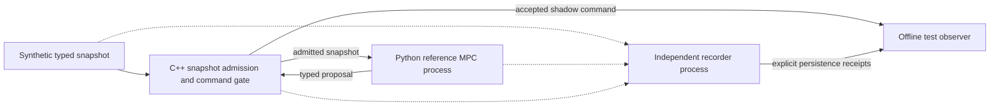

# X650 ROS 2 control-runtime migration

This opt-in workspace separates the upper controller, state admission,
periodic output and recording. Its original phase-one entry remains **offline
and shadow only**, with no actuator publishers. A separate explicit live
simulation entry connects actual PX4/Gazebo feedback and execution. Historical
revision 7, hold_v15 passed a complete 30 s endpoint-hold audit. **Revision 9 is
a new numerical-fix candidate and still requires full regression, a fresh hold,
and a fresh normal figure eight.** The historical pass is not admission for the
new library. Archived records and original task/library identities are retained.

An additional opt-in execution path now separates a C++ latest-state receiver,
the frozen Python/C++ worker, a C++ 20 ms output process, and a nonblocking
diagnostic recorder. It retains original snapshot age on repeated outputs and
waits for a shadow-output receipt before advancing to another candidate. It is
still a typed **software contract test**, with no actuator publishers. Its
registered sustained/fault-injection tests and live-adapter prerequisites are
described in [the execution and hardware migration method](../docs/X650_EXECUTION_ISOLATION_AND_TEST_METHOD.md).
Run it with `scripts/run_x650_isolated_runtime.py`; keep these results separate
from the older phase-one smoke test and from actual Gazebo endpoint-hold evidence.

The separate `x650_isolated_live_v1` simulation scenario opts into real Gazebo
joint commands and PX4 SITL MAVLink PVA through `live_dispatcher`. Build that
executable with `-DMAVLINK_INCLUDE_DIR=/absolute/path/to/existing/generated/mavlink`.
Its constructor accepts only an explicitly inherited loopback SITL socket,
not a default hardware connection. The normal `periodic_dispatcher` remains
shadow only. The live launch requires a current-binary transport proof and the
unchanged task/backend hashes; it does not confer a physical acceptance pass.
See `simulations/x650_isolated_live_v1/launch.py` and the independent
`scripts/audit_x650_isolated_live.py` for the complete-hold gate.

The actual plugin-consumption reader is another C++ process, `consumption_source`.
It acknowledges complete physical rows with both joint counters/values/times.
The optimizer advances only after an actual writer send, using the latest
causal real snapshot with its original timestamps; the writer cannot send its next command until the previous joint
commands were consumed. These are separate confirmations. The source model's
20 ms cadence uses simulation time, while output scheduling and transport ages
use monotonic wall time. The full workflow is documented in the
[live scenario README](../simulations/x650_isolated_live_v1/README.md).

Both full worker diagnostics and source/receipt observations now leave their
control-facing processes through separate bounded nonblocking recorder
channels. The source retains only the newest message per topic, rather than
an expanding graph of nested feedback objects. Natural GC and original age
limits remain unchanged. Sender counts, contiguous sequences and persisted
hashes must reconcile for both recorders after recovery.

The historical revision-7 live hold_v15 completed the entire 30 s window with independent native
endpoint RMS **2.82782 mm** and peak **4.89075 mm**. All **1490** recorded
algorithm calls replayed with maximum checked command difference **0**. All
**1500 paired joint commands**, including the final stop-zero, matched actual
consumption records (**3000 individual joint commands**); **1499 PVA sends**
were checked against the PX4 command evidence. The audit includes exclusive
handoff, normal exit, landing/disarm and parameter restoration for that version. See the
[actual live evidence](../docs/validation/isolated_live_20261023/README.md).

The first normal run exited after about 3.75 s when an old command exceeded its
50 ms lifetime; its final computation contained 11.532 ms of generation-2 GC.
Revision 8 moved an explicit full collection to after construction, before READY
and arming, while retaining automatic control-time GC and unchanged thresholds.
The subsequent hold_v16 failed at solve 1416, around task time 28.38 s, with 1415
accepted solves. This was a separate QP numerical-convergence failure, not
another accepted hold or a GC diagnosis.

The rejected original-row violation was `3.270557920181938e-7`. Whitening and
normalization with row norm about `4.98172` reduced it to about `6.565e-8`, below
the old aggregate stopping threshold `7.6189e-8`; the unchanged outer `2e-7`
gate correctly rejected the result. The user-authorized revision-9 correction
adds a `1e-10` original-row convergence requirement, transformed as
`1e-10 / row_norm`, in addition to the old aggregate check. Nonfinite residuals
or exhausted search without both conditions throw; iteration caps, objective,
constraints, model and control parameters remain unchanged.

The corrected candidate library SHA256 is
`b9cbdf78c76e92f973800e07c6219611759fcb4471a1a39192c5cbf30f5e2e48`.
The captured rejected case now has zero primal violation and independently recomputed KKT residual about
`2.78e-17`; 16 native tests, including 12 subcases, passed. These are targeted
regressions, not the complete 30-case/388-record qualification or a flight pass.
Full qualification and fresh physical hold/normal results remain pending.

This certifies the observed normal exit, not every failure path. A delayed or
missing acknowledgement for an earlier joint command followed by stop-zero
remains an unqualified corner case: a cumulative counter can overtake the
pending command before a distinct zero-consumption receipt is emitted. It
can also occur at a normal end if the final ordinary command is still pending.
It needs a dedicated fault-injection and physical-log audit; missing zero
acknowledgement disqualifies the run before historical recovery is credited.
Server simulation
also does not qualify the TS20-50 at actual 24 V or deployment on Orin NX.

The separate [normal figure-eight entry](../simulations/x650_isolated_figure8_v1/README.md)
requires a complete live-hold certificate for the exact admitted version and its original bound artifacts,
unchanged numerical/transport sources and binaries, and the same execution
protocol. Its only task change is the original analytic X/Z reference:
±0.25/±0.10 m, 12 s per circle, two circles, 32 s full window. The new reference
is installed once from actual LiveStart before the first solve, and is shared
by target validation and preview. **Revision 9 must first earn a new complete
hold certificate; no complete normal result exists, and fast is not admitted
by this entry.**

The output period is **20 ms**. **50 ms is the lifetime measured from the
original snapshot**, also retained as the full computation/model-dt ceiling;
it is not the output period. A computation shorter than 50 ms may still miss a
usable slot while its predecessor ages. Repeats never renew that predecessor.
Expiration is acted on at a dispatch tick, not by an instantaneous hardware
stop at exactly 50 ms. A fault stops normal PVA sends and issues joint zero;
PX4 temporarily retains its last setpoint until the existing recovery takes
over. This behavior still needs separate hardware timeout qualification.

## Original shadow process boundaries



The packages are:

- `flyarm_control_interfaces`: bounded messages for snapshots, proposals,
  decisions, drain requests and persistence receipts. Rotation is row-major
  FLU-to-ENU. Base position/velocity/acceleration are ENU; angular velocity is
  body FLU. Joint coordinates retain the imported arm's convention.
- `flyarm_mpc_reference`: a separate Python process calling the original
  `ControllerAdapter` and `Ts20MpcController`. Task/model/PID/prior/oracle/native
  identities are checked once. A task explicitly selecting `cpp_numerics_v1`
  calls the frozen native numerical backend through the original Python adapter;
  archived tasks retain their original Python/SciPy reference backend.
- `flyarm_control_gateway`: a C++ shadow gate with one in-flight snapshot,
  source/time/identity/sequence checks, fixed limits and deadline checks. It
  forwards admitted snapshots before the worker can respond, preventing a
  cross-topic snapshot/proposal ordering race. Accepted proposals are published
  to a shadow topic in the original software path; opt-in live execution uses
  the separate actuator adapter described above. A proposal's optimization flags are claims of the
  reference worker; the gateway does not independently re-solve the QP.
- `flyarm_control_recorder`: an independent process persisting the typed input,
  proposal and decision streams. Original CDR bytes and hashes preserve the
  message values. A reliable DDS delivery is not treated as a disk receipt.

The context carries at most 64 consumed two-joint command entries and 64 MIT
packets. Overflow is an error, never truncation. Those task-relative histories
are distinct from the five-axis prestream publication history used to prime the
controller once. A synthetic initialization is explicitly labelled; it cannot
be promoted into proof of historical packet availability or a real flight.

The original shadow prefix is `/flyarm/offline/v1`; the isolated shadow/live
path uses `/flyarm/isolated/v1` with an explicit execution mode. Configuration identity is the caller-pinned
task JSON SHA-256. Gateway timing uses the source-issued and gateway-received
Linux monotonic timestamps on the **same host**, separately from the supplied
simulation clock. This is not a distributed-clock synchronization scheme.
The frozen 25 ms joint-source age and 50 ms control/round-trip limits remain.
Control and recording failure are reported separately; accepted shadow output
does not certify successful recording or physical command application.

## Build using the server's existing dependencies

The current server has ROS 2 Humble, `rclcpp`, `rclpy`, Eigen, `colcon`, and the
existing `px4_msgs` overlay. No package download is part of these commands.
Use a fresh build destination and build only this workspace, not every package
under the repository:

```bash
repo=/root/autodl-tmp/safe-aerial-manipulator-testbed
taskBuildRoot=/root/autodl-tmp/flyarm_ros2_structure_fresh
source /opt/ros/humble/setup.bash
source /root/autodl-tmp/ros2_px4_ws/install/setup.bash
colcon --log-base "$taskBuildRoot/log" build \
  --base-paths "$repo/ros2_ws/src" \
  --build-base "$taskBuildRoot/build" \
  --install-base "$taskBuildRoot/install" \
  --cmake-args -DCMAKE_BUILD_TYPE=RelWithDebInfo
source "$taskBuildRoot/install/setup.bash"
```

Run the native guard tests with CTest in the gateway build directory, and the
two Python packages' pure unit tests with `unittest`. The source packages do
not require ROS to import their pure test cores; actual typed-message and DDS
integration still require the generated workspace on the server.

## Offline process integration

Use an existing, reviewed TS20 damped `tip_hold` task and its actual raw-file
SHA-256. It provides the frozen model, PID, prior and predictor dependencies.
The integration script creates a **new synthetic stationary-hold fixture**;
it does not replay a historical airborne controller heap or claim hardware
precision. Output directories must be fresh.

```bash
env OPENBLAS_NUM_THREADS=1 OMP_NUM_THREADS=1 MKL_NUM_THREADS=1 \
  /usr/bin/python3 "$repo/scripts/run_x650_ros2_structure_smoke.py" \
  --repo-root "$repo" \
  --task-config /absolute/path/to/reviewed_quiet_task.json \
  --task-config-sha256 ACTUAL_RAW_TASK_SHA256 \
  --output /absolute/path/to/fresh_healthy_output --case healthy
```

The healthy case compares the same five command-vector fields from a direct
Python reference and the ROS worker, then requires gateway decisions and a
hash-bound final recording receipt. The worker-timeout case deliberately stops
the reference process before sending a snapshot; it must produce a rejection
and no accepted shadow command:

```bash
/usr/bin/python3 "$repo/scripts/run_x650_ros2_structure_smoke.py" \
  --repo-root "$repo" \
  --task-config /absolute/path/to/reviewed_quiet_task.json \
  --task-config-sha256 ACTUAL_RAW_TASK_SHA256 \
  --output /absolute/path/to/fresh_timeout_output --case worker_timeout
```

Each test uses a separate localhost-only DDS domain and owns only its spawned
process groups. The finite test proves the process/message/recording contracts;
it does not establish sustained 50 Hz operation, worst-case execution time,
native-port equivalence or the full 30 s endpoint-hold acceptance.

The driver converts the generated `uint64[3]` final stream counts to Python
integers before reporting, preserving the full integer range. It serializes
strict JSON before creating the exclusive output file, so an unsupported value
does not leave a truncated JSON report. Cleanup checks the owned process group,
including ROS children whose `ros2 run` parent has already exited.

On 2026-10-23, the user's server terminal reported the native
`shadow_gate_synthetic` CTest passing (1/1). The first `healthy_manual_v1`
attempt then failed while writing `structure_report.json`, because the original
driver kept NumPy `uint64` values in that stream-count list. The following
`worker_timeout` command was not executed. This terminal report is not a DDS
acceptance result: retain that output directory, inspect its recording and
child logs, deploy the driver fix, and run both cases in fresh output
directories. The original phase-one checkpoint records the earlier state
before this manual attempt; it is not retroactively changed.

The subsequent [server follow-up](../docs/validation/ros2_structure_20261023/report_repair_followup.json)
used the repaired driver at commit `bfb4da9` in fresh output directories over
authorized SSH. All 13 driver regression tests and the native CTest passed.
The healthy DDS case accepted 5/5 proposals, matched the direct Python command
vectors, and verified all 15 persisted input/proposal/decision records. The
worker-stop case accepted no proposal and verified its two input/decision
records. Both closed with no cleanup errors or remaining owned ROS processes.
The five healthy request round trips were 18.403–20.997 ms; the timeout case
reported its rejection after 54.930 ms. These finite software cases validate
the process separation and failure handling, not sustained 50 Hz operation.

## Server management connection

On the same date, Remote startup intermittently failed while fetching its
public `/api/mcp-info` endpoint. General HTTPS and authenticated SSH worked.
The existing Node 22 runtime reconnected with process-scoped options
`--dns-result-order=ipv4first --network-family-autoselection-attempt-timeout=1000`.
Its saved session was restored, and an actual Remote tool call returned the
expected container hostname and both software test results. This is an observed
recovery, not a guarantee against future network outages.

Those defaults are saved in `/root/autodl-tmp/rdc-runtime/env.sh`, only when
`NODE_OPTIONS` is otherwise empty. The previous file is retained as
`env.sh.before_network_20261023`; hashes and scope are recorded in the
[connection recovery record](../docs/validation/ros2_structure_20261023/report_repair_server/connection_recovery.json).
The existing command remains `/root/autodl-tmp/rdc-runtime/bin/rdcctl start`.
It still reports that screen was started, so confirm actual online tool access
before calling the connection recovered. Authorized SSH is an independent
maintenance path; do not treat a Remote outage as a ROS controller failure.

## Next integration boundary

The explicit `cpp_numerics_v1` task binding now selects the
[native numerical backend](../control_packages/x650_wholebody_v1/NATIVE_NUMERICS.md)
inside the existing worker. C++ performs matrix assembly, QP solution, full-row
quality checks and nonlinear candidate acceptance. Python still prepares the
observed context/MIT packets and owns the transactional lifecycle; the worker
is not yet a standalone C++ executor. Startup provenance records the actually
loaded optimization library, and the smoke driver checks it against the task's
pinned identity. Existing tasks continue to use the archived reference backend.

The original admitted implementation passed 328 regressions, all 30 frozen cases
and all 388 recorded calls. Historical hold_v15 adds a full-window result and
1490 independent numerical replays for that original implementation. The
revision-9 library must repeat the complete numerical qualification and obtain
new physical hold/normal evidence; targeted regression is not a substitute. These are separate
qualification levels. A future fully native ROS worker, a changed actuator
transport or a target-hardware build would require its own admission evidence.

The original library retains its historical 30-case and recorded-input
qualification; it does not transfer to the corrected candidate. Each version needs its own
actual command, consumption, source-history, full-window and exit evidence.
Preserve command commit/rollback and ENU/NED/PVA semantics. Live integration
keeps the existing MAVLink supervisor and PX4 lower PID;
a DDS actuator-output migration is a separate change. A complete hold for the
current admitted library opens the normal experiment gate; normal must independently pass before fast
is considered. ROS 2 alone does not establish hard real-time behavior;
deployment on Orin NX needs its own timing, resource and interface measurements.
