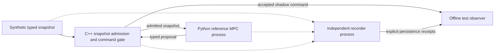

# X650 ROS 2 control-runtime migration

This is an opt-in workspace for separating the existing upper controller from
its gateway and recorder. The first phase is **offline and shadow only**. It
does not start PX4/Gazebo, arm a vehicle, or publish `/fmu/in/*` or `/arm/*`.
Existing simulation scenarios and their frozen numerical sources are unchanged.

## Implemented process boundaries



The packages are:

- `flyarm_control_interfaces`: bounded messages for snapshots, proposals,
  decisions, drain requests and persistence receipts. Rotation is row-major
  FLU-to-ENU. Base position/velocity/acceleration are ENU; angular velocity is
  body FLU. Joint coordinates retain the imported arm's convention.
- `flyarm_mpc_reference`: a separate Python process calling the original
  `ControllerAdapter` and `Ts20MpcController`. Task/model/PID/prior/oracle/native
  identities are checked once. It is the numerical reference for a future
  native controller, **not a completed C++ MPC port**.
- `flyarm_control_gateway`: a C++ shadow gate with one in-flight snapshot,
  source/time/identity/sequence checks, fixed limits and deadline checks. It
  forwards admitted snapshots before the worker can respond, preventing a
  cross-topic snapshot/proposal ordering race. Accepted proposals are published
  only to a shadow topic. A proposal's optimization flags are claims of the
  reference worker; the gateway does not independently re-solve the QP.
- `flyarm_control_recorder`: an independent process persisting the typed input,
  proposal and decision streams. Original CDR bytes and hashes preserve the
  message values. A reliable DDS delivery is not treated as a disk receipt.

The context carries at most 64 consumed two-joint command entries and 64 MIT
packets. Overflow is an error, never truncation. Those task-relative histories
are distinct from the five-axis prestream publication history used to prime the
controller once. A synthetic initialization is explicitly labelled; it cannot
be promoted into proof of historical packet availability or a real flight.

The prefix is `/flyarm/offline/v1`. Configuration identity is the caller-pinned
task JSON SHA-256. Gateway timing uses the source-issued and gateway-received
Linux monotonic timestamps on the **same host**, separately from the supplied
simulation clock. This is not a distributed-clock synchronization scheme.
The frozen 25 ms joint-source age and 50 ms control/round-trip limits remain.
Control and recording failure are reported separately; accepted shadow output
does not certify successful recording or physical command application.

## Build using the server's existing dependencies

The current server has ROS 2 Humble, `rclcpp`, `rclpy`, Eigen, `colcon`, and the
existing `px4_msgs` overlay. No package download is part of these commands.
Use a fresh build destination and build only this workspace, not every package
under the repository:

```bash
repo=/root/autodl-tmp/safe-aerial-manipulator-testbed
taskBuildRoot=/root/autodl-tmp/flyarm_ros2_structure_fresh
source /opt/ros/humble/setup.bash
source /root/autodl-tmp/ros2_px4_ws/install/setup.bash
colcon --log-base "$taskBuildRoot/log" build \
  --base-paths "$repo/ros2_ws/src" \
  --build-base "$taskBuildRoot/build" \
  --install-base "$taskBuildRoot/install" \
  --cmake-args -DCMAKE_BUILD_TYPE=RelWithDebInfo
source "$taskBuildRoot/install/setup.bash"
```

Run the native guard tests with CTest in the gateway build directory, and the
two Python packages' pure unit tests with `unittest`. The source packages do
not require ROS to import their pure test cores; actual typed-message and DDS
integration still require the generated workspace on the server.

## Offline process integration

Use an existing, reviewed TS20 damped `tip_hold` task and its actual raw-file
SHA-256. It provides the frozen model, PID, prior and predictor dependencies.
The integration script creates a **new synthetic stationary-hold fixture**;
it does not replay a historical airborne controller heap or claim hardware
precision. Output directories must be fresh.

```bash
env OPENBLAS_NUM_THREADS=1 OMP_NUM_THREADS=1 MKL_NUM_THREADS=1 \
  /usr/bin/python3 "$repo/scripts/run_x650_ros2_structure_smoke.py" \
  --repo-root "$repo" \
  --task-config /absolute/path/to/reviewed_quiet_task.json \
  --task-config-sha256 ACTUAL_RAW_TASK_SHA256 \
  --output /absolute/path/to/fresh_healthy_output --case healthy
```

The healthy case compares the same five command-vector fields from a direct
Python reference and the ROS worker, then requires gateway decisions and a
hash-bound final recording receipt. The worker-timeout case deliberately stops
the reference process before sending a snapshot; it must produce a rejection
and no accepted shadow command:

```bash
/usr/bin/python3 "$repo/scripts/run_x650_ros2_structure_smoke.py" \
  --repo-root "$repo" \
  --task-config /absolute/path/to/reviewed_quiet_task.json \
  --task-config-sha256 ACTUAL_RAW_TASK_SHA256 \
  --output /absolute/path/to/fresh_timeout_output --case worker_timeout
```

Each test uses a separate localhost-only DDS domain and owns only its spawned
process groups. The finite test proves the process/message/recording contracts;
it does not establish sustained 50 Hz operation, worst-case execution time,
native-port equivalence or the full 30 s endpoint-hold acceptance.

The driver converts the generated `uint64[3]` final stream counts to Python
integers before reporting, preserving the full integer range. It serializes
strict JSON before creating the exclusive output file, so an unsupported value
does not leave a truncated JSON report. Cleanup checks the owned process group,
including ROS children whose `ros2 run` parent has already exited.

On 2026-10-23, the user's server terminal reported the native
`shadow_gate_synthetic` CTest passing (1/1). The first `healthy_manual_v1`
attempt then failed while writing `structure_report.json`, because the original
driver kept NumPy `uint64` values in that stream-count list. The following
`worker_timeout` command was not executed. This terminal report is not a DDS
acceptance result: retain that output directory, inspect its recording and
child logs, deploy the driver fix, and run both cases in fresh output
directories. The original phase-one checkpoint records the earlier state
before this manual attempt; it is not retroactively changed.

## Next integration boundary

Move prediction assembly, QP execution and nonlinear candidate checks into the
native controller behind this interface. Qualify it against the frozen 30
software cases and source-bound recorded inputs before connecting a live
gateway. Preserve command commit/rollback and ENU/NED/PVA semantics. The first
live integration should keep the existing MAVLink supervisor and PX4 lower PID;
a DDS actuator-output migration is a separate change. Only after the new
complete endpoint-hold evidence should normal and fast figure-eight stages be
enabled. ROS 2 alone does not establish hard real-time behavior; deployment on
Orin NX needs its own timing and resource measurements.
